# I-ITSM Backend: System Guide

> **What this is.** A living, plain-language guide to everything the backend does and why it is built the way it is. It is updated with every module, so it always describes the code as it really is. It feeds the project report (PDF), the recorded video and the demo walkthrough. The screens are the Frontend teammate's: how far each one is wired to this API is in `frontend/FRONTEND_GUIDE.md` (several still run on hardcoded data), so this guide describes the backend only.
>
> **How to read it.** Sections 1 to 4 give the big picture. Section 5 onwards has one chapter per module, each with *what it does*, *how it works* (with diagrams), *the classes involved* and *the rules it enforces*. Diagrams are written in Mermaid and render on GitHub and in IntelliJ.

| | |
|---|---|
| **Project** | I-ITSM: Intelligent IT Service Management and Incident Resolution System (CS F213 OOP, BITS Pilani Hyderabad, Sem I 2026-27) |
| **Component** | Backend (Spring Boot REST API) |
| **Owner** | Backend Lead |
| **Last updated** | 2026-11-16 (everything agreed is built; 129 contract operations (132 endpoint methods, 3 demo-only); 83 live settings; Flyway V1 to V10; B1 `AT_RISK`, B2 report PDF, B3 Gemini embeddings and B4 removal of `schema-auto` merged) |
| **Source of truth for scope** | Backend Lead Handbook (modules M1 to M14) and the API Data Dictionary |

---

## Contents

1. [Status at a glance](#1-status-at-a-glance)
2. [Architecture](#2-architecture)
3. [Package map](#3-package-map)
4. [The life of a request](#4-the-life-of-a-request)
5. [M1 Foundations: errors, request IDs, CORS, security baseline](#5-m1-foundations)
6. [M2 Users, roles and authentication](#6-m2-users-roles-and-authentication)
7. [M3 Catalog and configuration](#7-m3-catalog-and-configuration)
8. [M4 Incidents and their lifecycle](#8-m4-incidents-and-their-lifecycle)
9. [M5 Priority engine](#9-m5-priority-engine)
10. [M6 Technician assignment](#10-m6-technician-assignment)
11. [M7 SLA engine and monitor](#11-m7-sla-engine-and-monitor)
12. [M8 Events and the audit trail](#12-m8-events-and-the-audit-trail)
    - [12a. M9 Notifications](#12a-m9-notifications)
    - [12b. M10 Search and reports](#12b-m10-search-and-reports)
    - [12c. M12 Intelligence and AI (core)](#12c-m12-intelligence-and-ai-core)
    - [12d. M11 Escalation, auto-verify and the demo clock](#12d-m11-escalation-auto-verify-and-the-demo-clock)
    - [12e. M12 rest: duplicates, problem records and Major Incident Mode](#12e-m12-rest-duplicates-problem-records-and-major-incident-mode)
    - [12f. M13 Real-time layer, dashboard and service graph](#12f-m13-real-time-layer-dashboard-and-service-graph)
    - [12g. M14 Hardening and the sealed audit trail](#12g-m14-hardening-and-the-sealed-audit-trail)
    - [12h. M2b Google sign-in](#12h-m2b-google-sign-in)
    - [12i. S1 Service Desk Simulator](#12i-s1-service-desk-simulator)
    - [12j. A8 Observability](#12j-a8-observability)
    - [12k. A12 Password reset and two-step verification, A4 mobile push](#12k-a12-password-reset-and-two-step-verification-a4-mobile-push)
13. [Data model built so far](#13-data-model-built-so-far)
14. [OOP and design patterns: where to find them](#14-oop-and-design-patterns-where-to-find-them)
15. [Configuration and running the backend](#15-configuration-and-running-the-backend)
16. [Key decisions](#16-key-decisions)
17. [Changelog](#17-changelog)
18. [Planned work beyond the handbook](#18-planned-work-beyond-the-handbook)

---

## 1. Status at a glance

| Module | What it covers | Status |
|---|---|---|
| **M1** Foundations | Exception hierarchy, one global error handler, request IDs, CORS, security headers, OpenAPI | ✅ Done, verified over HTTP |
| **M2** Users, roles, auth | User and role model, register / login / refresh / logout / me, JWT, lockout, multi-role permissions, admin user / role / skill management | ✅ Done and smoke-tested (failed logins and refusals audited since M8) |
| **M3** Catalog and configuration | Services (with dependency graph), category tree, skills, SLA and escalation policies, SLA resolver, live `app_config` | ✅ Done and smoke-tested (42/42) |
| **M4** Incidents and lifecycle | Incident aggregate, State pattern (10 states), factory, creation pipeline with auto-assignment, manual assignment with eligibility, SLA clocks and state, comments, role-based lists and filters, optimistic locking | ✅ Done and smoke-tested (54/54), history since M8, escalate with M11; duplicates on create, mark-duplicate and withdraw (G3) with M12 (section 12e) |
| **M5** Priority engine | Weighted strategy, override rules, explanation, recalculation, manual override | ✅ Done (checked with M4: T01, T05, T06) |
| **M6** Assignment | Five strategies (Composite with service familiarity), eligibility with reasons, auto-assign on creation, triage, explainable recommendations, technician workload and queue | ✅ Done and smoke-tested (33/33) |
| **M7** SLA engine | Scheduled monitor: warnings at 75 % and 90 %, violations at 100 %, each exactly once; `sla_violations`; `SlaWarning` / `SlaViolated` events; `GET /sla/violations` | ✅ Done and smoke-tested, incl. the business-hours calendar; its events become notifications (M9) |
| **M8** Events and audit | Domain events (Observer); append-only audit trail of every incident action, SLA alert, failed login, refused request, role and settings change; incident history; admin audit search | ✅ Done and smoke-tested |
| **M9** Notifications | Six channels (inbox, WebSocket push, mail, simulated SMS for P1, simulated mobile push (A4), chat webhook), after-commit async listener, per-user preferences with locked critical alerts, digest for SLA warning storms, `/notifications` endpoints | ✅ Done and smoke-tested (72 checks, needs Mailpit) |
| **M12** Intelligence (core) | Category and intake suggestions, similar incidents (Gemini embeddings when available, TF-IDF otherwise, section 12c.9), suggested resolutions, thread summary, SLA risk score with a scheduled scan; offline keyword engine by default, optional LLM with redaction, fallback and circuit breaker (section 12c) | ✅ Done and smoke-tested (`m12_smoke.py` 61, `m12b_smoke.py` 107, `m12b_drill.py` 9, `m12c_embedding_smoke.py` 26); the rest (section 12e) done 2026-11-14: duplicate check on create, applied AI category, mark-duplicate, problem records with correlation, Major Incident Mode (S2: known outages, one-click join, crowd-driven priority, root cause from the graph, Resolve whole problem), recurring-problem detector (E2), chatbot intake (A1), outage drill (D2, demo); `m12b_smoke.py` 107 |
| **M10** Search and reports | All search filters incl. `slaState`; reports (overview, workload, services, trends, distributions, SLA compliance) and CSV or PDF export (`format=csv|pdf`, section 12b.3); `slaState=AT_RISK` from the SLA risk scan (section 12b.1); E3 coverage risk; E4 post-incident report with PDF; feedback; saved views; priority what-if (section 12b) | ✅ Done and smoke-tested (147 checks, 2026-11-16); the reporter withdraw action (G3) followed with M12 |
| **M11** Escalation (section 12d) | Chain of Responsibility (technician, team lead, system admin, IT manager), escalation monitor with triage escalation and one final exhausted alert, manual `POST /incidents/{id}/escalate`, escalation preview, auto-verify job, demo-only adjustable clock | ✅ Done and smoke-tested (`m11_smoke.py`); its events are notified by M9 since the E-034 fix (each hop to the holders of the level it reached, the exhausted alert to every administrator, `e034_check.py`) |
| **M13** Real-time, dashboard, graph (section 12f) | Live admin dashboard (`DashboardListener` after commit, `GET /dashboard/live`, `/topic/dashboard` events and coalesced counters), WebSocket permission per destination and close at token expiry, `GET /services/graph`, `/services/{id}/impact`, E1 status board `GET /services/status`, `ServiceGraph` | ✅ Done and smoke-tested (`m13_smoke.py` 72) |
| **M14** Hardening (section 12g) | Attachments, 503 `SERVICE_UNAVAILABLE` on database or AI outage, one shared sliding-window rate limiter (login, Google sign-in, incident creation, AI, denied-audit flood guard), password policy, input limits, S3 sealed audit trail (`GET /audit/verify`, `POST /audit/seal`); G4 and C3 done with M12 | ✅ Core done and smoke-tested (`m14_smoke.py` 74) · ⏳ A7 load test |
| **M2b** Google sign-in (section 12h) | `POST /auth/google` behind a verifier port: JJWT adapter with Google's published keys, offline fake (dev, demo, test only); link by verified email, optional auto-registration | ✅ Done and smoke-tested with the fake verifier (`m2b_smoke.py` 32); the real adapter is not yet tried against Google |
| **S1** Service Desk Simulator (section 12i) | Replays the last N real incidents in memory through the real assignment engine under up to three configurations on a virtual clock; compares SLA violations, time to resolve, waiting time and fairness; `POST /admin/simulations`, `/apply` | ✅ Done and smoke-tested (`s1_smoke.py` 51) |
| **A12, A4, A8** (sections 12j and 12k) | Password reset by mailed link and optional two-step verification (TOTP); simulated mobile push behind a gateway port; Prometheus metrics behind a scrape token and a Grafana dashboard | ✅ Done; `a12_a4_smoke.py` 72 checks, the 40 automated tests pass on migration V10 |
| Accepted additions | Signature features S1 to S3, demo aids D1 and D2, challenge features E1 to E5, additions A1 to A14, review fixes (section 18) | 🟡 Mostly built: S1, S2, S3, D1, D2, E1, E2, E3, E4, A1, A6, A11, G2, G3, G4, C1 to C4 done; A7 index review and scale-out path written (`SCALING.md`), its load test is the Testing teammate's; A4, A8, A12, A13 done (sections 12j, 12k and `TRACEABILITY.md`); A5 cloud deployment decided against (DEC-118); E5, A2 are frontend |

**Tech stack:** Java 21 · Spring Boot 4.1.1 (Spring Framework 7, Spring Security 7, Hibernate 7, Jackson 3) · PostgreSQL 16 · Flyway · JJWT 0.12 · springdoc OpenAPI (Swagger UI).

---

## 2. Architecture

The backend is a **layered monolith**. Each layer has one job and may only call the layer below it. The domain layer, where the business rules live, knows nothing about HTTP or SQL, which keeps the rules testable as plain Java and easy to explain.

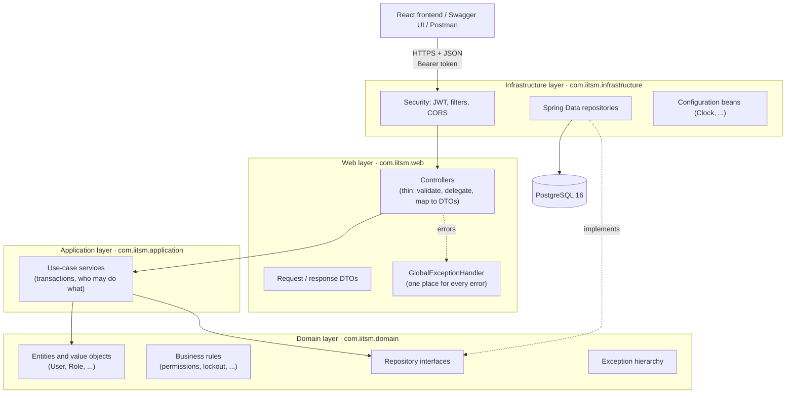

**Rules every class follows**

| Rule | Why |
|---|---|
| Controllers contain no business logic | Logic in one place (services and domain), easy to test and reuse |
| The domain imports no web or Spring MVC classes (only thin JPA mapping annotations) | Business rules stay plain Java: testable without Spring, presentable as pure OOP |
| Entities are never returned from controllers; services return snapshot "view" records built inside the transaction | No accidental data leaks (for example the password hash), no lazy-loading errors (`open-in-view` is off) |
| Repository interfaces live in the domain, implementations in infrastructure | The domain does not know about SQL or JPA (Repository pattern) |
| Every error is an `ItsmException` subclass rendered by one handler | Every failure has the same JSON shape for the frontend |
| Time always comes from an injected `Clock` | Time-based rules (lockout, SLA, escalation) can be tested by moving a fake clock |

---

## 3. Package map

```
com.iitsm
├── IitsmBackendApplication          entry point (forces the JVM time zone to UTC)
├── web
│   ├── controller                   AuthController, CatalogController, IncidentController, TechnicianController,
│   │                                AdminUserController, AdminCatalogController, AdminSlaController,
│   │                                AdminConfigController, AdminSimulatorController (S1), SlaController, AuditController, NotificationController,
│   │                                ReportController, PostIncidentReportController, FeedbackController,
│   │                                SavedFilterController, PriorityController, IntelligenceController,
│   │                                ProblemController (M12), DashboardController, ServiceGraphController (M13),
│   │                                AttachmentController, AuditSealController (M14),
│   │                                AdminDemoController, AdminOutageDrillController (demo profile only)
│   ├── dto                          ErrorResponse, PageResponse, request records (dto/auth, admin, catalog, incident,
│   │                                intelligence, notification, problem, report)
│   ├── filter                       RequestIdFilter, RateLimitFilter (M14: login, Google sign-in, incident creation)
│   ├── validation                   ValidPassword, ValidPasswordValidator, PasswordSubject (M14 password policy)
│   ├── handler                      GlobalExceptionHandler (also 503, 429 with Retry-After, denied-audit cap)
│   └── openapi                      OpenApiConfig, ApiErrors, ErrorCode, contract customizers
├── application
│   ├── admin                        UserAdminService, UserAdminViews
│   ├── assignment                   AssignmentService, WorkloadService, TechnicianWorkService
│   ├── auth                         AuthService, AuthenticatedUser, UserView, AccessTokenIssuer (port),
│   │                                GoogleSignInService, GoogleIdTokenVerifier (port, M2b)
│   ├── catalog                      CatalogService, SlaAdminService, CatalogViews
│   ├── incident                     IncidentService, IncidentCreationService (creation pipeline, M12),
│   │                                PriorityRecalculator, IncidentAccessPolicy, IncidentViewMapper, IncidentViews,
│   │                                IncidentEventPublisher, AutoVerifyMonitor (G2)
│   ├── incident/command             IncidentCommand + 10 commands (Acknowledge ... Reopen, Escalate, Withdraw),
│   │                                IncidentCommandRunner, CommandContext (Command pattern, C1)
│   ├── problem                      ProblemService, ProblemCorrelator, KnownOutageService, RecurringProblemService (E2),
│   │                                JoinerNotifier, ProblemViews (M12: problem records, Major Incident Mode)
│   ├── sla                          SlaMonitor (the monitor run), SlaViolationService
│   ├── audit                        AuditListener (Observer), AuditService, AuditSealService (S3)
│   ├── notification                 NotificationListener (Observer), NotificationPlanner, NotificationDispatcher,
│   │                                DigestCollector, NotificationService, NotificationRequest
│   ├── dashboard                    DashboardService, DashboardListener (Observer), DashboardPublisher (port),
│   │                                DashboardViews (M13)
│   ├── graph                        ServiceGraphService, ServiceGraphViews (M13: graph, impact, E1 status board)
│   ├── simulation                   SimulatorService (S1: replays recent incidents under up to three configurations)
│   ├── report                       ReportService, ReportExportService, CsvWriter, CoverageRiskService (E3),
│   │                                PostIncidentReportService (E4), PostIncidentPdfRenderer (port)
│   ├── feedback                     FeedbackService
│   ├── search                       SavedFilterService
│   ├── priority                     PriorityWhatIfService (A11)
│   ├── escalation                   EscalationMonitor, EscalationPlanner, EscalationPreviewer,
│   │                                EscalationRecipients, EscalationService
│   ├── intelligence                 IntelligenceService, IntelligenceReader, SlaRiskService, ChatIntakeService (A1),
│   │                                AiRateLimiter (delegates to RateLimiter), AiResultCache
│   ├── attachment                   AttachmentService, AttachmentView (M14)
│   ├── ratelimit                    RateLimiter (one sliding-window limiter with named buckets, M14)
│   ├── demo                         AdjustableClock (D1), OutageDrillService (D2), demo profile only
│   └── config                       ConfigService (live app_config cache)
├── domain
│   ├── assignment                   AssignmentStrategy + 5 strategies, FactorStrategy, AssignmentEngine,
│   │                                AssignmentFactors, EligibilityFilter, WorkloadTracker, TechnicianCandidate
│   ├── attachment                   IncidentAttachment, AttachmentType (checks the first bytes), AttachmentName,
│   │                                AttachmentStorage (port)
│   ├── category                     Category (tree, required skills)
│   ├── config                       ConfigKey, AppSettings, AppConfigEntry
│   ├── audit                        AuditRecord (immutable), AuditAction, AuditQuery; S3: AuditSeal, AuditSealEntry,
│   │                                AuditSealing, AuditFacts, AuditChainVerifier
│   ├── event                        IncidentEvent, IncidentChanged, TriageNeeded, SlaWarning, SlaViolated,
│   │                                SlaRunCompleted, SlaAtRisk, IncidentEscalated, EscalationExhausted,
│   │                                SecurityAuditEvent (Observer pattern events)
│   ├── notification                 Notification, NotificationPreference, NotificationEventType, ChannelType, Audience,
│   │                                NotificationChannel (Adapter port), NotificationFactory, NotificationRules,
│   │                                NotificationMessage, TeamResolver
│   ├── escalation                   EscalationChain, EscalationHandler + 4 handlers (Chain of Responsibility),
│   │                                EscalationRequest, EscalationStep, EscalationTarget, EscalationTimeouts
│   ├── intelligence                 TextAnalysisService (Strategy port), KeywordTextAnalysisService, Tokenizer,
│   │                                TfIdfModel, KeywordDictionary, TextRedactor, CircuitBreaker, SlaRiskScorer,
│   │                                LlmClient (Adapter port), suggestion records
│   ├── problem                      ProblemRecord, ProblemStatus (M12)
│   ├── report                       ReportRows, ReportScope
│   ├── feedback                     Feedback
│   ├── search                       SavedFilter
│   ├── exception                    ItsmException + business exceptions (incl. ServiceUnavailableException, M14)
│   ├── incident                     Incident, IncidentState + 10 states (OpenState is the parent of the open ones),
│   │                                StateFactory, IncidentFactory, SlaTracker, SlaAlert, Resolution, IncidentComment,
│   │                                IncidentFact, enums
│   ├── priority                     Priority, PriorityStrategy, WeightedPriorityStrategy,
│   │                                PriorityOverrideRule, PriorityEngine, PriorityBreakdown
│   ├── repository                   one repository interface per aggregate (incl. Problem, Attachment, AuditSeal,
│   │                                Dashboard)
│   ├── service                      ItService (IT services and their dependency graph), ServiceGraph (impact,
│   │                                upstream and common-upstream walks, M13)
│   ├── simulation                   DeskSimulation (discrete-event replay over the real AssignmentEngine),
│   │                                ServiceTimeModel (S1)
│   ├── sla                          SlaPolicy, EscalationPolicy, CalendarType, SlaPolicyResolver, SlaViolation
│   └── user                         User, Role hierarchy, profiles, SkillSet, RefreshToken, UserFactory,
│                                    PasswordPolicy (M14), Totp (A12), PasswordResetToken (A12), enums
└── infrastructure
    ├── config                       ClockConfig (not demo), DemoClockConfig (demo only), CorsConfig, DomainConfig
    ├── persistence                  Spring Data implementations of the domain repositories, CriteriaIncidentSearch,
    │                                NativeReportRepository, NativeDashboardRepository (SQL aggregates),
    │                                JpaIncidentTextRepository (M12 texts)
    ├── notification                 InAppChannel, EmailChannel, WebSocketChannel, SmsSimulatedChannel,
    │                                ChatWebhookChannel, GlobalTeamResolver, NotificationAsyncConfig, WebSocketConfig,
    │                                PushSimulatedChannel, SimulatedPushGateway (A4), PasswordResetMailer (A12)
    ├── observability                BusinessMetrics, BusinessGauges (A8, Prometheus)
    ├── realtime                     StompDashboardPublisher (Adapter), StompDestinationPolicy, StompPrincipal,
    │                                WebSocketSessions (closes a socket at token expiry), RealtimeConfig (M13)
    ├── ai                           AiConfig, FallbackTextAnalysisService (@Primary), LlmTextAnalysisService,
    │                                GeminiLlmClient (default), AnthropicLlmClient, ScriptedLlmClient,
    │                                LlmProperties, PromptLibrary
    ├── google                       JjwtGoogleIdTokenVerifier, FakeGoogleIdTokenVerifier (Adapters),
    │                                GoogleJwksKeyLocator, GoogleClaimsChecker, GoogleProperties, GoogleSignInConfig (M2b)
    ├── attachment                   DiskAttachmentStorage (M14)
    ├── report                       OpenPdfPostIncidentRenderer (PDF adapter)
    ├── scheduler                    SchedulingConfig, SlaMonitorJob, EscalationMonitorJob, AutoVerifyJob,
    │                                SlaRiskScanJob, DashboardCountersJob, AuditSealJob (intervals from app_config)
    └── security                     SecurityConfig, JwtService, JwtAuthenticationFilter, ApiErrorWriter, ApiErrorCorsProcessor
```

---

## 4. The life of a request

Every HTTP request passes through the same pipeline. The diagram follows a call to `GET /api/v1/auth/me`.

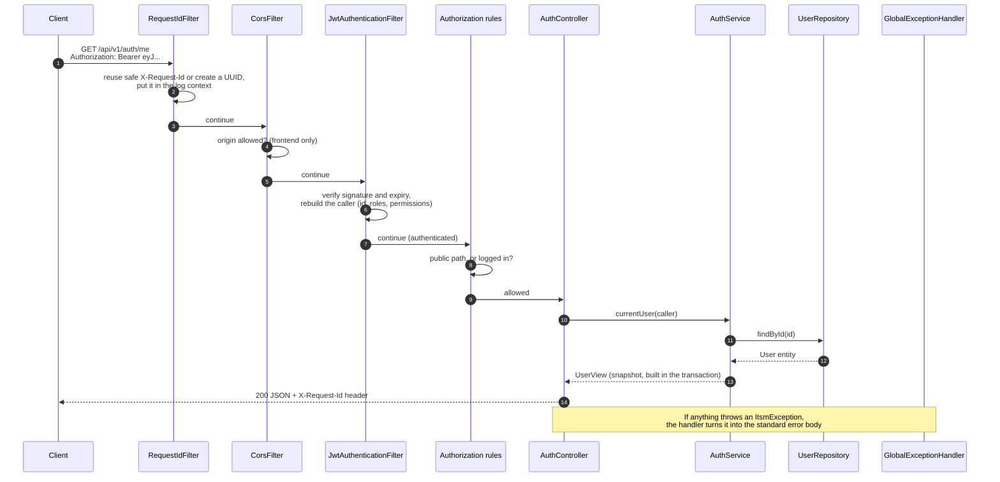

---

## 5. M1 Foundations

**What it does.** Gives the whole API one consistent way to fail, trace and protect itself: every error looks the same, every request carries an ID that also appears in the logs, only the frontend may call the API from a browser, and standard security headers are always sent.

### 5.1 The standard error body

Every failure, whether thrown by our code, by Spring (404, 405, bad JSON) or by the security filters (401, 403), returns this shape (API contract B.1):

```json
{
  "timestamp": "2026-11-06T09:21:00Z",
  "status": 400,
  "code": "VALIDATION_FAILED",
  "message": "Please correct the highlighted fields.",
  "path": "/api/v1/auth/register",
  "fieldErrors": [
    { "field": "email", "message": "must be a well-formed email address" },
    { "field": "password", "message": "must contain at least one letter and one digit" }
  ]
}
```

`fieldErrors` is always present (empty unless it is a validation failure). Stack traces are never returned; an unexpected error returns `INTERNAL_ERROR` with the request ID to quote.

### 5.2 Exception hierarchy

All 18 business errors extend one abstract base class that carries the machine-readable code and the HTTP status. This is inheritance used for a real *is-a* relationship: an `AccountLockedException` **is an** `ItsmException`.

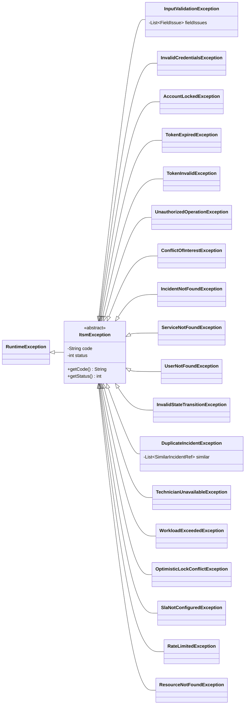

| Code | HTTP | Thrown when |
|---|---|---|
| `VALIDATION_FAILED` | 400 | Invalid input (with `fieldErrors`) |
| `INVALID_CREDENTIALS` | 401 | Wrong email or password (never says which) |
| `TOKEN_EXPIRED` / `TOKEN_INVALID` | 401 | Access token expired / missing, forged or revoked |
| `UNAUTHORIZED_OPERATION` | 403 | Role or permission does not allow the action |
| `CONFLICT_OF_INTEREST` | 403 | Trying to handle an incident you reported |
| `INCIDENT_NOT_FOUND` / `SERVICE_NOT_FOUND` / `USER_NOT_FOUND` | 404 | Missing resource |
| `ACCOUNT_LOCKED` | 423 | Too many failed logins |
| `INVALID_STATE_TRANSITION` | 409 | Action not allowed in the incident's current status |
| `DUPLICATE_INCIDENT` | 409 | Likely duplicate (response lists the similar incidents) |
| `TECHNICIAN_UNAVAILABLE` / `WORKLOAD_EXCEEDED` | 409 | Chosen technician cannot take the incident |
| `OPTIMISTIC_LOCK_CONFLICT` | 409 | Someone else changed the incident meanwhile |
| `SLA_NOT_CONFIGURED` | 422 | No SLA policy for that service and priority |
| `RATE_LIMITED` | 429 | Too many requests |
| `INTERNAL_ERROR` | 500 | Anything unexpected (no details exposed) |
| `NOT_FOUND`, `METHOD_NOT_ALLOWED`, `NOT_ACCEPTABLE`, `UNSUPPORTED_MEDIA_TYPE`, `REQUEST_REJECTED` | 404, 405, 406, 415, 4xx | Framework-level failures with no contract code (decision D-005) |

### 5.3 How an error becomes JSON

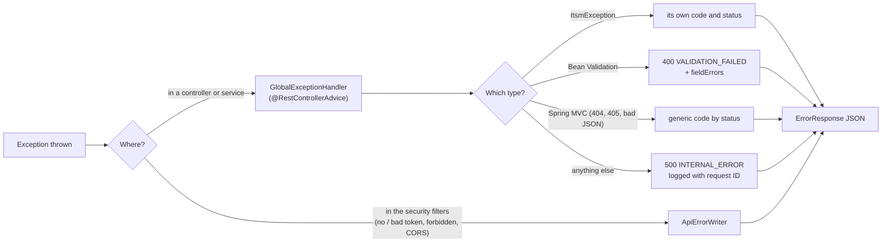

### 5.4 Request IDs, CORS and security headers

| Feature | Class | Behavior |
|---|---|---|
| Request ID | `RequestIdFilter` | Runs first. Reuses a safe incoming `X-Request-Id` (8 to 64 letters, digits, `.`, `_`, `-`) or generates a UUID. Echoed in the response header and printed on every log line. Unsafe values (for example `<script>`) are replaced, so nobody can inject text into the logs. |
| CORS | `CorsConfig`, `ApiErrorCorsProcessor` | Only the frontend origin (`CORS_ORIGIN`, default `http://localhost:5173`) may call the API from a browser. A rejected cross-origin request gets **403 `REQUEST_REJECTED` in the standard body** (Spring's default would be plain text). |
| Security headers | `SecurityConfig` | `X-Frame-Options: DENY` (no click-jacking), `Referrer-Policy: no-referrer`, plus Spring Security's defaults. |
| OpenAPI | `OpenApiConfig` | Swagger UI at `/swagger-ui.html` with an **Authorize** button for the Bearer token. |

---

## 6. M2 Users, roles and authentication

**What it does.** Lets people register and log in, keeps them logged in safely with short-lived access tokens and rotating refresh tokens, locks accounts under password guessing, and gives every request a clear answer to "who is this and what may they do?".

### 6.1 The user model: one person, several roles

A `User` **has** one or more `Role`s (composition). `Role` is abstract; each concrete role knows its own permissions (polymorphism). One person can therefore be an employee and a technician at once, and simply gets the union of both permission sets. A **Team Lead is not a separate class**: it is a technician whose escalation level is 1, and that single fact widens the permissions.

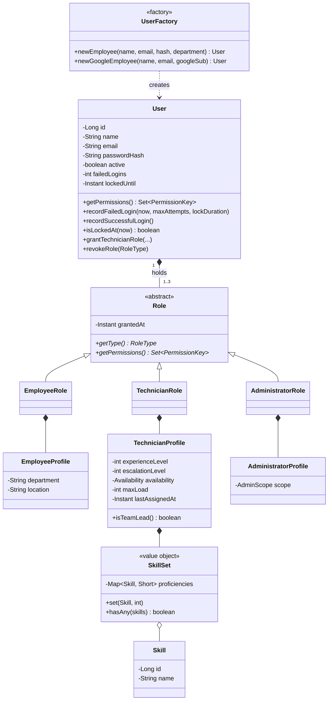

### 6.2 Who may do what (permissions)

Security checks use **permission keys, never role names**, so multi-role users work naturally and a role can change its permissions in one place.

| Permission | Employee | Technician | Team Lead (technician, level 1) | Administrator |
|---|:---:|:---:|:---:|:---:|
| `INCIDENT_CREATE`, `INCIDENT_VIEW_OWN` | ✅ | | | |
| `INCIDENT_VIEW_ASSIGNED`, `INCIDENT_HANDLE`, `WORKLOAD_VIEW` | | ✅ | ✅ | |
| `INCIDENT_VIEW_TEAM`, `TEAM_VIEW`, `INCIDENT_ASSIGN`, `INCIDENT_OVERRIDE_PRIORITY`, `SLA_VIOLATION_VIEW` | | | ✅ | |
| `INCIDENT_VIEW_ALL`, `USER_MANAGE`, `CATALOG_MANAGE`, `SLA_MANAGE`, `CONFIG_MANAGE`, `REPORT_VIEW`, `AUDIT_VIEW` | | | | ✅ |
| `INCIDENT_ASSIGN`, `INCIDENT_OVERRIDE_PRIORITY`, `TEAM_VIEW`, `SLA_VIOLATION_VIEW` | | | | ✅ |

Every user also holds EMPLOYEE (it cannot be removed), so everyone can report and follow their own incidents. Example: a user with EMPLOYEE + TECHNICIAN (team lead) gets the employee, technician and team-lead rows combined.

### 6.3 Endpoints

| Method and path | Who | What it returns |
|---|---|---|
| `POST /api/v1/auth/register` | Public | **201** `AuthResponse`. The new user gets EMPLOYEE only. Email stored lower-case. |
| `POST /api/v1/auth/login` | Public | `AuthResponse`, or 401 / 423 |
| `POST /api/v1/auth/refresh` | Public | New `AuthResponse`; the old refresh token stops working |
| `POST /api/v1/auth/logout` | Logged in | **204**; the refresh token is revoked |
| `GET /api/v1/auth/me` | Logged in | `CurrentUser` |

`AuthResponse` = `{ accessToken, refreshToken, expiresInSeconds: 900, user: { id, name, email, roles, permissions, technician | null, administrator | null } }`.

### 6.4 Logging in

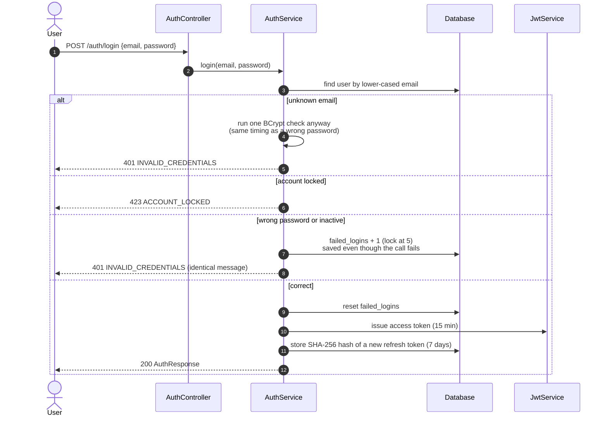

### 6.5 Account lockout

The lockout logic lives **inside the `User` entity** (`recordFailedLogin`, `isLockedAt`), not in a service, so it is a plain-Java business rule that is easy to test with a fake clock.

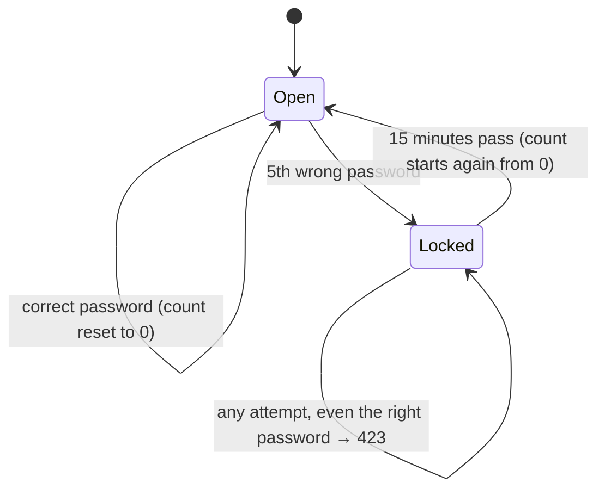

### 6.6 Tokens

| | Access token | Refresh token |
|---|---|---|
| Format | JWT, signed HS256 | 32 random bytes (URL-safe Base64) |
| Lifetime | 15 minutes | 7 days |
| Stored on the server | No (stateless) | Only its **SHA-256 hash** |
| Contains | user id, email, roles, permissions | nothing readable |
| Sent as | `Authorization: Bearer ...` | Request body of `/refresh` and `/logout` |

**Refresh rotation and theft detection.** Each refresh token works exactly once. Using an old one again means it was probably stolen, so every session of that user is revoked.

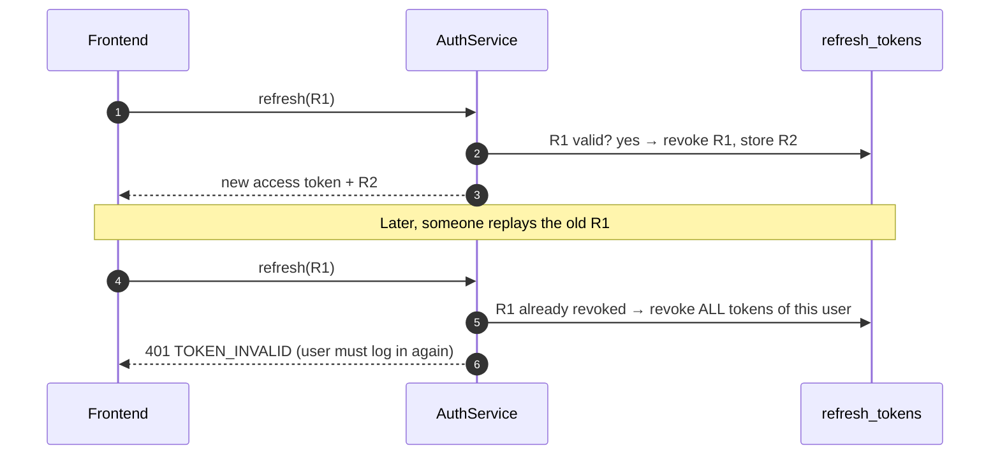

**How a token is checked on each request.** `JwtAuthenticationFilter` verifies the token and turns its permissions into Spring authorities. A bad or expired token does **not** end the request in the filter: public endpoints such as `/refresh` must keep working even if the browser still sends a stale header. The filter remembers the failure, and only endpoints that need a login answer `401 TOKEN_EXPIRED` or `401 TOKEN_INVALID`.

### 6.7 Security rules enforced

| Rule | Where |
|---|---|
| Passwords: 8 to 72 characters, at least one letter and one digit | `RegisterRequest` (Bean Validation) |
| Stored as BCrypt (cost 10) | `SecurityConfig.passwordEncoder` |
| Same message for unknown email and wrong password, same timing | `AuthService.login` |
| 5 failed logins lock the account for 15 minutes | `User.recordFailedLogin` |
| Access token 15 minutes, refresh token 7 days, rotated, revoked on logout | `JwtService`, `AuthService` |
| JWT secret must be at least 32 bytes, or the app refuses to start | `JwtService` constructor |
| Refresh tokens and passwords never stored in plain text | `RefreshToken`, `User` |
| Method security on permission keys (`@PreAuthorize("hasAuthority('...')")`) | `@EnableMethodSecurity` in `SecurityConfig` |

### 6.8 Verified behavior (2026-11-06)

Smoke run against the running app and a real PostgreSQL: **27 of 27 checks passed**, plus manual checks.

| Area | Checked |
|---|---|
| Register | 201, EMPLOYEE only, email lower-cased, `technician`/`administrator` present as `null`, duplicate email → 400 on `email`, invalid input → 400 with one fieldError per bad field |
| Tokens | `/me` with valid / missing / tampered / expired token → 200 / 401 `TOKEN_INVALID` / 401 `TOKEN_INVALID` / 401 `TOKEN_EXPIRED` |
| Refresh | Rotation issues a new refresh token; replaying the old one → 401 and the newest one is revoked too; refresh after logout → 401 |
| Lockout | 5 wrong passwords → 401 five times; unknown email gives the identical message; 6th attempt with the right password → 423; `locked_until` ≈ 15 minutes ahead |
| Multi-role | EMPLOYEE + team-lead TECHNICIAN → roles and permission union correct, `technician: { escalationLevel: 1, availability: AVAILABLE }` |
| Storage | Passwords are BCrypt (`$2a$10$...`), refresh tokens are 64-character hex hashes |
| CORS | Frontend origin allowed; other origins → 403 `REQUEST_REJECTED` JSON |
| Authorization | An employee calling admin endpoints (`/admin/services`, `/admin/config`, `/admin/sla-policies`) → 403 `UNAUTHORIZED_OPERATION` (checked with M3) |

---

## 7. M3 Catalog and configuration

**What it does.** Holds everything the incident engine looks things up in: the IT services the company runs (and which depend on which), the categories of problems and the skills needed for each, the SLA promises per priority, the escalation timeouts, and every tunable number (thresholds, weights, active strategies). Administrators manage all of it from the admin screens; changes apply **immediately, with no restart**.

### 7.1 The catalog model

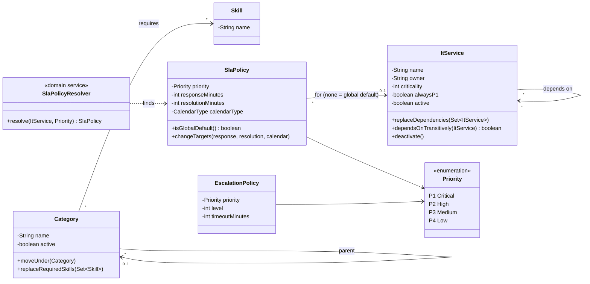

### 7.2 Services and the dependency graph

Each service has a **business criticality** (1 to 5) that feeds the priority score, and an **always P1** flag for services whose outage must always be critical (Payment). Services can depend on each other; the graph is used later for impact analysis ("if Database fails, what else breaks?") and correlation.

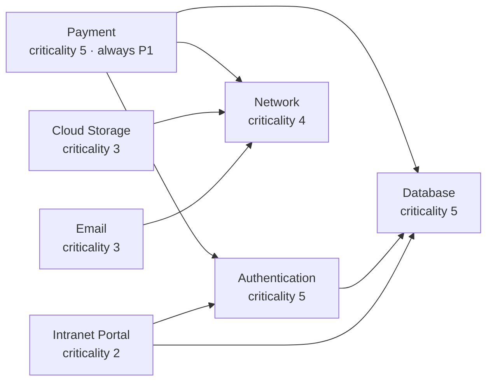

*Example graph from the planned seed data. An arrow means "depends on".*

**Graph rules** (enforced in `ItService.replaceDependencies`, the database adds a `CHECK (service_id <> depends_on_id)`):

- a service cannot depend on itself;
- no cycles: before adding "A depends on B", the code walks B's dependencies depth-first (`dependsOnTransitively`, using a stack and a visited set) and rejects the change if it reaches A. Example: with Payment → Authentication → Database, making Database depend on Payment is refused.

Services and categories are **never deleted**, only switched off (`DELETE` sets `active = false`), because incidents keep pointing at them. Switched-off items disappear from the lists users pick from.

### 7.3 Categories and skills

Categories form a tree (Network has VPN and Wi-Fi). Each lists the **skills needed to resolve it**; assignment (M6) only considers technicians who hold at least one of them. `GET /categories` returns the active tree for the report form; `moveUnder` refuses to place a category under itself or one of its own children. A skill can only be deleted when no category or technician uses it.

### 7.4 SLA policies and how the right one is found

A policy states the response and resolution minutes for one priority. A policy **without a service** is the global default; a **service-specific** policy overrides it (Payment promises 3 / 20 minutes for P1 instead of the default 5 / 30).

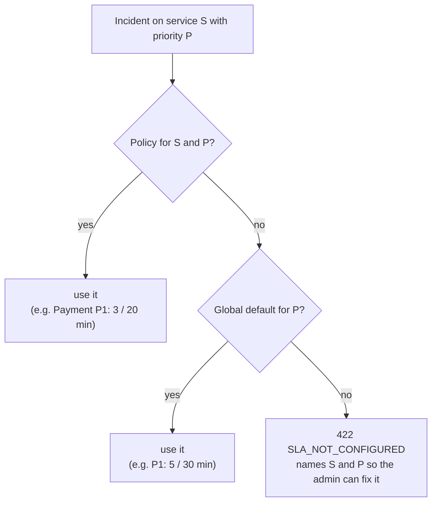

| Default policy | Response | Resolution |
|---|---|---|
| P1 Critical | 5 min | 30 min |
| P2 High | 15 min | 2 h |
| P3 Medium | 1 h | 8 h |
| P4 Low | 4 h | 24 h |

Rules: resolution must be longer than response (also a database `CHECK`), limits 1 to 10 080 and 1 to 43 200 minutes, one policy per service and priority. The "one global default per priority" rule is checked in code, because PostgreSQL treats two `NULL` service ids as different and its unique constraint alone would allow duplicates. `SlaPolicyResolver` is used by incident creation in M4.

### 7.5 Escalation policies

For P1 and P2 only: how long an incident may stay unacknowledged before it moves up a level (1 Team Lead, 2 System Admin, 3 IT Manager). Levels are added in order and removed from the top, so there is never a gap (level 3 without level 2). Used by the escalation chain in M11.

### 7.6 Live configuration (`app_config`)

Every tunable number lives in the `app_config` table, never in Java constants: priority bands and multipliers, assignment strategy and weights, SLA warning percentages, duplicate thresholds, AI engine, lockout rules (30 keys: the 27 of handbook Appendix A.5 plus 3 for service familiarity, DEC-28).

| Class | Role |
|---|---|
| `ConfigKey` (enum) | Every key with its default, meaning and allowed range or values. A missing row means "use the default", so the system works before seed data exists. |
| `AppSettings` | An **immutable, fully validated snapshot** of all values with typed getters. Also checks rules across keys. |
| `ConfigService` | Keeps the current snapshot in memory; readers get it instantly. Updates are validated as a whole and swapped in only **after the database commit**. |

**Cross-key rules:** the four assignment weights add up to 1.0 · priority bands descend (P1 > P2 > P3) · the mid affected-users threshold is below the high one, and its multiplier is not larger · the first SLA warning comes before the second · the duplicate threshold is above the "related" threshold. A bad value comes back as a `fieldError` keyed by the config key, for example `{ "field": "assignment.weight.skill", "message": "the four assignment weights must add up to 1.0 (now 1.5)" }`.

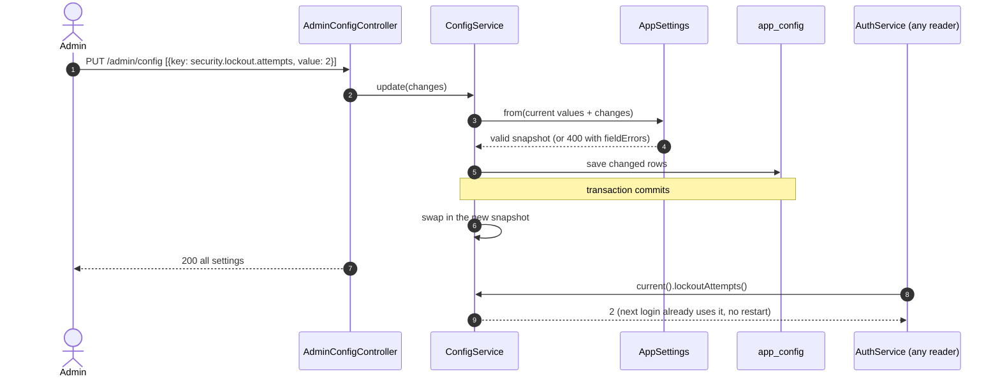

### 7.7 Endpoints

| Method and path | Permission | What it does |
|---|---|---|
| `GET /api/v1/services` | logged in | Active services: `id`, `name`, `criticality` |
| `GET /api/v1/categories` | logged in | Active categories as a tree |
| `GET, POST /api/v1/admin/services` · `GET, PUT, DELETE /admin/services/{id}` | `CATALOG_MANAGE` | Manage services (`DELETE` switches off) |
| `PUT /api/v1/admin/services/{id}/dependencies` | `CATALOG_MANAGE` | Replace the dependency list |
| `GET, POST /api/v1/admin/categories` · `PUT, DELETE /admin/categories/{id}` | `CATALOG_MANAGE` | Manage categories (`DELETE` switches off) |
| `GET, POST /api/v1/admin/skills` · `PUT, DELETE /admin/skills/{id}` | `CATALOG_MANAGE` | Manage skills (`DELETE` only when unused) |
| `GET, POST /api/v1/admin/sla-policies` · `PUT, DELETE /admin/sla-policies/{id}` | `SLA_MANAGE` | Manage SLA policies |
| `GET, POST /api/v1/admin/escalation-policies` · `PUT, DELETE /admin/escalation-policies/{id}` | `SLA_MANAGE` | Manage escalation levels |
| `GET, PUT /api/v1/admin/config` | `CONFIG_MANAGE` | Read and change settings |

Anyone without the permission gets **403 `UNAUTHORIZED_OPERATION`**; the check is a single `@PreAuthorize("hasAuthority('...')")` on each admin controller.

### 7.8 Verified behavior (2026-11-06)

Smoke run against the running app and PostgreSQL: **42 of 42 checks passed**. Highlights:

| Area | Checked |
|---|---|
| Authorization | Employee on admin services, config and SLA endpoints → 403; catalog without a token → 401 |
| Services | Create with dependencies; cycle (Database → Payment → Auth → Database) refused; self-dependency refused; criticality 6, duplicate name, unknown dependency id → 400 on the right field; unknown id → 404 `SERVICE_NOT_FOUND`; switched-off service hidden from `GET /services` but visible to admins |
| Categories and skills | Tree Network → VPN; moving a category under its own child refused; deleting a skill still required by a category refused; unused skill deleted |
| SLA policies | Second global default for P1 refused; Payment-specific P1 3 / 20 created; duplicate service + priority refused; resolution ≤ response refused; changing priority on update refused; targets updated |
| Escalation | Level 2 before level 1 refused; levels 1 to 3 created; deleting level 1 while level 2 exists refused; P3 refused |
| Configuration | 27 settings listed with defaults (30 since M6); weights not summing to 1.0, unknown key and first warning after second → 400 keyed by config key; **done-when: setting `security.lockout.attempts` to 2 made the next account lock after two failures, with no restart** |
| Schema | All M3 tables match Appendix A.2, including `CHAR(2)` priorities and every `CHECK` and unique constraint |

---

## 8. M4 Incidents and their lifecycle

**What it does.** An incident is one reported IT problem, tracked from the moment an employee reports it until it is closed. On creation the system classifies it, calculates its priority and sets its SLA deadlines in one step. After that it moves through a fixed lifecycle (assign, acknowledge, work, resolve, verify, close, reopen), and the system refuses every move that does not make sense, such as closing a brand-new incident.

### 8.1 The lifecycle

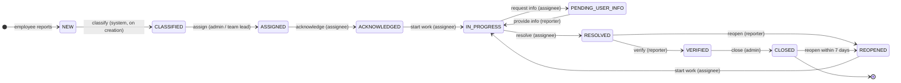

Reassign is allowed in ASSIGNED, ACKNOWLEDGED and IN_PROGRESS and does not change the status. **Every other combination is refused with `409 INVALID_STATE_TRANSITION`**, for example `NEW → CLOSED` or closing a CLASSIFIED incident.

| Clock | Starts | Stops | Special |
|---|---|---|---|
| Response | creation | ACKNOWLEDGED | |
| Resolution | creation | RESOLVED | pauses in PENDING_USER_INFO (the deadline moves later by exactly the paused time); restarts on REOPEN with the full target |

### 8.2 The State pattern

Each status is an object that knows which actions are legal in it. `IncidentState` declares every action with a default that refuses it; each concrete state overrides only what it allows. `Incident` keeps the status in the database and hands every lifecycle call to the matching state object, which `StateFactory` looks up.

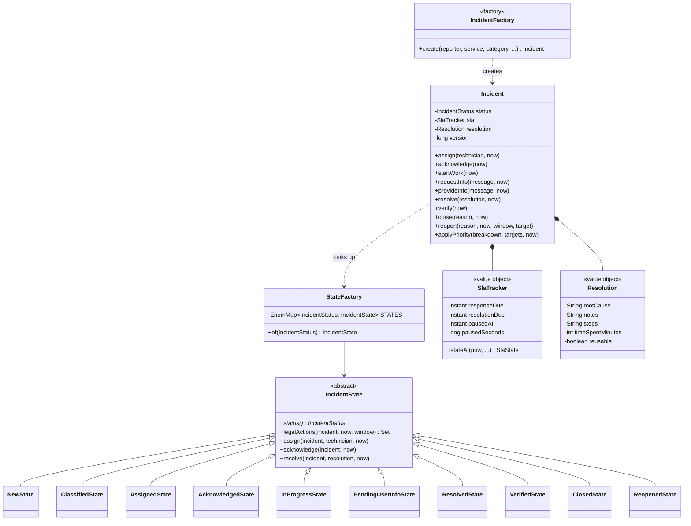

Preconditions live in the states too: assigning needs a known priority and never the reporter; requesting information needs a message of 10 to 2000 characters; resolving needs a valid `Resolution` (root cause and notes of at least 10 characters); reopening needs a reason and, from CLOSED, must happen within the reopen window (`reopen.window.days`, default 7).

### 8.3 Creating an incident

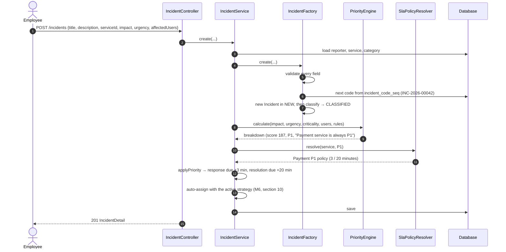

Since M6 the pipeline ends by assigning the best eligible technician with the active strategy (section 10); without a category, or with nobody eligible, the incident waits in CLASSIFIED (triage) for an admin or team lead. Not yet in the pipeline (they come with their modules): the duplicate check and AI category suggestion (M12), events and audit records (M8).

### 8.4 Who may do what

The State pattern answers "is this move legal now?" (409 if not). `IncidentAccessPolicy` answers "may this person make it?" (403 if not). Together they produce **`allowedActions`**, the list of buttons the frontend shows.

| Action | Who | Status rule (State pattern) |
|---|---|---|
| View | reporter, assignee, team lead, admin (others get 404) | any |
| Edit details | reporter, admin | until RESOLVED |
| Comment | anyone who can view; INTERNAL notes only technicians and admins | any |
| Assign / reassign | admin, team lead (`INCIDENT_ASSIGN`) | CLASSIFIED / ASSIGNED, ACKNOWLEDGED, IN_PROGRESS |
| Acknowledge, start, request info, resolve | the assignee (`INCIDENT_HANDLE`) | see lifecycle |
| Provide info, verify | the reporter | PENDING_USER_INFO / RESOLVED |
| Close | admin | VERIFIED |
| Reopen | reporter, admin | RESOLVED, or CLOSED within 7 days |
| Override priority | admin, team lead (`INCIDENT_OVERRIDE_PRIORITY`) | before RESOLVED |

**Conflict of interest:** nobody can be assigned an incident they reported (`403 CONFLICT_OF_INTEREST`), but they keep their reporter rights (reply, verify, reopen). **Eligibility for manual assignment** (`EligibilityFilter`): holds the TECHNICIAN role, is AVAILABLE or BUSY (`409 TECHNICIAN_UNAVAILABLE` otherwise), weighted load below `max_load` (`409 WORKLOAD_EXCEEDED`; P1 counts 4 points, P2 3, P3 2, P4 1, computed by `WorkloadTracker`), and holds at least one skill the category requires.

Example: the same incident seen by different people.

| Viewer | Status ASSIGNED | Status PENDING_USER_INFO | Status CLOSED (3 days ago) |
|---|---|---|---|
| Reporter | `EDIT, COMMENT` | `EDIT, COMMENT, PROVIDE_INFO` | `COMMENT, REOPEN` |
| Assignee | `ACKNOWLEDGE, COMMENT` | `COMMENT` | `COMMENT` |
| Team lead | `REASSIGN, COMMENT, OVERRIDE_PRIORITY` | `COMMENT, OVERRIDE_PRIORITY` | `COMMENT` |

### 8.5 SLA state

Computed in one place (`SlaTracker.stateAt`) and used by lists and the detail page:

| SlaState | When |
|---|---|
| `OK` | clocks running, below the first warning |
| `WARNING` | 75 % (`sla.warn.first.percent`) of an open clock has passed |
| `PAUSED` | waiting for the reporter |
| `VIOLATED` | a deadline passed or a violation was recorded |
| `MET` | resolved before the resolution deadline |
| `AT_RISK` | predicted to miss the SLA (risk score, module M12) |

### 8.6 Concurrent updates

Every incident has a `version` column (optimistic locking). If two people save the same incident at the same moment, the database accepts only the first; the second gets **`409 OPTIMISTIC_LOCK_CONFLICT`** ("Someone else changed this incident. Reload and try again.") instead of silently overwriting. Clients can also send the `version` they last saw on `PUT` to detect stale edits early.

### 8.7 Endpoints

| Method and path | Who | Notes |
|---|---|---|
| `POST /api/v1/incidents` | any logged-in user | 201 IncidentDetail, already classified, prioritized, with SLA deadlines |
| `GET /api/v1/incidents` | any (filtered by role) | Filters: `q`, `code`, `status` (repeatable), `priority` (repeatable), `categoryId`, `serviceId`, `assigneeId`, `reporterId`, `createdFrom`, `createdTo`, `mine`, `assignedToMe`; paging `page`, `size` (max 100); `sort=createdAt,desc` (also `priority`, `status`, `code`, `resolutionDue`) |
| `GET /api/v1/incidents/{id}` | participant | IncidentDetail with `allowedActions` |
| `PUT /api/v1/incidents/{id}` | reporter, admin | priority and deadlines recalculated |
| `POST /api/v1/incidents/{id}/assign` · `/reassign` | admin, team lead | eligibility checked; assign without `technicianId` uses the active strategy (M6) |
| `POST /api/v1/incidents/{id}/acknowledge` · `/start` · `/request-info` · `/resolve` | assignee | |
| `POST /api/v1/incidents/{id}/provide-info` · `/verify` | reporter | |
| `POST /api/v1/incidents/{id}/close` | admin | |
| `POST /api/v1/incidents/{id}/reopen` | reporter, admin | |
| `POST /api/v1/incidents/{id}/override-priority` | admin, team lead | reason recorded |
| `GET, POST /api/v1/incidents/{id}/comments` | participants | internal notes hidden from the reporter |

### 8.8 Verified behavior (2026-11-06)

End-to-end run against the running app and PostgreSQL: **54 of 54 checks passed**, mapped to the documented test cases:

| Test case | Checked |
|---|---|
| **T01** | Payment incident, impact 5, urgency 5, 150 users → 201, score 187, P1, major, rule "Payment service is always P1", deadlines exactly 3 and 20 minutes after creation (Payment policy) |
| **T03** | Full path create → acknowledge → start → resolve → verify → close, final CLOSED with reason VERIFIED |
| **T05 / T06** | Band edges 60/56/30/27/10/9 → P1 P2 P2 P3 P3 P4; users 9/10/100/101 → 48 P2, 60 P1, 60 P1, 72 P1 |
| **T08** | Reopen 7 days 1 minute after closing → 409; 6 days 23 hours 59 minutes → REOPENED |
| **T09** | Empty description, impact 6, 0 users → 400 with a fieldError for each |
| **T11** | Close a CLASSIFIED incident → 409 INVALID_STATE_TRANSITION |
| **T12** | Resolve without notes → 400, status unchanged |
| **T14 / T15** | Unknown service → 404 SERVICE_NOT_FOUND; missing P4 policy → 422 SLA_NOT_CONFIGURED naming service and priority |
| **T18** | Another technician acknowledges → 403, status unchanged |
| **T21** | Request info, wait, reply → resolution deadline moved later by exactly the paused seconds |
| **T24** | Two simultaneous PUTs → one 200, one 409 OPTIMISTIC_LOCK_CONFLICT |
| **T25** | Admin assigns an incident to its reporter → 403 CONFLICT_OF_INTEREST; reporter rights kept |
| Also | AWAY technician, missing skill, max load → 409 with the right code; security override rule; role-based visibility (404 for strangers, own-only lists); filters, text search, paging, sorting; stale version → 409; manual priority override with reason; internal notes hidden from the reporter; reassign keeps the status; edit or override after resolution → 409 |

---

## 9. M5 Priority engine

**What it does.** Decides how urgent an incident is (P1 Critical to P4 Low) from how badly the business is hit, how fast it must be fixed and how important the service is, and explains the result in plain words.

### 9.1 The formula

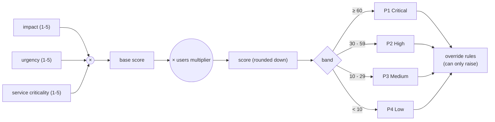

| Affected users | Multiplier |
|---|---|
| 1 to 9 | × 1.0 |
| 10 to 100 | × 1.25 |
| 101 or more | × 1.5 |

Every threshold, band and multiplier is read from `app_config` at the moment of calculation, so an administrator can tune them without a restart.

**Override rules** (applied after the score, can only raise the priority, and are named in the explanation):

1. A **Security** incident (category Security or one of its children, such as Phishing) on a service with criticality 4 or more is **at least P2**.
2. A service flagged **always P1 on outage** (Payment) is **P1** when impact is 4 or more.

### 9.2 Worked examples

| Case | Calculation | Result |
|---|---|---|
| Payment unavailable, impact 5, urgency 5, 150 users | 5 × 5 × 5 = 125 × 1.5 = 187.5 → 187 | **P1**, rule 2 named |
| Impact 4, urgency 4, criticality 3, 10 users | 48 × 1.25 = 60 | **P1** (exactly on the edge) |
| Impact 4, urgency 4, criticality 3, 9 users | 48 × 1.0 = 48 | **P2** |
| Phishing on Network (criticality 4), impact 1, urgency 1, 1 user | 4 | score says P4, **rule 1 raises it to P2** |

The explanation is stored with the incident and returned as `priorityBreakdown`:

```json
{
  "impact": 5, "urgency": 5, "criticality": 5,
  "usersMultiplier": 1.5, "baseScore": 125, "score": 187,
  "band": "P1", "overrideRule": "Payment service is always P1"
}
```

### 9.3 Design (Strategy pattern)

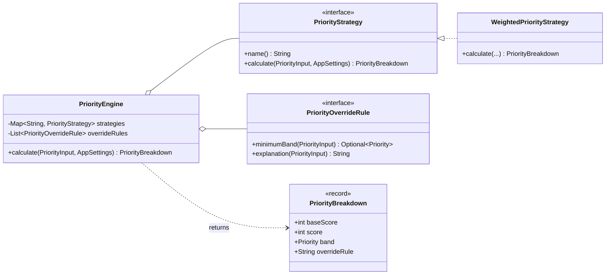

`PriorityEngine` picks the strategy named by the setting `priority.strategy`, then applies each override rule in order. A new algorithm (for example one based on history) is one new class implementing `PriorityStrategy`; nothing else changes. The priority is recalculated when impact, urgency or affected users change; the SLA deadlines are then recalculated from the original creation time. An admin or team lead can also **set the priority by hand with a reason**, which is recorded in the breakdown ("Manually set to P4 by Priya Lead: ...") and as an internal note.

---

## 10. M6 Technician assignment

**What it does.** Picks the best technician for each new incident automatically, explains the choice in plain words, and lets an administrator switch the algorithm at runtime. Team leads see the top three candidates with a score breakdown, plus everyone who was left out and why.

### 10.1 From incident to technician

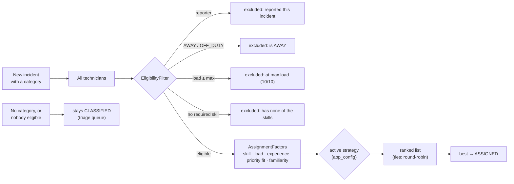

### 10.2 The five factors (each 0 to 1)

| Factor | How it is computed | Source |
|---|---|---|
| **Skill** | 70% best proficiency among the required skills + 30% share of required skills held | Handbook, refined by DEC-29 |
| **Load** | 1 − current weighted load / max load (P1 = 4 points, P2 = 3, P3 = 2, P4 = 1) | Handbook |
| **Experience** | level / 5 | Handbook |
| **Priority fit** | P1/P2: seniors (level 4-5) score 1. P3/P4: levels 1-3 score 1, keeping seniors free | Handbook, refined by DEC-31 |
| **Service familiarity** | incidents on the same service resolved in the last 90 days / 5, capped at 1 | **Our addition** from the course brief (DEC-28) |

### 10.3 Five interchangeable strategies (Strategy pattern)

| `assignment.strategy` | Picks | Score |
|---|---|---|
| **`COMPOSITE`** (default) | the best overall | 0.35 skill + 0.25 load + 0.15 experience + 0.10 priority fit + 0.15 familiarity (weights are live settings, must sum to 1.0) |
| `SKILL` | the best skill match | skill |
| `LOAD` | the least busy | load |
| `ROUND_ROBIN` | the one assigned longest ago | place in the rotation |
| `EXPERIENCE_PRIORITY` | seniors for P1/P2, juniors for P3/P4 | 0.8 priority fit + 0.2 experience |

Ties (scores equal to six decimals) always go to whoever was assigned longest ago, then by id, so the result is deterministic and fair.

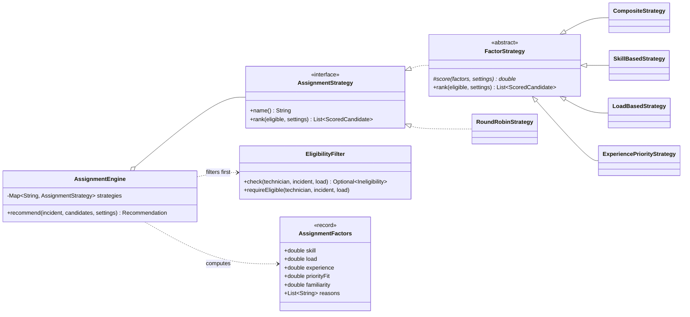

`FactorStrategy` is a small *template method*: subclasses only say how to score one candidate; sorting and tie-breaking are shared.

### 10.4 Worked example (the one the team decided on)

P1 "VPN gateway down" on Network (criticality 4), category requiring **Networking** and **Linux**, reported by Karthik:

| | Networking | Linux | Load | Level | Fixes on Network (90 days) | Skill | Load | Exp. | Prio. fit | Familiarity | **Composite** |
|---|---|---|---|---|---|---|---|---|---|---|---|
| **Asha** | 5 | — | 6/10 | 5 | 6 | 0.85 | 0.40 | 1.0 | 1.0 | 1.0 | **80** ← assigned |
| Meera | 4 | 4 | 7/10 | 4 | 2 | 0.86 | 0.30 | 0.8 | 1.0 | 0.4 | 66 |
| Ravi | 3 | 4 | 2/10 | 2 | 0 (3 were 200 days ago) | 0.86 | 0.80 | 0.4 | 0.4 | 0.0 | 60 |
| Tom | 5 | 5 | | | | | | | | | excluded: is AWAY |
| Karthik | | | | | | | | | | | excluded: reported this incident |

Without the familiarity factor (handbook weights), Ravi would rank second (70) ahead of Meera (69): familiarity rewards Meera's recent work on this service. All numbers above were reproduced exactly by the running system.

### 10.5 Recommendations (explainable)

`GET /api/v1/incidents/{id}/recommendations` (admin, team lead):

```json
{
  "strategy": "COMPOSITE",
  "recommendations": [
    { "technicianId": 9, "name": "Meera", "score": 66, "currentLoad": 7, "maxLoad": 10,
      "reasons": ["Linux 4/5, Networking 4/5", "Load 7/10", "Experience level 4 (senior)",
                  "Resolved 2 Network incidents in the last 90 days"],
      "factors": { "skill": 0.86, "load": 0.3, "experience": 0.8, "priorityFit": 1.0, "familiarity": 0.4 } }
  ],
  "excluded": [
    { "technicianId": 11, "name": "Tom", "reason": "is AWAY" },
    { "technicianId": 7, "name": "Asha", "reason": "at max load (10/10)" },
    { "technicianId": 12, "name": "Karthik", "reason": "reported this incident" }
  ]
}
```

### 10.6 Managing users and technicians (completes M2)

| Method and path | Permission | What it does |
|---|---|---|
| `GET, POST /api/v1/admin/users` · `GET, PUT, DELETE /admin/users/{id}` | `USER_MANAGE` | List, create (with roles and profiles), edit, deactivate (never delete; sessions revoked) |
| `POST /api/v1/admin/users/{id}/roles` · `DELETE /admin/users/{id}/roles/{role}` | `USER_MANAGE` | Make someone a technician, team lead (escalation level 1) or admin; EMPLOYEE always stays; TECHNICIAN only removable without active incidents |
| `PUT /api/v1/admin/technicians/{id}/skills` · `PUT /admin/technicians/{id}` | `USER_MANAGE` | Replace skills; change experience, escalation level, max load, availability |
| `GET /api/v1/technicians?skillId=&availability=` | `TEAM_VIEW` | Active technicians with load, availability and skills |
| `GET /api/v1/technicians/me/workload` | `WORKLOAD_VIEW` | My load, capacity, resolved this week, next 10 SLA deadlines |
| `GET /api/v1/technicians/me/queue` | `WORKLOAD_VIEW` | My active incidents, most urgent deadline first |
| `PUT /api/v1/technicians/me/availability` | `INCIDENT_HANDLE` | Mark myself AVAILABLE, BUSY, AWAY or OFF_DUTY |
| `GET /api/v1/incidents/{id}/recommendations` | `INCIDENT_ASSIGN` | See 10.5 |
| `POST /api/v1/incidents/{id}/assign` (no `technicianId`) | `INCIDENT_ASSIGN` | Assign with the active strategy |

### 10.7 Verified behavior (2026-11-06)

**33 of 33 M6 checks passed**, and the M2 (27), M3 (42) and M4 (54) suites were re-run green: **156 checks in total**.

| Area | Checked |
|---|---|
| Auto-assignment | New incident with a category → ASSIGNED on creation to the expected technician (Asha, 80) |
| Explainability | Recommendations reproduce the hand calculation exactly (Meera 66, Ravi 60, factor values and reasons); excluded list gives AWAY, OFF_DUTY, at max load, reporter |
| Familiarity | Fixes older than the 90-day window count 0; with familiarity weight 0 the order flips (Ravi 70 > Meera 69) |
| **T04** | Switching `assignment.strategy` to LOAD sends the next two incidents to the least busy technician, no restart; ROUND_ROBIN rotates Ravi then Meera |
| **T13** | Every skilled technician unavailable → incident created (201), stays CLASSIFIED, no error |
| **T26** | Multi-role user: queue 200, report 201, admin endpoint 403 |
| Assignment without a technician | Uses the active strategy; nobody eligible → 409 TECHNICIAN_UNAVAILABLE |
| Admin users | Create with roles and skills; roles without EMPLOYEE, technician without profile, duplicate email → 400; add and remove ADMINISTRATOR; EMPLOYEE not removable; self-deactivation refused; deactivated user cannot log in; skills replaced; lead lists technicians by skill; technician sets own availability |
| Config | Five weights must sum to 1.0 (1.15 refused) |

---

## 11. M7 SLA engine and monitor

Every incident carries two SLA clocks (section 8.5): the **response** clock runs until a technician acknowledges, the **resolution** clock until the incident is resolved, paused while waiting for the reporter. M7 adds the **monitor** that watches those clocks and raises alerts: a first warning at 75 % of a deadline, a second at 90 %, and a violation at 100 %, **each exactly once**.

### 11.1 One monitor run

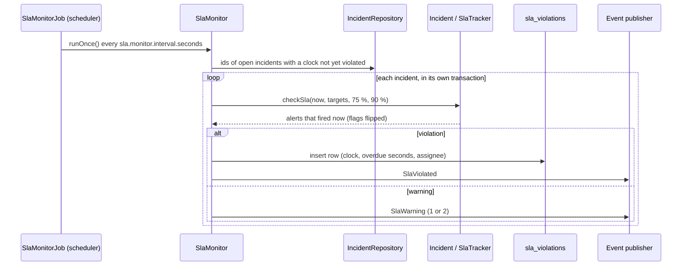

The rules live in the domain: `SlaTracker.check` decides which alert a clock has reached and flips its stored flag (`resp_warn75_sent`, `res_violated`, ...), so a second run, or a run after a restart, finds the flag set and raises nothing. Each incident is checked in its own transaction: one bad incident (no SLA policy, a concurrent edit) is logged and retried on the next run without stopping the rest.

### 11.2 Rules

| Situation | What happens |
|---|---|
| Clock at 75 % / 90 % of its target | First / second warning (`SlaWarning`) |
| Deadline passed | Violation: row in `sla_violations`, `SlaViolated` event, `slaState` = VIOLATED |
| A run finds a clock past several thresholds at once (late run) | Only the highest alert fires; the lower ones are marked sent |
| Resolution clock paused (PENDING_USER_INFO) | Nothing; the deadline moves later on resume (section 8.1) |
| Priority changed, deadline moved | That clock's warnings reset (violations stay) |
| Interval | `sla.monitor.interval.seconds` in `app_config` (60 s, 30 s in the demo seed), re-read after every run |

The audit trail (M8, section 12) records both events; notifications (M9) will turn them into messages to the technician and alerts to admins.

### 11.3 Business-hours calendar

Each SLA policy counts time either around the clock (`ALWAYS`) or only in business hours (`BUSINESS_HOURS`). The business calendar is one company calendar in `app_config` (DEC-39), editable live:

| Key | Default |
|---|---|
| `sla.business.zone` | Asia/Kolkata |
| `sla.business.open` / `close` | 09:00 / 18:00 |
| `sla.business.days` | MON,TUE,WED,THU,FRI |
| `sla.business.holidays` | empty (comma-separated dates) |

Every deadline, the shift after a pause and the monitor's percentages go through a `WorkCalendar` (Strategy pattern: `AlwaysCalendar`, `BusinessHoursCalendar`). Example: an 8-hour P3 reported on Friday at 16:00 is due on Monday at 15:00; a holiday on Monday moves it to Tuesday at 15:00.

```mermaid
classDiagram
    class WorkCalendar {
        <<interface>>
        +addWorkingTime(start, work) Instant
        +workingTimeBetween(from, to) Duration
    }
    WorkCalendar <|.. AlwaysCalendar
    WorkCalendar <|.. BusinessHoursCalendar
    SlaPolicy --> CalendarType
    SlaPolicy ..> SlaTargets : targets(settings)
    SlaTargets --> WorkCalendar
    SlaTracker ..> SlaTargets : start, retarget, check
```

### 11.4 Endpoint

| Endpoint | Who | What |
|---|---|---|
| `GET /api/v1/sla/violations?from&to&page&size` | `SLA_VIOLATION_VIEW` (admin, team lead) | Violations recorded in [from, to), newest first: `{id, incidentId, incidentCode, type, overdueSeconds, technician, createdAt}` in the paged wrapper |

### 11.5 Verified behavior (2026-11-07)

**35 of 35 checks passed** (`m7_smoke.py` against the running app: deadlines are moved in the database and the monitor runs every 5 s).

| Area | Checked |
|---|---|
| Response clock | Warning 1 at 83 %, `slaState` WARNING; warning 2 at 92 %; violation 30 s after the deadline with overdue seconds and the technician recorded; `slaState` VIOLATED |
| **T23** | Resolution clock at 75, 90 and 100 %, the monitor running at least twice at each point: each alert fired exactly once, one RESOLUTION violation row |
| Fire once | More runs after the violation: still one row, one log line per warning |
| Pause | No resolution alert while PENDING_USER_INFO even with the deadline passed; after the reply, the violation is recorded |
| Late run | Clock at 97 % in one step: only warning 2 fires, warning 1 is marked sent |
| Priority change | Override P4 → P3 resets that clock's warnings |
| `GET /sla/violations` | Admin and team lead 200 with code and technician; technician and employee 403; `from` after `to` 400 on `to`; range filter |
| Business hours (`calendar_smoke.py`, 11/11) | Bad zone, days, dates and close-before-open refused with field errors; BUSINESS_HOURS policy accepted; response and resolution deadlines match an independent working-time calculation; holidays skipped |

---

## 12. M8 Events and the audit trail

Every action publishes an **event**; independent **listeners** react to it (Observer pattern). The first listener is the **audit trail**: a permanent, append-only log of who did what, when, and how the status changed. Notifications (M9) and the live dashboard (M13) will listen to the same events.

### 12.1 From action to audit record

```mermaid
flowchart LR
    S[IncidentService / SlaMonitor] -- IncidentChanged, SlaWarning, SlaViolated --> P((Event publisher))
    X[AuthService, error handler, UserAdminService, ConfigService] -- SecurityAuditEvent --> P
    P --> AL[AuditListener]
    P -. M9 .-> NL[NotificationListener]
    P -. M13 .-> DL[DashboardListener]
    AL --> AR[(audit_records)]
```

| Event | When | Written |
|---|---|---|
| `IncidentChanged` | every lifecycle move, edit, assignment, reassignment, priority change, comment | in the **same** transaction as the action: no action without its record, a refused action leaves none |
| `SlaWarning`, `SlaViolated` | SLA monitor (section 11) | in the monitor's transaction for that incident |
| `SecurityAuditEvent` | failed login, any 403, role change, settings change | in its **own** transaction, so it survives the failed request |
| `TriageNeeded` | a new incident could not be assigned | not audited (for M9 notifications) |

Inside the aggregate, every move records a fact (`IncidentFact`: action, status before, status after); the service drains the facts after the action and publishes one `IncidentChanged` per fact, adding the actor and the wording. An action that recorded no fact cannot be published and fails loudly (DEC-46, C2). Creating an incident leaves four entries: INCIDENT_CREATED (by the reporter), CLASSIFIED, PRIORITY_CALCULATED (score, rule and deadlines) and ASSIGNED (by the system, naming the strategy).

### 12.2 Who sees what

| Endpoint | Who | What |
|---|---|---|
| `GET /api/v1/incidents/{id}/history` | participants (404 for others) | the incident's trail, oldest first; a reporter without staff rights does not see internal-note entries |
| `GET /api/v1/audit?incidentId&actorId&action&from&to&page&size` | `AUDIT_VIEW` (admin) | the whole log, newest first, paged |

Each entry: `{id, timestamp, actor {id, name} or null for the system, action, incidentCode, previousState, newState, description}`. There is no endpoint that writes, changes or deletes an entry; the entity is immutable and the repository only inserts and reads (DEC-38).

### 12.3 Verified behavior (2026-11-07)

Smoke test `m8_smoke.py` against the running app.

| Area | Checked |
|---|---|
| **M8 done-when** | One transition (acknowledge) adds exactly one row with ASSIGNED → ACKNOWLEDGED and the technician as actor; a refused transition (409) adds none |
| Creation | Four entries in order with the right states and actors |
| Lifecycle | Start, comments, request and provide info, resolve, verify, close, reopen: one entry each, in order |
| Visibility | Staff see the internal-note entry, the reporter does not; strangers get 404; the override reason never reaches the reporter |
| Security | A 403 on an incident action and a 403 from a permission check are both audited as ACCESS_DENIED; wrong password and unknown email give LOGIN_FAILED; role and settings changes are audited with old and new values |
| SLA | A warning from the monitor appears in the history with the system as actor |
| `GET /audit` | Filter by incident matches the row count, newest first; `from` after `to` 400; unknown action 400 |

---

## 12a. M9 Notifications

Every incident event that matters to a person becomes a **notification**: a row in their inbox, a live push, a mail, for P1 a simulated text message, and for team-wide alerts a post to a chat room. The listener runs **after the action's transaction commits and on its own thread**, so a broken mail server can never roll back or slow down an incident (decisions DEC-40, DEC-42, DEC-54).

### 12a.1 From event to delivery

```mermaid
flowchart LR
    E[IncidentChanged / TriageNeeded / SlaWarning / SlaViolated / SlaRunCompleted] -->|after commit, async| NL[NotificationListener]
    NL --> NP[NotificationPlanner: who? values?]
    NP -->|TeamResolver| TR[GlobalTeamResolver]
    NL --> ND[NotificationDispatcher: which channels?]
    ND --> NF[NotificationFactory: words from templates]
    ND --> C1[InAppChannel: row]
    ND --> C2[WebSocketChannel: push]
    ND --> C3[SmsSimulatedChannel: log + row, P1]
    ND --> C4[EmailChannel: SMTP, 3 retries]
    ND --> C5[ChatWebhookChannel: HTTP POST]
    ND -. SLA warnings .-> DC[DigestCollector]
    C1 --> N[(notifications)]
    C3 --> N
```

Patterns: **Observer** (`NotificationListener`), **Adapter** (`NotificationChannel` and its six adapters), **Factory** (`NotificationFactory`), a small seam for later teams (`TeamResolver`), **Repository**.

### 12a.2 Who hears what

The single `IncidentChanged` event carries an action; it is mapped onto the 15 notification types of Appendix A.4 (DEC-54). Actions with no type send nothing. The person who did the action is not told, except the reporter of a new incident, who gets a receipt.

| Action (audit) | Notification type | Who |
|---|---|---|
| INCIDENT_CREATED | INCIDENT_CREATED | reporter |
| ASSIGNED, REASSIGNED | INCIDENT_ASSIGNED | reporter, new assignee |
| ACKNOWLEDGED | INCIDENT_ACKNOWLEDGED | reporter |
| PRIORITY_CHANGED | PRIORITY_CHANGED | assignee, reporter |
| INFO_REQUESTED / INFO_PROVIDED | INFO_REQUESTED / INFO_PROVIDED | reporter / assignee |
| RESOLVED, VERIFIED, CLOSED, REOPENED | INCIDENT_RESOLVED, _VERIFIED, _CLOSED, _REOPENED | reporter, assignee, reporter, assignee |
| ESCALATED | none from the audit action; `IncidentEscalated` gives INCIDENT_ESCALATED | holders of the level reached, from the event (critical), assignee; not the person who escalated by hand. `EscalationExhausted`: every administrator, "Escalation exhausted" wording, SMS for P1 (E-034) |
| DUPLICATE_LINKED | DUPLICATE_SUSPECTED, only when the incident is closed as a duplicate | reporter, assignee; grouping into a problem record keeps the status and is not announced (DEC-110) |
| CLASSIFIED, PRIORITY_CALCULATED, WORK_STARTED, COMMENT_ADDED | none | nobody |
| `TriageNeeded` event | TRIAGE_NEEDED | every team lead |
| `SlaWarning` event | SLA_WARNING | assignee; team leads if nobody is assigned |
| `SlaViolated` event | SLA_VIOLATED | every administrator (critical), assignee |

A **team lead** is a technician with escalation level 1; one global pool behind the `TeamResolver` interface (DEC-42). Escalation targets: level 1 team leads, 2 `SYSTEM_ADMIN`, 3 `IT_MANAGER`, decided by the escalation module (`EscalationRecipients`) and carried in its event; a level nobody holds is passed over and tells nobody (DEC-50, E-034).

### 12a.3 Channels

| Channel | What it does | Stored? | When |
|---|---|---|---|
| `IN_APP` | inserts the inbox row | row, channel IN_APP | always |
| `WEBSOCKET` | pushes the same Notification object (with the inbox row id) to `/user/queue/notifications` | no | unless switched off |
| `SMS_SIM` | log line and a row (channel SMS_SIM, 160 characters) | row | P1 only, staff only (assigned, triage, SLA warning and violation, escalation) |
| `PUSH_SIM` | a simulated push to every device the person registered (A4, DEC-117): log line plus a row with channel PUSH_SIM; not a per-user switch | row | urgent events of P1 and P2 incidents; "information requested" and "resolved" for the reporter at any priority; only for people with a registered device |
| `EMAIL` | HTML mail through SMTP (Mailpit on 1025); first try plus `notification.email.retries` retries, wait `notification.email.backoff.seconds` doubling; then dropped and logged | no | unless switched off |
| `CHAT` | one JSON POST (`text`, `content`) to `notification.chat.webhook.url`; empty URL means only logged | no | SLA violations and escalations always; assigned, triage and SLA warning for P1 |

Each channel is tried alone; a failure is logged and the others still run. The wording lives in `notification-templates.properties` (`<EVENT>.<audience>.title|message`, placeholders such as `{code}` and `{priority}`), the mail shell in `notification-email.html`.

### 12a.4 Preferences and alert storm control

- **Preferences** (`notification_preferences`, one row per user, event type and channel; no row means on). The inbox is always on. **Critical alerts cannot be switched off**: SLA violation for an administrator, escalation for a team lead or administrator. `PUT` replaces the caller's switches and answers 400 for a locked switch, `CHAT` or an unknown value.
- **Digest.** The SLA monitor publishes `SlaRunCompleted` at the end of each run. Warnings of a run are held; if one person has more than `notification.digest.threshold` (default 5) they get **one** digest, otherwise single messages. **P1 incidents and SLA violations are never held back.**

### 12a.5 Endpoints (any logged-in user, always the caller's own data)

| Endpoint | Result |
|---|---|
| `GET /api/v1/notifications?unread&channel&page&size` | page of `{id, eventType, title, message, incidentId, channel, read, createdAt}`, newest first; `channel` defaults to IN_APP, `SMS_SIM` is allowed |
| `GET /api/v1/notifications/unread-count` | `{count}` |
| `POST /api/v1/notifications/{id}/read` | 204; someone else's id is 404 |
| `POST /api/v1/notifications/read-all` | 204 |
| `GET /api/v1/notifications/devices`, `POST /api/v1/notifications/devices {token, platform}`, `DELETE /api/v1/notifications/devices/{id}` | my push devices (201 new or 200 again, the token shown only as its last six characters), A4 |
| `GET /api/v1/notifications/preferences` | 60 switches `{eventType, channel, enabled, locked}` (15 types x IN_APP, EMAIL, WEBSOCKET, SMS_SIM) |
| `PUT /api/v1/notifications/preferences` | body: list of `{eventType, channel, enabled}`; returns the 60 switches |

WebSocket: connect to `/ws`, send the access token as the STOMP `Authorization: Bearer ...` header on CONNECT, subscribe to `/user/queue/notifications`. Assumptions and what M13 will extend: DEC-54.

### 12a.6 Settings (live, `app_config`) and tables

`notification.digest.threshold` (5), `notification.email.retries` (3), `notification.email.backoff.seconds` (2), `notification.email.from` (`no-reply@iitsm.local`), `notification.link.base.url` (`http://localhost:5173`), `notification.chat.webhook.url` (empty).
Tables `notifications` and `notification_preferences` as in Appendix A.4 (column `read` is `seen` in the entity). Under the removed `schema-auto` profile Hibernate added a CHECK that also allowed `CHAT`; the real migrations (V5, V10) own the CHECK now.

### 12a.7 Verified behavior (2026-11-13)

Smoke test `m9_smoke.py` (needs Mailpit): 72 checks, all passed against the running app.

| Area | Checked |
|---|---|
| **M9 done-when** | One P1 assignment: reporter gets created + assigned (inbox and mail), technician gets assigned (inbox, mail, SMS row, WebSocket push with the inbox row id), the chat room gets one post; admin and team lead get nothing |
| Lifecycle | Acknowledge, resolve, verify, close notify the right person and never the actor; work started sends nothing |
| Triage | Team lead gets TRIAGE_NEEDED, SMS and chat only for P1 |
| Inbox API | unread count, mark one and all, other user's id 404, paging, `channel=WEBSOCKET` 400 |
| Preferences | 60 switches, locked ones per role, 400 for inbox, critical, CHAT and unknown values; a switched-off mail is not sent; empty `PUT` resets |
| Failing channels | Mail server stopped: incident still created, inbox and push still delivered, mail arrives after a retry; dead webhook and empty webhook handled and logged |
| Storm control | Threshold 1: two P4 warnings in one run become one digest, two P1 warnings stay single (with SMS); below the threshold single messages; violations single even at threshold 1 |
| WebSocket | CONNECT without token and other destinations refused |

---

## 12b. M10 Search and reports

Built 2026-11-14 (decisions DEC-60 to DEC-66). The incident list gets its last filter, every report is a database aggregate over the incidents the caller may see, and four small features answer the brief: coverage risk (E3), post-incident report with PDF (E4), feedback after resolution, saved views and the priority what-if (A11). The reporter withdraw action (G3) is not part of this module's first delivery.

```mermaid
flowchart LR
    C[Client] --> RC[ReportController]
    C --> IC[IncidentController GET /incidents]
    C --> X[Feedback, SavedFilter, Priority, PostIncidentReport controllers]
    RC --> RS[ReportService]
    RC --> EX[ReportExportService + CsvWriter]
    RC --> CV[CoverageRiskService]
    IC --> IS[IncidentService.list]
    IS --> CR[CriteriaIncidentSearch<br/>filters + slaState + visibility]
    RS --> RR[(ReportRepository<br/>NativeReportRepository: COUNT / GROUP BY)]
    CV --> RR
    EX --> RS
    EX --> IS
    X --> PS[PostIncidentReportService] --> AU[(audit_records)]
    PS --> PDF[PostIncidentPdfRenderer port<br/>OpenPdfPostIncidentRenderer adapter]
    X --> FS[FeedbackService] --> FB[(feedback)]
    X --> SF[SavedFilterService] --> SV[(saved_filters)]
    X --> WI[PriorityWhatIfService] --> PE[PriorityEngine, live settings]
```

### 12b.1 Search: all filters of Appendix B

`GET /incidents` takes `q`, `code`, `status` (repeatable), `priority` (repeatable), `categoryId`, `serviceId`, `assigneeId`, `reporterId`, `slaState`, `minEscalationLevel` (0 to 3, level and above; DEC-113), `createdFrom`, `createdTo`, `mine`, `assignedToMe`, `page`, `size` (max 100) and `sort` (`createdAt`, `priority`, `status`, `code`, `resolutionDue`, `,asc|desc`). Everything is one dynamic Criteria query (DEC-24); visibility (own and assigned incidents for everyone except team leads and administrators) is added by `IncidentService` and cannot be chosen by the client.

**`slaState` (DEC-61).** The shown state needs business-hours elapsed time, which SQL cannot compute, so the filter reads the flags the SLA monitor stores plus the status:

| Filter | Matches |
|---|---|
| `OK` | no deadline yet, or open, not paused, no violation flag and no warning flag |
| `WARNING` | open, not paused, not violated, and a first or second warning has fired (response warnings count only until acknowledged) |
| `VIOLATED` | open, not paused, and a response or resolution violation flag is set; or finished (RESOLVED, VERIFIED, CLOSED) but not met |
| `PAUSED` | open and the resolution clock is paused (PENDING_USER_INFO) |
| `MET` | finished, resolved no later than the resolution deadline, and no violation flag |
| `AT_RISK` | open, running, not yet violated, and flagged by the SLA risk scan (M12, DEC-M12-11). It replaces `OK` and `WARNING` for that incident; `VIOLATED`, `PAUSED` and `MET` are never replaced. The detail, the list and the filter read the same flags (`SlaRiskFlags`), so they agree |

Consequence: the list can trail the detail view by up to one monitor interval (60 s by default). The detail view computes the state live; the list filter reports what the monitor has recorded.

### 12b.2 Reports

Every report covers the incidents the caller may see (employee: own; technician: own and assigned; team lead and administrator: all), the same rule as the list (DEC-60). Workload and coverage risk show other people's work and need `TEAM_VIEW`. All numbers come from one SQL `COUNT` or `GROUP BY` (`NativeReportRepository`), so a total equals a direct count.

| Endpoint | Returns |
|---|---|
| `GET /reports/overview?from&to` | `total, open, critical (open P1), resolved, slaViolations, avgResolutionMinutes, avgSatisfaction (null if no rating)` |
| `GET /reports/services?from&to` | `[{serviceId, name, count}]`, most first |
| `GET /reports/trends?from&to&bucket=day\|week` | `[{date, created, resolved}]`, empty buckets filled with zero, UTC, weeks start Monday; default last 30 days or 12 weeks; limit `report.trend.max.buckets` |
| `GET /reports/priority-distribution?from&to` | `[{label, count}]`, P1 to P4 always listed (then UNSET if any) |
| `GET /reports/category-distribution?from&to` | `[{label, count}]`, `Uncategorized` for incidents still in triage |
| `GET /reports/sla-compliance?from&to&groupBy=priority\|service\|technician` | `[{label, total, met, violated, compliancePercent}]` |
| `GET /reports/workload` (TEAM_VIEW) | `[{technicianId, name, active, load, maxLoad, avgResolutionMinutes}]` |
| `GET /reports/coverage-risk?onlyFlagged` (TEAM_VIEW) | E3, section 12b.4 |
| `GET /reports/export?type&from&to&format=csv|pdf` | CSV (default) or PDF, section 12b.3; any other `format` is 400 `VALIDATION_FAILED` |

Definitions shared by all reports (one place, `NativeReportRepository`): **open** = NEW to REOPENED, **resolved** = RESOLVED, VERIFIED or CLOSED, so open + resolved = total. **Violated** = the incident has an `sla_violations` row, or was resolved after its resolution deadline. **Judged** = has a deadline, was not closed as duplicate or withdrawn, and is finished or violated. **Met** = judged and not violated, so met + violated = total in every compliance row, and `overview.slaViolations` equals the sum of `violated`. `from`/`to` limit by creation time (trends: created by creation time, resolved by resolution time); `to` is exclusive and must be after `from`.

### 12b.3 CSV and PDF export

`GET /reports/export?type=` with `incidents`, `overview`, `services`, `trends`, `priority-distribution`, `category-distribution`, `sla-compliance` or `workload` (TEAM_VIEW). The rows are written straight to the response (no async dispatch, so the JWT check stays valid), the incident export walks through the list 200 rows at a time, and the number of rows is capped by the setting `report.export.max.rows` (default 10000). **Formula injection (DEC-62):** a text cell starting with `=`, `+`, `-`, `@`, tab or carriage return gets a leading apostrophe; numbers are never altered; cells with commas, quotes or line breaks are quoted (RFC 4180). **PDF (B2, DEC-M12-12):** `format=pdf` returns `application/pdf` (`attachment; filename=<type>.pdf`). `ReportExportService` writes the same rows into an `ExportSink` (`header`, `row`): `CsvWriter` for CSV, a collector for PDF. The collector hands a `ReportDocument` (title, range, generated-at time, headers, rows, and `capped`) to the `ReportPdfRenderer` port; `OpenPdfReportRenderer` (OpenPDF, landscape A4, header row repeated on every page, same look as the post-incident PDF) draws it. The same row cap `report.export.max.rows` applies and the PDF says when it cut the table short. The format is checked first (`requireFormat`, any case); anything but `csv` or `pdf` is 400 `VALIDATION_FAILED` and nothing is written. Permissions are the same as for CSV.

### 12b.4 E3 Coverage risk report

A service has no category of its own, so the report ties them through history (DEC-63): every service and category seen together on incidents in the last `coverage.window.days` (90). For each pair it counts the technicians the assignment engine would accept for that category (active account, AVAILABLE or BUSY, holding at least one required skill; anyone if the category needs none) and lists them, with how many hold each required skill. `level` is `NO_COVERAGE` (0), `SINGLE_HOLDER` (1), `THIN` (below `coverage.min.holders`, default 2) or `COVERED`. A pair is **flagged** when the service criticality is at least `coverage.min.criticality` (4) and the count is below the minimum holders. Flagged pairs come first.

### 12b.5 E4 Post-incident report

`GET /incidents/{id}/post-incident-report` (JSON) and `.../pdf`, for whoever may see the incident (others get 404). Computed from the audit trail: `timeline` (every entry; a reporter without staff rights does not get internal-note entries), `timeInStatus` (wall-clock seconds per status over all visits; the current status runs to now, CLOSED is final and has no duration), `sla` (state, response and resolution due and result, violation rows), `people` (reporter, assignee and every actor, with roles and action counts), `resolution`, `satisfaction`, `totalSeconds`. An open incident gives a report so far (`complete: false`). The PDF is drawn by the `PostIncidentPdfRenderer` port; `OpenPdfPostIncidentRenderer` (OpenPDF 3.0.5) is the Adapter (DEC-64).

### 12b.6 Feedback, saved views, what-if

| Endpoint | Rules |
|---|---|
| `POST /incidents/{id}/feedback {rating 1-5, comment ≤1000}` | 201 `{rating, comment, createdAt}`. Stranger: 404. Viewer who is not the reporter: 403. Before RESOLVED: 409. Second time: 409 (primary key `incident_id`). `IncidentDetail.feedback` shows it; `allowedActions` has `GIVE_FEEDBACK` for the reporter until a rating exists. |
| `GET /saved-filters`, `POST /saved-filters {name ≤60, filter}`, `DELETE /saved-filters/{id}` | Private to the owner (another user's id is 404). `filter` may hold only the keys of `GET /incidents`, with valid values (400 with `filter.<key>` field errors otherwise); a name is unique per user; at most `saved.filters.max` (20) per user (DEC-65). |
| `POST /priority/what-if {incidentId? \| serviceId?+categoryId?, impact, urgency, affectedUsers}` | Any user who can see the incident. Returns `current` (stored priority and score, only for an incident), `whatIf` (the live `PriorityEngine` result with its breakdown and the SLA minutes of the resulting priority), `changed`, `scoreDifference`. Changes nothing: no save, no audit entry, no version change (DEC-66). |

### 12b.7 Verified behavior (2026-11-14)

Smoke test `m10_smoke.py` (147 checks since 2026-11-16, with the PDF and `AT_RISK` checks) against the running app: each of the ten filters alone equals a direct database count, combinations and paging and sorting, `slaState` against the stored flags (OK, WARNING, VIOLATED, PAUSED, MET), visibility for employee, technician, team lead and administrator; every report total equals a direct count for five users and open + resolved = total, distributions and services sum to the total, compliance met + violated = total, trends equal creation and resolution counts, employees count only their own incidents; CSV neutralises a `=HYPERLINK` title, is capped by the setting and refuses an unknown type and a non-staff workload export; coverage flags a single holder, gives NO_COVERAGE when that holder goes OFF_DUTY and leaves a two-holder minor service unflagged; the post-incident report and its PDF (text extracted with `pdftotext`) show the timeline, SLA outcome, durations and people; feedback follows reporter-only, once, status rules; saved views are private, validated and limited; the what-if matches a real incident's priority and changes nothing.

---

## 12c. M12 Intelligence and AI (core)

**Built 2026-11-14 (branch `claude/m12-core-d3df02`).** The first part of M12: suggestions while a person fills in the report form, similar incidents, suggested fixes, the thread summary and the SLA risk score. Everything works with no API key; an LLM is an optional upgrade behind the same interface. **Not in this part** (they touch `Incident` and `IncidentService`): the duplicate check on creation (409 `DUPLICATE_INCIDENT`), `mark-duplicate`, problem records and Major Incident Mode, the recurring-problem detector, the chatbot intake. `TextAnalysisService.findSimilar` and `IntelligenceService.similarTo` are the entry points they will call.

### 12c.1 How a suggestion is made

```mermaid
flowchart LR
    UI[Report form] -->|POST /intelligence/*| C[IntelligenceController]
    C --> S[IntelligenceService<br/>rate limit, cache, threshold]
    S --> R[IntelligenceReader<br/>short read-only transaction]
    R --> DB[(incidents, categories)]
    S --> F[FallbackTextAnalysisService]
    F -->|ai.primary = LLM and breaker closed| L[LlmTextAnalysisService<br/>redact, strict JSON, validate]
    L --> P[LlmClient port]
    P --> G[GeminiLlmClient<br/>default, HTTP, 8 s timeout]
    P --> A[AnthropicLlmClient<br/>optional]
    F -->|key missing, KEYWORD primary,<br/>failure, timeout, bad JSON, breaker open| K[KeywordTextAnalysisService<br/>TF-IDF + dictionary]
    L -.->|findSimilar: embeddings when every vector exists, else TF-IDF| K
```

The data is loaded first (a few milliseconds, then the connection is released), the engine runs with no database connection held, and the answer carries `source` (`LLM` or `KEYWORD`).

### 12c.2 Endpoints (API contract B.4, C.6)

| Endpoint | Who | Answer |
|---|---|---|
| `POST /intelligence/suggest-category` `{title, description, serviceId?}` | any signed-in user | `{categoryId, categoryName, confidence, reason, source}`; category null and reason empty when confidence is below `autocat.min.confidence` (0.60) |
| `POST /intelligence/suggest-intake` `{description}` | any | `{categoryId, categoryName, impact, urgency, confidence, reason, source}` |
| `POST /intelligence/similar` `{title, description, serviceId}` | any | `[{incidentId, code, title, similarity, status, match, source}]`: open incidents of that service created inside `dup.window.hours`; `match` is `DUPLICATE` or `RELATED` (addition to the contract); `source` is `EMBEDDING` or `KEYWORD`, the engine whose scale the score is on (the thresholds differ, section 12c.9) |
| `GET /incidents/{id}/similar` | reporter, assignee, team lead, admin | the same list for an existing incident (window counted either side of its creation) |
| `GET /incidents/{id}/suggested-resolutions` | assignee, team lead, admin | `[{fromIncidentId, code, title, similarity, rootCause, notes, steps, reusable}]` from resolved incidents |
| `POST /incidents/{id}/summary` | assignee, team lead, admin | `{summary, handoverNotes, source}` |
| `GET /incidents/{id}/sla-risk` | assignee, team lead, admin | `{score, level, atRisk, threshold, factors: [{name, contribution, detail}]}` |

A caller who may not see the incident gets 404 `INCIDENT_NOT_FOUND`; a viewer who is not staff (the reporter) gets 403 on the last four. The three `/intelligence/*` calls and the summary are rate-limited per user (`ai.ratelimit.per.minute`, 429 `RATE_LIMITED`) and briefly cached (`ai.cache.ttl.seconds`).

### 12c.3 The keyword engine (the default, fully offline)

* **Similarity: TF-IDF cosine.** Text becomes word stems (lower case, filler words dropped, a light stemmer so "disconnects" and "disconnected" meet). A word weighs more the rarer it is across incidents of the last `ai.idf.window.days` (90) days; the title counts double; two texts are compared by the cosine of their weight vectors (1.0 identical wording, 0.0 nothing in common). Candidates are open incidents of the same service inside the window.
* **Thresholds are its own, not the embedding ones.** The handbook's 0.80 and 0.65 were written for embeddings; TF-IDF scores lower for the same pair, so there are separate keys `dup.tfidf.threshold.duplicate` (0.55) and `.related` (0.35), plus `resolution.min.similarity` (0.30) for suggested fixes. Calibration below. When embeddings are available the pair `dup.embedding.threshold.*` (0.93 and 0.90) applies instead (section 12c.9).
* **Category: two witnesses.** (1) A dictionary (`ai/keywords.json`, editable by the Report teammate): a category is linked to every topic whose name words appear in the category's name, and each matched word adds its weight `w`; the dictionary confidence is `1 - 0.5^(sum of w)`, so one strong word (1.5) gives 0.65 and two normal words 0.75. (2) The five nearest past incidents that people categorised, with TF-IDF: share of the neighbours in the category times its best similarity. Combined as `1 - (1 - dictionary)(1 - history)`, capped at 0.95. A single weak word stays below 0.60 and nothing is shown.
* **Impact and urgency:** phrase cues from the same file (`everyone`, `outage`, `only me`, `not urgent`, `asap`, ...); the longest matching phrase wins, so "not urgent" beats "urgent"; a number of people named ("150 users") also sets impact. Neutral 3 and 3 when no cue.
* **Summary:** a template over the thread: status, priority, assignee, counts, latest note, resolution, and handover notes (next step for the status, due time, last three notes, last four recorded actions).

### 12c.4 The LLM engine (optional, behind the same interface)

| Piece | Rule |
|---|---|
| Provider | `LLM_PROVIDER`: `gemini` (default, Google Gemini API, DEC-111), `anthropic`, or `fake` (below). Gemini: `POST /v1beta/models/{model}:generateContent`, system prompt as `system_instruction`, `responseMimeType: application/json`, key in the `x-goog-api-key` header; a blocked prompt, a SAFETY stop or an empty answer is a failure |
| Key | `LLM_API_KEY` (or `GEMINI_API_KEY`) in the environment only. No key: the LLM path is off and the keyword engine answers. Model `LLM_MODEL` (default `gemini-3.5-flash-lite` for Gemini, `claude-haiku-5-5` for Anthropic) |
| Prompts | `src/main/resources/ai/prompts/suggest-category.txt`, `suggest-intake.txt`, `summarize-thread.txt`; the Report teammate edits them, no Java change |
| What is sent | Title, description and category names (for summaries: comment and audit text without names), after `TextRedactor` replaced emails by `[email]`, IP addresses by `[ip]`, and tokens, keys and `password=...` pairs by `[token]` / `[redacted]` |
| Untrusted text | Incident text travels as quoted JSON values and the prompts say to treat it as data, never as instructions |
| Answer | Strict JSON in the exact shape; a category id that is not in the active list, a number out of range or any other shape is a failure |
| Failure | Any exception, timeout (`ai.timeout.seconds`, 8), malformed answer: a warning is logged and the keyword engine answers (`source` KEYWORD) |
| Circuit breaker | After `ai.breaker.failures` (3) consecutive failures the LLM is skipped for `ai.breaker.cooloff.seconds` (60); the first request after the cool-off is the trial: success closes the breaker, failure re-opens it |
| Smoke runs | `LLM_PROVIDER=fake` swaps in a scripted client that never touches the network and can be told to fail from inside the text (`[[LLM_FAIL]]`, `[[LLM_BAD_JSON]]`, `[[LLM_BAD_CATEGORY]]`) |

### 12c.5 SLA risk

Score = 50 % elapsed share of the resolution time (counted in the policy's calendar, frozen while paused) + 20 % the assignee's load ratio (load points over `maxLoad`; nobody assigned counts as 1.0) + 15 % priority (P1 1.0, P2 0.75, P3 0.5, P4 0.25) + 15 % how long similar resolved incidents took compared with the SLA target (0.5 when there is no similar one). The weights are settings (`sla.risk.weight.*`, must add up to 1.0). Level: HIGH from `sla.risk.threshold` (0.70, "at risk"), MEDIUM from threshold minus 0.30 (0.40), else LOW. Resolved incidents score 0. It is computed on read, and `SlaRiskScanJob` runs `SlaRiskService.scanOnce()` every `sla.risk.scan.interval.seconds` (300; first run at most 30 s after start): one transaction per incident, failures logged and retried next scan, and `SlaAtRisk` is published (and logged) once when an incident first crosses the threshold, not again until it dropped below and rose again.

### 12c.6 Calibration of the TF-IDF thresholds (2026-11-14)

A labelled set of 20 queries against 6 existing incidents (`smoke-tests/m12_calibrate.py`): 8 paraphrases of the same problem (duplicates), 6 same-area-different-problem (related), 6 unrelated, 8 background incidents on the same service.

| Group | Similarity of the target incident | At 0.55 / 0.35 |
|---|---|---|
| Duplicates (8) | 0.53, 0.64, 0.70, 0.70, 0.74, 0.80, 0.81, 0.85 | 7 of 8 are DUPLICATE; the one at 0.53 is RELATED |
| Related (6) | 0.19, 0.21, 0.37, 0.40, 0.50, 0.54 | none is DUPLICATE; 4 of 6 are RELATED, 2 stay hidden |
| Unrelated (6) | 0 for the target; best match of any incident 0.00 to 0.44 | one shares "second monitor" with an older incident (0.44) and shows as RELATED, which is fair |

Precision of DUPLICATE is 100 % on this set and recall 87.5 %; lowering the duplicate threshold to 0.50 would catch the last pair but also label two related pairs (0.50, 0.54) as duplicates. Both keys are live settings, so the team can retune them with its own data. Scores depend on the corpus: a bigger corpus lowers the weight of common words.

### 12c.7 Classes

| Layer | Classes |
|---|---|
| domain `intelligence` (no Spring) | `TextAnalysisService` (port), `KeywordTextAnalysisService`, `KeywordDictionary`, `Tokenizer`, `TfIdfModel`, `TextRedactor`, `SlaRiskScorer`, `CircuitBreaker`, `LlmClient` (port), records `CategorySuggestion`, `IntakeSuggestion`, `SimilarMatch`, `ThreadSummary`, `AnalysisContext` and others; event `SlaAtRisk` |
| domain `repository` | `IncidentTextRepository` (read-only queries), implemented by `JpaIncidentTextRepository` |
| application `intelligence` | `IntelligenceService`, `IntelligenceReader`, `SlaRiskService`, `AiResultCache`, `AiRateLimiter`, `IntelligenceViews` |
| infrastructure | `ai/GeminiLlmClient`, `ai/AnthropicLlmClient`, `ai/ScriptedLlmClient`, `ai/LlmTextAnalysisService`, `ai/FallbackTextAnalysisService`, `ai/AiConfig`, `ai/LlmProperties`, `ai/PromptLibrary`; `scheduler/SlaRiskScanJob` |
| web | `IntelligenceController`, `web/dto/intelligence/*` |

### 12c.8 Verified behavior (2026-11-14)

`m12_smoke.py` (61 checks, scripted client) plus its scan phase (1) and no-key phase (3), against a running app:

| Area | Checked |
|---|---|
| Keyword path | Network, Email and Printer texts give the right category with source KEYWORD; one weak clue (0.50) is hidden with confidence kept; the threshold is live; "no clue" gives null; intake cues (`everyone`, `urgent`, `not urgent`, `only me`, 150 users, neutral) |
| Similarity | Staged duplicates found (DUPLICATE, at least 0.55); a related pair; unrelated text gives []; the same text on another service is absent; thresholds and their cross-rule are live and validated; `GET /incidents/{id}/similar` excludes itself; a non-viewer gets 404 |
| LLM path | source LLM; redaction proven (the scripted model echoes what it received: `[email]`, `[ip]`, `[redacted]`, no raw values, surrounding text kept); forced failure, non-JSON answer and unknown category id all give 200 with source KEYWORD; the confidence threshold applies to the LLM too |
| Circuit breaker | Two failures open it, a healthy request is answered by KEYWORD without calling the LLM, after the cool-off the trial request goes to the LLM and closes it |
| Rate limit | Third request passes, fourth is 429 `RATE_LIMITED`; another user unaffected |
| SLA risk | Four factors adding up to the score; fresh incident low; deadline in 5 minutes gives elapsed contribution of at least 0.45; threshold live (0.30 flags it); weights rule (sum 1.0) validated; reporter 403; non-viewer 404; scan flags once (second phase after a restart) |
| Fixes and summary | A resolved incident with a reusable fix is suggested (notes, steps, root cause, reusable); reporter 403; summary with handover notes (LLM and KEYWORD); the keyword summary names the code, status and latest note |
| No key | With the real provider and no key: suggest-category, suggest-intake and similar answer from the keyword engine |

Earlier suites run against this build: auth 27/27, M3 42/42, M6 33/33, M7 35/35, M8 24/24, calendar 11/11, M4 53/54 (the one failure expects `GIVE_FEEDBACK`, an M10 feature that is not in this branch), endpoint sweep 72/72 (65 earlier operations plus the 7 new ones; the M10 checks added to the shared sweep were removed from the copy used for this branch).

---

### 12c.9 Gemini embeddings for similarity (B3, DEC-M12-10)

**What it does.** Similar-incident search and the duplicate check on create compare the meaning of two texts, not only shared words ("VPN keeps dropping" and "cannot stay connected to the VPN"). Each incident gets a vector from the Gemini embedding model; two incidents are compared by the cosine of their vectors. When anything is missing, TF-IDF (the keyword engine above) answers instead, so nothing breaks without a key. DEC-M12-10 supersedes DEC-M12-3 ("no embeddings").

```mermaid
flowchart LR
    C[Incident created] -->|after commit, own thread| L[EmbeddingListener]
    L --> E[EmbeddingService<br/>cap, breaker, redaction]
    J[EmbeddingBackfillJob<br/>every 60 s, batch of 20] --> E
    E --> P[EmbeddingClient port]
    P --> G[GeminiEmbeddingClient]
    P --> D[DisabledEmbeddingClient<br/>no key]
    E --> R[(incident_embeddings<br/>vector, model)]
    Q[Similar or duplicate check] --> I[IntelligenceService]
    I -->|every vector present| S[EmbeddingSimilarity cosine<br/>source EMBEDDING, 0.93 / 0.90]
    I -->|otherwise| K[TF-IDF<br/>source KEYWORD, 0.55 / 0.35]
```

**Pieces (all on `main`).**

| Piece | Class | Role |
|---|---|---|
| Port | `EmbeddingClient` (`application/intelligence`) | texts in, one L2-normalised vector per text out; `enabled()`, `model()` |
| Adapters | `GeminiEmbeddingClient`, `DisabledEmbeddingClient` (`infrastructure/ai`) | the Google call (default model `gemini-embedding-001`, 768 dimensions); a null object when there is no key |
| Settings | `EmbeddingProperties` (`app.embedding.*`) | provider `gemini` or `none`, key, model, dimensions, base URL |
| Orchestration | `EmbeddingService` | the per-minute cap, the circuit breaker, a 10-minute cache of query vectors, redaction (`TextRedactor`) before text leaves the system, text cut at 6000 characters |
| Observer | `EmbeddingListener` | embeds a new incident after commit on its own single thread (`embeddingExecutor`); a failure is logged and the backfill picks it up |
| Job | `EmbeddingBackfillJob` | every `embedding.backfill.interval.seconds` (60), embeds up to `embedding.backfill.batch` (20) newest incidents with no vector or a vector from another model; does nothing without a key or with `ai.primary=KEYWORD`; never throws |
| Repository | `EmbeddingRepository` (domain), `JdbcEmbeddingRepository` | table `incident_embeddings` (from V7: `incident_id`, `vector`, `model`, `created_at`); no new migration |
| Scoring | `EmbeddingSimilarity` (domain), `SimilarResult` | all or nothing: if the query or any candidate has no vector of the same length, the whole request uses TF-IDF, so two scales are never mixed |

**Rules.**

* **Key.** `EMBEDDING_API_KEY`; if it is empty and the LLM provider is Gemini, the LLM key (`LLM_API_KEY`) is used, so one free Google key does both. The Anthropic key is never sent to Google. No key, `EMBEDDING_PROVIDER=none` or `ai.primary=KEYWORD` means embeddings are off and TF-IDF answers.
* **Cost control (free tier).** An incident is embedded once (the model name is stored with the vector, so a changed model recomputes). A search embeds only the query, once, and the vector is kept for 10 minutes so the incident created right after its duplicate check costs no second call. All callers share one cap of `embedding.rate.per.minute` (60) texts per sliding minute; a call over the cap is skipped and the backfill catches up later.
* **Circuit breaker.** A failure, a 429 or a timeout opens the same kind of breaker as the LLM (`ai.breaker.*` settings); while it is open nothing is called and similarity silently uses TF-IDF.
* **Thresholds.** `dup.embedding.threshold.duplicate` 0.93 and `.related` 0.90 (validated: duplicate must be greater than related). The handbook's 0.80 and 0.65 do not fit Gemini vectors: the pair was calibrated during B3 on the 212 seed incidents (DEC-M12-10); at that time unrelated pairs had a median cosine near 0.85 and same-issue pairs near 0.95 (not re-measured since), so 0.80 would call nearly everything a duplicate. TF-IDF keeps 0.55 and 0.35.
* **Answer.** Every similar match carries `source` (`EMBEDDING` or `KEYWORD`), because the two scores are on different scales. Suggested resolutions and the SLA-risk history stay on TF-IDF.
* **Settings added (5, total 83).** `dup.embedding.threshold.duplicate`, `dup.embedding.threshold.related`, `embedding.rate.per.minute`, `embedding.backfill.batch`, `embedding.backfill.interval.seconds`.
* **Environment.** `EMBEDDING_API_KEY`, `EMBEDDING_PROVIDER`, `EMBEDDING_MODEL`, `EMBEDDING_DIMENSIONS`, `EMBEDDING_BASE_URL` (all optional, see `.env.example`).

**Verified behavior.** Verified by running suites on 2026-11-16 (fresh database each): `m12c_embedding_smoke.py` 26/26 (the embedding path, including the TF-IDF fallback) and `m10_smoke.py` 147/147 (includes the PDF export and the `AT_RISK` checks); the whole set of 25 suites passes (PR #30).

---

## 12d. M11 Escalation, auto-verify and the demo clock

Built 2026-11-14 (decisions DEC-48 to DEC-53). A critical incident nobody acknowledges climbs a chain of people; a resolved incident nobody confirms closes itself; and for the recorded demo the clock can be moved forward so both happen on camera in seconds.

### 12d.1 The chain (Chain of Responsibility)

```mermaid
flowchart LR
    T["Level 0<br/>TechnicianHandler<br/>(assigned technician, or nobody in triage)"] -->|"timeout of level 1<br/>P1 10 min, P2 30 min"| TL["Level 1<br/>TeamLeadHandler<br/>(technicians with escalation level 1)"]
    TL -->|"timeout of level 2"| SA["Level 2<br/>SystemAdminHandler<br/>(administrators, scope SYSTEM_ADMIN)"]
    SA -->|"timeout of level 3"| IM["Level 3<br/>ItManagerHandler<br/>(administrators, scope IT_MANAGER)"]
    IM -->|"escalation.exhausted.minutes"| EX(["One final 'escalation exhausted' alert<br/>to all administrators, then nothing more"])
```

- `EscalationHandler` (domain, no Spring) is the abstract link. An incident at another level is passed on; at its own level a handler returns the step to perform once the time its level may take has passed (`EscalationStep`: `RAISE` to the next level, or `EXHAUSTED` at the top). `EscalationChain` links the four handlers once.
- The waiting times are the rows of `escalation_policies` (per priority and level, wall-clock minutes, DEC-42) and the setting `escalation.exhausted.minutes`. Only P1 and P2 have rows, so only they climb.
- `EscalationPlanner` (application) turns an incident and the live policies into the chain's input. The monitor and the preview both ask it, so they cannot disagree. The moment the incident came to its level is read from the audit trail (DEC-50): the newest of creation, ASSIGNED, REASSIGNED, ESCALATED, PRIORITY_CHANGED.
- `EscalationRecipients` finds the people at a level: team lead = active technician with escalation level 1; system administrator and IT manager = active administrators by `AdminScope`. Every holder is notified; a level nobody holds is passed over in the same run.

### 12d.2 What the monitor does

```mermaid
sequenceDiagram
    participant J as EscalationMonitorJob
    participant M as EscalationMonitor
    participant P as EscalationPlanner
    participant I as Incident
    participant B as Event bus
    J->>M: runOnce() every escalation.monitor.interval.seconds
    M->>M: candidates: P1/P2, ASSIGNED, or CLASSIFIED with no assignee
    loop one transaction per incident
        M->>P: due(incident, now)?
        P-->>M: step (RAISE or EXHAUSTED) or nothing
        M->>I: escalateUnattended(now) records an ESCALATED fact
        M->>B: IncidentChanged (the audit entry) + IncidentEscalated (recipients)
    end
```

- Same shape as the SLA monitor (DEC-37): one transaction per incident, a failed row is logged and retried next run, the interval is read again after every run, scheduling is off in the test profile.
- **Stops at acknowledgement:** an acknowledged incident is no longer ASSIGNED, so it is not a candidate any more.
- **Triage (DEC-48):** a P1 or P2 in CLASSIFIED with no assignee starts at level 0 and climbs after the same timeout; the first ESCALATED entry says "no technician was assigned within N min". Assigning it ends the triage climb: the timer restarts, the level is kept, and it is then an ordinary unacknowledged incident.
- **Exhausted (DEC-49):** at level 3, after `escalation.exhausted.minutes`, one ESCALATED entry "Escalation exhausted at level 3 ..." and an `EscalationExhausted` event for all administrators. The audit trail is the memory of "already raised"; nothing more follows.
- **Events for M9:** `IncidentEscalated(incidentId, code, priority, fromLevel, toLevel, target, recipientIds, assigneeId, manual)` and `EscalationExhausted(incidentId, code, priority, recipientIds)`. M9's listener sends INCIDENT_ESCALATED to `recipientIds` and the assignee, never to the person who escalated by hand (`actorId`); the exhausted alert goes to every administrator in the event with its own wording ("Escalation exhausted: ...", SMS also for P1). The ESCALATED audit action itself notifies nobody, so each hop is announced once, to the right level (ERROR_LOG E-034, fixed). The audit entries are complete either way.

### 12d.3 Manual escalation and the preview

| Endpoint | Who | Rules |
|---|---|---|
| `POST /incidents/{id}/escalate` `{reason}` (10 to 1000 characters) | the assignee, a team lead, an administrator | allowed from ASSIGNED, ACKNOWLEDGED, IN_PROGRESS; raises the level by one, status unchanged; 403 for anybody else, 409 from other statuses and at level 3, 400 for a short reason; the reason is an internal note; audit entry "Escalated to level N (role) by name"; `IncidentEscalated` with `manual = true` |

It is an `IncidentCommand` (`EscalateCommand`) run by `IncidentCommandRunner`; `IncidentAccessPolicy` answers who (403), the State pattern answers when (409, `ESCALATE` is in the legal actions of ASSIGNED, ACKNOWLEDGED and IN_PROGRESS below level 3).

The incident detail carries `escalationPreview` for staff (DEC-51): `{kind, fromLevel, toLevel, targetRole, dueAt, secondsRemaining, recipients}`, or null.

### 12d.4 Auto-verify (G2)

`AutoVerifyMonitor` + `AutoVerifyJob`: a RESOLVED incident older than `verify.auto.hours` (default 48, demo 0.033) is moved to VERIFIED and closed with `AUTO_VERIFIED`, two audit entries without an actor, one transaction per incident, idempotent. The interval is the setting `verify.monitor.interval.seconds` (default 300; the demo seed should set 30). DEC-53.

### 12d.5 The demo clock (D1), demo profile only

| Endpoint | Who | Rules |
|---|---|---|
| `GET /admin/demo/clock` | administrators (CONFIG_MANAGE) | `{now, offsetMinutes}` |
| `POST /admin/demo/clock/advance` `{minutes}` | administrators | 1 to 1440 minutes per call, forward only; audited as CONFIG_CHANGED |

In the `demo` profile `Clock` is an `AdjustableClock` (system time plus a forward-only offset); in every other profile it is the system clock and these two routes do not exist (404). SLA warnings and violations, escalation hops and auto-verify all read the injected clock, so one advance triggers them within one monitor interval. **For the recorded demo only.** After a large advance the access token (15 minutes) may be expired; refresh it. DEC-52.

### 12d.6 Settings added

| Key | Default | Range | Meaning |
|---|---|---|---|
| `escalation.exhausted.minutes` | 15 | 1 to 1440 | Minutes at level 3 before the one final exhausted alert |
| `verify.monitor.interval.seconds` | 300 | 5 to 3600 | How often the auto-verify job runs |

(`escalation.monitor.interval.seconds` and `verify.auto.hours` already existed.) `app_config` had 37 keys on the M11 branch; 63 after the merge with M9, M10 and M12.

### 12d.7 Verified behavior

`m11_smoke.py` (78 checks in the dev profile, 88 in the demo profile, which adds the demo-clock checks): the chain climbs one level per timeout with one audit entry and one logged event per hop; acknowledging stops it; an unassigned P1 starts at level 0 and says "no technician was assigned"; one exhausted alert and nothing after it; a level nobody holds is passed over; manual escalate gives 403 for the wrong person and 409 for the wrong status or level 3; P3 and P4 never escalate; auto-verify closes only the old unconfirmed incident, once.

---

## 12e. M12 rest: duplicates, problem records and Major Incident Mode

Decisions: DEC-70 to DEC-78. Smoke suites: `m12b_smoke.py` (107 checks) and `m12b_drill.py` (9 checks, demo profile).

### 12e.1 The creation pipeline now (front half in `IncidentCreationService`)

```mermaid
flowchart TD
    A[POST /incidents] --> B{similar open incident on the same service in 24 h?}
    B -- "score 0.55 or more, not confirmed" --> X[409 DUPLICATE_INCIDENT with similar]
    B -- "no, or confirmNotDuplicate" --> C{category given?}
    C -- no --> D{AI suggestion at 0.60 or more?}
    D -- yes --> E[category applied, audit names the AI]
    D -- no --> F[triage]
    C -- yes --> G[IncidentService.create: one transaction]
    E --> G
    F --> G
    G --> H[ProblemCorrelator: same service and score 0.35 or more, or neighbour service with an open P1/P2 within 60 min]
    H --> I[grouped under a problem record, audited as DUPLICATE_LINKED]
```

The model call and the similarity read happen **before** the transaction, so no database connection is held (DEC-M12-9). Grouping runs after commit; a failure there is logged and the incident stays ungrouped.

### 12e.2 Endpoints

| Method and path | Who | What |
|---|---|---|
| `POST /incidents/{id}/withdraw` `{reason}` | reporter | closes as WITHDRAWN (CLASSIFIED, ASSIGNED, ACKNOWLEDGED only) |
| `POST /incidents/{id}/mark-duplicate` `{duplicateOfId}` | admin, team lead | closes as DUPLICATE, audit DUPLICATE_LINKED |
| `POST /incidents` (+ `confirmNotDuplicate`) | any user | 409 `DUPLICATE_INCIDENT` with `similar` unless confirmed |
| `GET /problems?status=` / `GET /problems/{id}` | admin, team lead | record with lead, linked incidents, `joined` count |
| `POST /problems` `{title?, incidentIds}` | admin, team lead | opens a record by hand |
| `POST /problems/{id}/resolve` `{rootCause, notes, steps, timeSpentMinutes}` | admin, team lead | "Resolve whole problem": one fix for every open incident, record RESOLVED |
| `DELETE /problems/{id}/incidents/{incidentId}` | admin | ungroup, audited |
| `GET /problems/{id}/root-cause` | admin, team lead | probable root cause and candidates from the service graph, with paths |
| `GET /problems/known-outages?serviceId=` | any user | open outages on the service or on a service it depends on |
| `POST /problems/{id}/join` | any user | one-click join (below) |
| `GET /problems/recurring` | admin, team lead | E2 proposals |
| `POST /intelligence/chat` | any user | A1 chatbot turn |
| `POST /admin/demo/outage-drill` `{rootServiceId}` | admin, **demo profile only** | D2 |

### 12e.3 Major Incident Mode (S2) in one picture

```mermaid
sequenceDiagram
    participant R as Employee
    participant API as Backend
    participant L as Lead incident
    R->>API: GET /problems/known-outages?serviceId=Portal
    API-->>R: "Core platform down, 120 affected, being worked on"
    R->>API: POST /problems/7/join
    API->>API: new incident for R, closed as DUPLICATE of the lead
    API->>L: affected users +1, priority recalculated (x1.25 at 10, x1.5 at 101)
    Note over L: technician resolves the lead
    L->>API: resolve
    API->>API: internal note on every other open linked incident, record stays OPEN
    API-->>R: one in-app notice (after commit)
    Note over API: a team lead or admin presses Resolve problem (POST /problems/7/resolve): same fix for the rest, record RESOLVED
```

### 12e.4 Rules worth knowing

- **Lead of a record:** highest priority, then earliest created; joiner incidents never lead. Derived on read, never stored.
- **No automatic cascade (DEC-72, as changed):** resolving the *lead* only leaves an internal note on the other open incidents (staff only); "Resolve problem" (`POST /problems/{id}/resolve`, team lead or admin) resolves them all with one fix through `Incident.resolveWithProblem`, legal from every open status (`OpenState`). Joiners are notified once.
- **Withdraw and duplicate closures cannot be reopened** (`ClosedState.reopenable`).
- **G4:** wrong person is 403, but a closed incident is still 409 (the G4 check runs only while the incident is editable).
- **Internal audit entries** exist only through `AuditRecord.internal(...)`; `IncidentChanged.internal` carries the flag to the audit listener.
- **Root cause:** `ServiceGraph.commonUpstream` ranks by farthest distance, then total distance, then id; an affected service is its own upstream at distance 0.

### 12e.5 Settings added (live, `app_config`; six keys added by this part)

| Key | Default | Meaning |
|---|---|---|
| `priority.security.category` | Security | category (with its children) that triggers override rule 1 |
| `autocat.apply.confidence` | 0.60 | apply a suggested category on create from this confidence |
| `problem.correlation.window.minutes` | 60 | age of the open P1/P2 on a neighbouring service that still pulls a new incident in |
| `recurring.min.count` | 3 | resolved times of one service and category to be proposed |
| `recurring.window.days` | 30 | look-back of the recurring detector |
| `recurring.min.reopens` | 2 | reopens from which an incident is proposed |

Tables: `problem_records` (Appendix A.3, id, title, service_id, status, created_at) and `incidents.problem_id` / `duplicate_of_id` (already in Appendix A). No new table.

### 12e.6 Classes

Domain: `OpenState` (shared parent of CLASSIFIED, ASSIGNED, ACKNOWLEDGED, IN_PROGRESS, PENDING_USER_INFO, REOPENED: mark-duplicate, withdraw, resolve with the problem), `ProblemRecord`, `ProblemStatus`, `ProblemRepository`, `ServiceGraph` (from session B), `IncidentAction.WITHDRAW`, `Category.isWithin`, `AuditRecord.internal` / `of`. Application: `IncidentCreationService`, `PriorityRecalculator`, `WithdrawCommand`, `ProblemCorrelator`, `ProblemService`, `KnownOutageService`, `JoinerNotifier`, `RecurringProblemService`, `ChatIntakeService`, `OutageDrillService` (demo). Web: `ProblemController`, `AdminOutageDrillController` (demo), `ChatRequest`, `CreateProblemRequest`, `MarkDuplicateRequest`. Patterns visible: State (`OpenState` hierarchy), Command (`WithdrawCommand`), Strategy (similarity behind `TextAnalysisService`), Observer (grouping and audit through events), Factory (`IncidentFactory` for joiners).

### 12e.7 Verified behavior (2026-11-14, `m12b_smoke.py` 107/107, `m12b_drill.py` 9/9)

Withdraw (CLASSIFIED, ASSIGNED, ACKNOWLEDGED allowed; IN_PROGRESS 409; stranger 403 or 404; reopen of the result 409; load drops); mark-duplicate (employee refused, self, unknown and already-duplicate targets 400, audit names the original); G4 (reporter 403 on impact after assignment, description still editable, unchanged value allowed, team lead and admin allowed, before assignment allowed); C3 (the setting drives rule 1 for both create and what-if, over-long value 400, internal note hidden from the reporter's history); duplicate check (409 with `similar`, similarity at least 0.55, confirm creates and groups, other service not a duplicate, unrelated text not grouped); auto category (applied and audited, vague text stays in triage); correlation (dependant joins an open P1, unrelated service and a P4 do not); S2 (known-outage view hides reporters, join creates a DUPLICATE incident, lead users +1, priority P3 to P2 at ten users, joining twice idempotent, resolved outage 409); lead resolved (the related incident is not resolved, staff get an internal note that the reporter does not see, the record stays OPEN, the joiner is notified once); Resolve whole problem (an employee 403, team lead and admin allowed, the open incidents get the same root cause, the joiner is not told twice); ungroup (permissions and audit); root cause (Auth before Database, one path per affected service); E2 (three fixes proposed, disappear once a record exists, reopen proposal); chatbot (ask, re-ask, service by name, number read, ready to file, filed through POST /incidents); drill (403 for employees, 404 unknown service, 4 incidents in one record, root cause is the failing service, second run joins the same record).

---

## 12f. M13 Real-time layer, dashboard and service graph

**Built 2026-11-14 (branch `claude/m13-realtime-04c1cb`).** Three things share this module: the live administrator dashboard (an Observer pushing over STOMP), the hardened WebSocket (permission per destination, session closed at token expiry), and the service dependency graph with impact analysis and the E1 status board. Decisions: DEC-80 to DEC-84 in `DECISIONS.md`.

### 12f.1 The live dashboard

```mermaid
flowchart LR
    E[IncidentChanged / TriageNeeded / SlaWarning / SlaViolated] -->|after commit, own thread| DL[DashboardListener]
    DL --> DS[DashboardService: reads code, priority, status]
    DS -->|DashboardPublisher port| SP[StompDashboardPublisher]
    SP -->|DashboardEvent| T[/topic/dashboard/]
    J[DashboardCountersJob, every second] --> DS
    DS -->|COUNTERS after a change, or every 30 s| SP
    T --> A[admin browser]
    A -->|first load| L[GET /dashboard/live]
```

- **Observer.** `DashboardListener` is the fourth listener on the incident events (audit, notification, SLA, dashboard). It runs after the commit on its own single thread, so a rolled-back change is never shown and a slow socket cannot delay a request.
- **Two message shapes** on `/topic/dashboard` (API contract B.5, C.8):
  `{"type":"INCIDENT_CREATED","incidentId":214,"code":"INC-2026-00214","priority":"P1","status":"ASSIGNED","at":"..."}` for each event, and `{"type":"COUNTERS","counters":{"total":..,"open":..,"critical":..,"resolved":..,"slaViolations":..},"byPriority":[{"label":"P1","count":..},..],"at":"..."}` after a change (at most once a second) and every `dashboard.counters.interval.seconds`.
- Event types are the notification types of DEC-54 plus `SLA_WARNING` and `SLA_VIOLATED`; pipeline steps (classified, priority calculated, work started, comment added) are not pushed.
- **Counters** are the definitions of `/reports/overview` (open = NEW to REOPENED, critical = open P1, resolved = RESOLVED, VERIFIED, CLOSED) over all incidents, from the same query.

### 12f.2 Endpoints

| Endpoint | Who | Answer |
|---|---|---|
| `GET /dashboard/live` | `REPORT_VIEW` (administrators) | `{counters {total, open, critical, resolved, slaViolations}, byPriority [{label, count}] (open incidents, P1 to P4 always), recentEvents [DashboardEvent] (last 20, newest first, from the audit trail), atRisk [IncidentSummary] (up to 10)}`. `atRisk`: open, SLA not violated yet, and a resolution warning sent, or flagged by the risk scan (M12), or a response warning sent before acknowledgement; nearest resolution deadline first |
| `GET /services/graph` | any logged-in user | `{nodes [{id, name, criticality, openIncidents, hasOpenP1}], edges [{from, to}]}`; an edge means "from depends on to"; active services only |
| `GET /services/{id}/impact` | any logged-in user | `{serviceId, affected [{id, name, distance}]}`: services that depend on it, directly (1) or through others; unknown id 404 `SERVICE_NOT_FOUND` |
| `GET /services/status` | any logged-in user | E1 board, see 12f.4 |

### 12f.3 The WebSocket, hardened

```mermaid
sequenceDiagram
    participant C as Browser
    participant I as Interceptor (WebSocketConfig)
    participant S as WebSocketSessions
    C->>I: CONNECT Authorization: Bearer token
    I->>I: verify token, build StompPrincipal(user, permissions, expiry)
    I->>S: closeAtExpiry(session, expiry)
    C->>I: SUBSCRIBE /topic/dashboard
    I->>I: StompDestinationPolicy: REPORT_VIEW?
    Note over I,C: not allowed: ERROR frame
    S-->>C: at expiry: close 4001 TOKEN_EXPIRED
```

| Rule | Detail |
|---|---|
| CONNECT | needs `Authorization: Bearer <access token>`; bad or expired token refused with the code (`TOKEN_EXPIRED` or `TOKEN_INVALID`) |
| SUBSCRIBE | `/user/queue/notifications` any logged-in user; `/topic/dashboard` needs `REPORT_VIEW`; any other destination refused |
| SEND | refused for clients |
| Expiry | the server closes the socket at the token's expiry second with close code **4001** `TOKEN_EXPIRED`; any later frame is refused. The client refreshes its token and reconnects, polling `GET /dashboard/live` and `GET /notifications/unread-count` meanwhile |

Classes: `infrastructure/notification/WebSocketConfig` (interceptor), `infrastructure/realtime/StompDestinationPolicy`, `StompPrincipal`, `WebSocketSessions` (Decorator factory plus the timers), `RealtimeConfig` (`dashboardExecutor`, `socketExpiryScheduler`), `StompDashboardPublisher`. `JwtService.verify` returns the user and the expiry.

### 12f.4 Service graph, impact and the E1 status board

`ServiceGraph` (`domain/service`) is a plain class over ids with three breadth-first walks (visited set, shortest distance): `impactOf`, `upstreamOf` and `commonUpstream`. Worked example used by the smoke test: Payment to Auth, Portal to Auth, Auth to Database, Mail to Database.

| Question | Answer |
|---|---|
| Impact of Database | Auth 1, Mail 1, Payment 2, Portal 2 |
| Upstream of Payment | Auth 1, Database 2 |
| Common upstream of Payment and Portal (S2 root cause) | Auth (largest distance 1), then Database (2) |

**E1 status board** (`GET /services/status`), labelled "Based on reported incidents":

| Status | Rule |
|---|---|
| OUTAGE | an open P1 on the service |
| DEGRADED | an open P2 on the service, or an OUTAGE on any service it depends on (any distance; `causedBy` lists them, nearest first) |
| HEALTHY | otherwise |

Each row has `open {total, P1, P2, P3, P4}` (P3 and P4 are counted but never change the status), `slaCompliancePercent` and `slaJudged` over incidents created in the last `status.sla.window.days` days (the SLA compliance report's definition, null when nothing was judged). Order: OUTAGE, DEGRADED, HEALTHY, then name. A failing service nobody has reported shows HEALTHY, which is why the label is part of the answer.

### 12f.5 Settings added (live, `app_config`)

| Key | Default | Range | Meaning |
|---|---|---|---|
| `dashboard.counters.interval.seconds` | 30 | 5 to 3600 | counters are pushed at least this often, even when nothing changes |
| `status.sla.window.days` | 30 | 1 to 365 | days of incidents behind the status board's SLA compliance |

No new table, no schema change.

### 12f.6 Verified behavior (2026-11-14)

Smoke test `m13_smoke.py`: 72 checks, all passed against the running app (backend with 1-minute tokens for the expiry check). Done-when: creating a P1 incident reached an open admin subscription as `INCIDENT_CREATED` 1.3 s after the request started (request time included), a `COUNTERS` message followed with total +1; employee and technician sockets are refused on `/topic/dashboard` and receive nothing; the employee's own notification push still works; `GET /dashboard/live` equals `/reports/overview`; an expired token's socket is closed with 4001 and a reconnect with it is refused; graph, impact and the status board give the values of the table above on a staged chain, including `causedBy` distances, P2 and P3/P4 handling, SLA compliance from null to 100.0 to 0.0, and switched-off services left out. `m9_smoke.py` re-run against the same build.

---

## 12g. M14 Hardening and the sealed audit trail

Built 2026-11-14 (decisions DEC-90 to DEC-94). Six protections that make the system safe to demonstrate: it throttles abusers, accepts only safe files, answers politely when a dependency is down, refuses weak passwords, and can prove its audit log has not been tampered with.

### 12g.1 What it adds

| Item | Where | Endpoints and rules |
|---|---|---|
| Rate limits | `RateLimiter`, `RateLimitFilter`, `AiRateLimiter` (delegates) | login 10/min per address+e-mail (50/min per address), incident creation 20/min per user, AI 20/min per user, 429 `RATE_LIMITED` with `Retry-After` |
| Audit flood guard | `GlobalExceptionHandler.auditDenied` | 20 ACCESS_DENIED entries per user per minute, then one summary entry |
| Attachments | `AttachmentService`, `AttachmentController`, `DiskAttachmentStorage` | `POST /incidents/{id}/attachments`, `GET /incidents/{id}/attachments`, `GET /attachments/{id}/download` |
| Outages | `GlobalExceptionHandler`, `ServiceUnavailableException` | 503 `SERVICE_UNAVAILABLE`, `Retry-After: 30`, no trace |
| Password policy | `PasswordPolicy`, `@ValidPassword` | register and admin-created users |
| Sealed audit trail (S3) | `AuditSealService`, `AuditSealJob`, `AuditChainVerifier`, `AuditSealController` | `GET /audit/verify`, `POST /audit/seal` (permission `AUDIT_VIEW`) |

### 12g.2 Rate limiting

```mermaid
flowchart LR
    R[Request] --> F{RateLimitFilter}
    F -->|"POST /auth/login"| L["LOGIN: address + e-mail<br/>LOGIN_ADDRESS: address"]
    F -->|"POST /auth/google"| G["GOOGLE: address"]
    F -->|"POST /incidents"| I["INCIDENT_CREATE: user"]
    L & G & I --> RL[("RateLimiter<br/>sliding window, 60 s")]
    RL -->|"over the limit"| E["429 RATE_LIMITED<br/>Retry-After: seconds"]
    RL -->|"ok"| C[Controller]
    AI[IntelligenceService] --> AR[AiRateLimiter] --> RL
    EH[GlobalExceptionHandler, 403] --> RL
```

Worked example (limit 5 a minute): requests at 10:00:00, :10, :20, :30, :40 pass; the sixth at 10:00:45 is refused with `Retry-After: 16` (the first request leaves the window at 10:01:00); at 10:01:01 one request passes again. The limits are live settings: `ratelimit.login.per.minute` (10), `ratelimit.incident.create.per.minute` (20), `ratelimit.denied.audit.per.minute` (20), and the existing `ai.ratelimit.per.minute` (20). Reads are never limited. In memory and per instance (DEC-42).

### 12g.3 Attachments

```mermaid
flowchart TD
    U[multipart upload] --> V{participant of the incident?}
    V -->|no| N404[404 INCIDENT_NOT_FOUND]
    V -->|yes| S{"size 1 byte to 5 MB?<br/>fewer than 10 files?"}
    S -->|no| B400[400 VALIDATION_FAILED on file]
    S -->|yes| T{"first bytes: png jpg gif pdf or UTF-8 text?<br/>extension matches?"}
    T -->|no| B400
    T -->|yes| W["write &lt;dir&gt;/&lt;incidentId&gt;/&lt;uuid&gt;<br/>insert incident_attachments row<br/>audit ATTACHMENT_ADDED"]
```

The `Attachment` object is `{id, incidentId, filename, contentType, sizeBytes, uploadedBy {id, name}, createdAt}`; the storage path never leaves the server. Table `incident_attachments` is Appendix A (`id, incident_id, filename VARCHAR(200), content_type VARCHAR(80), size_bytes, storage_path VARCHAR(300), uploaded_by, created_at`). Setting: `app.attachments.dir` (env `ATTACHMENTS_DIR`, default `./data/attachments`).

### 12g.4 Outages

| Failure | Answer |
|---|---|
| Database not reachable | 503 `SERVICE_UNAVAILABLE`, standard body, `Retry-After: 30`; one WARN line in the log; pool timeout 3 s (`DB_CONNECT_TIMEOUT_MS`); recovers when the database returns |
| AI service down | the keyword engine answers (M12); an escaping `LlmException` is also 503 |

### 12g.5 Password policy

Contract rule (8 to 72 characters, a letter and a digit) plus: at most 72 bytes; not in the blocklist (about 110 common words, alone or with up to 4 trailing digits or symbols); no e-mail local part (4+ characters) and no name word (4+ characters). Examples: `Password1` 400 "is too common"; `Tr4in-lamp-91ab` accepted; for `asha.rao@x.edu` the password `asha.rao2026` is refused.

### 12g.6 Sealed audit trail (S3)

```mermaid
flowchart LR
    subgraph "audit_records (append only)"
    R1[101] --- R2[102] --- R3[103] --- R4[104] --- R5[105]
    end
    R1 & R2 & R3 -->|"digests + prev hash 000...0"| S1["seal #1<br/>records 101-103<br/>hash H1"]
    R4 & R5 -->|"digests + H1"| S2["seal #2<br/>records 104-105<br/>hash H2"]
    S1 --> S2
    S2 -->|"hash written to the log"| LOG[(application log)]
```

Tables: `audit_seals (id, from_id, to_id, record_count, hash, prev_hash, created_at)` and `audit_seal_entries (record_id, seal_id, digest)`. `AuditSealJob` runs every `audit.seal.interval.seconds` (300; demo 30) and seals records older than 10 seconds; `POST /audit/seal` seals now (200 with the seal, 204 if nothing is new). `GET /audit/verify` returns `{intact, sealsChecked, recordsChecked, unsealedRecords, lastSealId, lastSealHash, problemCount, firstProblem, problems[]}`.

Demo (two minutes): create an incident, press Seal, edit one audit row in SQL (`update audit_records set description = description || ' x' where id = 140`), press Verify: `firstProblem = {recordId: 140, sealId: 7, problem: "RECORD_CHANGED"}`. Problem kinds: `RECORD_CHANGED`, `RECORD_MISSING`, `RECORD_INSERTED`, `SEAL_ENTRIES_MISSING`, `SEAL_ALTERED`, `SEAL_CHAIN_BROKEN` (DEC-91). Patterns: Observer is unchanged (sealing reads the trail, it does not listen); the verifier is a pure domain function; `AuditSealRepository` is a Repository; the log line is the external witness.

### 12g.7 New settings

| Key | Default | Range | Meaning |
|---|---|---|---|
| `ratelimit.login.per.minute` | 10 | 1 to 1000 | Login attempts per address and e-mail (address alone: 5 x); Google sign-in per address |
| `ratelimit.incident.create.per.minute` | 20 | 1 to 1000 | Incidents one user may create per minute |
| `ratelimit.denied.audit.per.minute` | 20 | 1 to 1000 | ACCESS_DENIED entries written per user per minute |
| `audit.seal.interval.seconds` | 300 | 10 to 86400 | How often new audit records are sealed |

`app_config` has four more keys than after M11 (this module only); properties: `app.attachments.dir`, `spring.servlet.multipart.max-file-size=6MB`, `spring.datasource.hikari.connection-timeout=3000`.

### 12g.8 Verified behavior (2026-11-14)

`m14_smoke.py` (74 checks, own database): attachments (good PNG, log, PDF, JPEG, GIF; a program renamed `.png`, a PDF named `.png`, binary named `.txt`, empty, 5 MB + 1 byte, 8 MB, wrong content type refused; exactly 5 MB accepted; path and special characters cleaned; 11th file refused; stranger gets 404 on list, upload and download; bytes and headers equal on download; 10 audit entries; missing file on disk is 404), outage (Postgres container stopped: GET, login and attachments answer 503 in the standard body without trace and with `Retry-After`; the next request after the restart succeeds), password policy (7 refusals, 2 acceptances, including 42 accented letters), input limits, rate limits (login 5 then 429 with `Retry-After`, creation 4 then 429, a second user unaffected, reads unlimited, AI 3 then 429, 30 forbidden calls write 5 + 1 audit entries), and the seal chain (seal, nothing new gives 204, a second seal chains to the first, a tampered row is named `RECORD_CHANGED`, a deleted row `RECORD_MISSING`, an edited seal `SEAL_ALTERED`, an edited link `SEAL_CHAIN_BROKEN`, each restored state is intact again, seal hashes appear in the log). `auth_smoke.py` (27, after changing its password prefix), `m4_smoke.py` (54/54) and `m8_smoke.py` (24/24) pass against the same build.

---

## 12h. M2b Google sign-in

**What it does.** Lets a person sign in with their Google account instead of a password. The frontend shows the Google button and sends us the **ID token** Google gives it; the backend checks that token and answers with the same `AuthResponse` (15-minute access token, 7-day rotating refresh token) as `/auth/login`. It is an extra: password login stays (D-001, DEC-04). Decisions: DEC-100 to DEC-103.

### 12h.1 The adapter: one port, two implementations

```mermaid
classDiagram
    direction LR
    class GoogleSignInService {
        +signIn(idToken) AuthResult
    }
    class GoogleIdTokenVerifier {
        <<interface, port>>
        +verify(idToken) GoogleIdentity
    }
    class JjwtGoogleIdTokenVerifier {
        real adapter
    }
    class FakeGoogleIdTokenVerifier {
        offline adapter, HS256 fixed key
    }
    class GoogleJwksKeyLocator {
        fetches and caches Google's keys, picks by kid
    }
    class GoogleClaimsChecker {
        issuer, audience, subject, email
    }
    GoogleSignInService ..> GoogleIdTokenVerifier
    GoogleIdTokenVerifier <|.. JjwtGoogleIdTokenVerifier
    GoogleIdTokenVerifier <|.. FakeGoogleIdTokenVerifier
    JjwtGoogleIdTokenVerifier --> GoogleJwksKeyLocator
    JjwtGoogleIdTokenVerifier --> GoogleClaimsChecker
    FakeGoogleIdTokenVerifier --> GoogleClaimsChecker
```

`GoogleSignInConfig` picks the adapter from `app.google.verifier` (`google` or `fake`, env `GOOGLE_VERIFIER`). The fake exists so smoke runs work offline; the application refuses to start with it unless the `dev`, `demo` or `test` profile is active. Both adapters share `GoogleClaimsChecker`, so the claim rules are tested even with the fake.

### 12h.2 Signing in

```mermaid
flowchart TD
    A[POST /auth/google idToken] --> B{Token valid?<br/>signature, expiry,<br/>audience, issuer}
    B -- no --> X1[401 TOKEN_INVALID<br/>audited with the reason]
    B -- Google keys unreachable --> X5[503 SERVICE_UNAVAILABLE]
    B -- yes --> C{email_verified?}
    C -- no --> X2[401 INVALID_CREDENTIALS, audited]
    C -- yes --> D[find user by google_sub,<br/>then by email]
    D -- none --> E{auth.google.autoregister?}
    E -- off --> X2
    E -- on --> F[create EMPLOYEE user<br/>no password, google_sub set]
    D -- found --> G{locked?}
    G -- yes --> X3[423 ACCOUNT_LOCKED]
    G -- no --> H{active?}
    H -- no --> X2
    H -- yes --> I{linked to a<br/>different Google sub?}
    I -- yes --> X2
    I -- no --> J[link google_sub if empty,<br/>reset failed_logins]
    F --> K[200 AuthResponse]
    J --> K
```

Every failure writes a `LOGIN_FAILED` audit entry ("Failed Google login: ...") in its own transaction. Google failures never add to `failed_logins`; a success resets it. Account-level problems all answer the same `INVALID_CREDENTIALS` as a wrong password, so nobody can probe which emails have accounts.

### 12h.3 Endpoint, settings and environment

| Item | Value |
|---|---|
| Endpoint | `POST /api/v1/auth/google` `{ "idToken": "..." }`, public, returns `AuthResponse`; errors `TOKEN_INVALID` 401, `INVALID_CREDENTIALS` 401, `ACCOUNT_LOCKED` 423, `SERVICE_UNAVAILABLE` 503 |
| `app_config` key | `auth.google.autoregister` = `false` (default) or `true`: whether an unknown verified email gets a new EMPLOYEE account |
| Environment | `GOOGLE_CLIENT_ID` (the OAuth client id, same one the frontend button uses), `GOOGLE_VERIFIER` (`google` default, `fake` for offline) |
| Real key source | `https://www.googleapis.com/oauth2/v3/certs`, cached by `Cache-Control: max-age`, early refetch on an unknown `kid` (at most once a minute) |
| Schema | none: `users.password_hash` is already nullable and `users.google_sub` already unique (D-001) |

### 12h.4 Verified behavior (2026-11-14)

`m2b_smoke.py` against the running app with the fake verifier: **32 of 32 checks passed**; `auth_smoke.py` against the same app: **27 of 27**.

| Area | Checked |
|---|---|
| Linking | Existing account with the same verified email gets `google_sub`; the returned tokens work on `/auth/me` and rotate on `/auth/refresh`; a second sign-in is found by `google_sub` even when Google's email changed; password login of the linked account still works |
| Refusals | Unverified email 401 `INVALID_CREDENTIALS` and nothing linked; unknown email with auto-registration off 401 and no user created; deactivated account 401; email linked to a different Google account 401 and the stored sub unchanged |
| Auto-registration | An administrator switches `auth.google.autoregister` on through `/admin/config`; the new user is EMPLOYEE only, `password_hash` NULL, name from the token; its password login answers `INVALID_CREDENTIALS` |
| Bad tokens | Wrong audience, expired, wrong issuer, forged signature and garbage all 401 `TOKEN_INVALID`; a missing `idToken` is 400 `VALIDATION_FAILED` |
| Lockout | Failed Google attempts leave `failed_logins` at 3; a success resets it to 0; a locked account gets 423 even with a valid token |
| Audit | Refusals and rejected tokens are `LOGIN_FAILED` entries with their reasons |
| Contract | `/v3/api-docs` lists `POST /auth/google` as implemented (no longer tagged Planned) |

**Not verified here:** the real adapter against Google's live keys (needs internet and a real client id; only the fake was run), and the startup refusal of `fake` outside dev, demo and test.

---

## 12i. S1 Service Desk Simulator

Built 2026-11-15 (decisions DEC-44, DEC-45 and DEC-112). An administrator picks how many recent incidents to replay and up to three configurations, and sees on one screen what each configuration would have done: SLA violations, time to resolve, waiting time and how evenly the work was spread. One button applies the winner to the live settings.

### 12i.1 What it answers and how

*"If the last 100 incidents had arrived under a different assignment strategy or different weights, how many would have missed their deadline?"* The answer comes from the **real** `AssignmentEngine` (the same eligibility filter, strategies and weights as production), driven by a discrete-event loop over a virtual timeline. It is not a copy of the rules.

```mermaid
flowchart TD
    A["POST /admin/simulations<br/>last N incidents, up to 3 configurations"] --> B["SimulatorService (read-only transaction)<br/>load the incidents, today's technicians,<br/>build one AppSettings per configuration"]
    B --> C["ServiceTimeModel<br/>median handling time per priority<br/>from the replayed history"]
    B --> D["for each configuration:<br/>DeskSimulation.run(...)"]
    D --> E{"next event on the timeline<br/>(PriorityQueue by time)"}
    E -->|ARRIVAL| F["AssignmentEngine.recommend<br/>(candidates with simulated load)"]
    F -->|best technician| G["queue at that technician<br/>start if idle"]
    F -->|nobody eligible| H["wait in triage"]
    E -->|FINISH| I["free the technician,<br/>start their next incident,<br/>retry the triage list"]
    G --> E
    H --> E
    I --> E
    E -->|no events left| J["measure: violations, mean and p90 resolve time,<br/>wait, fairness, matches real assignee,<br/>per-technician work"]
    J --> K["SimulationView<br/>results + best + assumptions"]
```

### 12i.2 Endpoints (need `CONFIG_MANAGE`)

| Method and path | Purpose |
|---|---|
| `POST /api/v1/admin/simulations` | Run a simulation. Writes nothing. |
| `POST /api/v1/admin/simulations/apply` | Write a configuration's strategy and weights to the live settings (204). Audited as CONFIG_CHANGED. |

Request of the first: `{lastIncidents (10 to 500, default 100), speedUp (1 to 20, default 1), configurations: [{name, strategy, weights {skill, load, experience, priorityFit, familiarity}, technicians}]}` with at most three configurations. Anything left out keeps the live value; with no configurations the current settings are replayed alone. Strategy names: `COMPOSITE`, `SKILL`, `LOAD`, `ROUND_ROBIN`, `EXPERIENCE_PRIORITY`. Weights must still add up to 1.0, as in `PUT /admin/config` (a 400 with field errors otherwise).

Answer: `{workload {incidents, from, to, speedUp, excluded}, assumptions [text], results [...], best, bestReason}`. Each result has the configuration (`name`, `strategy`, `weights`, `technicians`), `incidents`, `slaViolations`, `slaViolationPercent`, `unassigned`, `meanResolveMinutes`, `p90ResolveMinutes`, `meanWaitMinutes`, `fairness`, `matchesRealAssigneePercent` and `perTechnician [{technicianId, name, assigned, busyMinutes, utilizationPercent}]`. `best` is the configuration with the fewest violations, then the lowest mean resolve time.

### 12i.3 The model (shown to the user as `assumptions`)

| Rule | Detail |
|---|---|
| Workload | The last N incidents by creation, oldest first, with their real spacing, or the same spacing divided by `speedUp` to imitate an outage storm. Duplicates, withdrawn incidents and ones without priority or category are left out and counted in `excluded`. |
| Technicians | Everyone with the technician role, with today's availability and maximum load. `technicians: n` keeps the first n by id. |
| Work | One incident at a time per technician, always the waiting incident with the highest priority, then the earliest arrival. |
| Handling time | Median acknowledged-to-resolved minutes per priority in the replayed history (fallbacks 45, 90, 180, 240 for P1 to P4), times 1.3 minus 0.1 times the experience level (level 1 is 20% slower, level 3 the base, level 5 20% faster). |
| What the strategies see | Load is the weighted load of everything assigned and not finished (P1 4, P2 3, P3 2, P4 1). Familiarity starts at zero and grows with the replayed resolutions. |
| Nobody eligible | The incident waits in triage and is offered again whenever a technician finishes. |
| Allowed time | Gap between creation and the real resolution deadline, counted on the wall clock. An incident that finishes later, or is never assigned, counts as a violation. |
| Fairness | Jain's index over incidents per technician: 1.0 is perfectly even, 1 divided by the number of technicians is one person doing everything. |

It is a model, not a forecast: real technicians multitask and take breaks, and the report says so next to the numbers.

### 12i.4 Why simulating changes nothing

The engine and the eligibility filter read the real `User` and `TechnicianProfile` entities, so the loop cannot run on copies. `SimulatorService.simulate` is `@Transactional(readOnly = true)`, so Hibernate never flushes, and the one thing the replay moves (each technician's round-robin memory) is restored after every scenario and in a `finally`. The smoke suite checks that the audit trail, incidents, settings, round-robin memory and notifications are unchanged afterwards. Applying a configuration is a separate call that goes through `ConfigService.update`, so it is validated as a whole and audited like any settings change.

### 12i.5 Classes and patterns

| Class | Package | Role |
|---|---|---|
| `DeskSimulation`, `ServiceTimeModel` | `domain.simulation` | The event loop (a `PriorityQueue` of timed events, finish before arrival at the same instant) and the handling-time model. No Spring or web imports. |
| `SimulatorService` | `application.simulation` | Loads the history and technicians, builds one settings snapshot per configuration, runs each, restores state, picks the best. |
| `AdminSimulatorController`, `SimulationRequest`, `ConfigurationRequest`, `WeightsRequest` | `web.controller`, `web.dto.simulation` | The two endpoints and their validation. |

Patterns shown: **Strategy** (configurations compared side by side through the same `AssignmentEngine`), a **priority queue of timed events** (the brief's "appropriate data structures"), immutable records for results, and the settings snapshot (`AppSettings`, DEC-18) that makes a what-if possible without touching live settings.

### 12i.6 Verified behavior (2026-11-15)

`smoke-tests/s1_smoke.py` 51/51 on the Flyway seed (212 incidents, 18 users): 401 without a token and 403 for an employee; every field present; assigned counts add up; the same request gives the same result; three configurations come back in request order with different results; fewer technicians never shorten the wait; a ten-times storm never shortens the wait; custom weights echoed; four configurations, weights not adding to 1, an unknown strategy, fewer than 10 incidents and a speed-up below 1 are all 400; **audit records, incidents, settings, round-robin memory and notifications are unchanged after simulating**; apply answers 204, changes the live strategy, is audited once and is restored. Example, last 200 incidents at 8 times speed: composite 59.5% of incidents past their deadline, load-only 37.0%, round robin 65.0%.

Limits: the seed's assignments were generated, not chosen by the engine, so `matchesRealAssigneePercent` (47 to 58% on the seed) is a diagnostic here, not a validation; business-hours calendars are not applied to the allowed time.

---

## 12j. A8 Observability

Built 2026-11-15 (decision DEC-115). The backend exposes Prometheus metrics and ships a Grafana dashboard, so the desk's state and the API's health can be shown on a screen.

```mermaid
flowchart LR
    E["Domain events<br/>IncidentChanged, SlaViolated,<br/>IncidentEscalated, TriageNeeded"] --> BM["BusinessMetrics<br/>(Observer, after commit)"]
    D["DashboardService<br/>counters"] --> BG["BusinessGauges<br/>(snapshot, 10 s)"]
    AI["FallbackTextAnalysisService"] -->|"engine used"| REG
    SIM["SimulatorService"] -->|"runs"| REG
    BM --> REG["Micrometer registry<br/>+ HTTP, JVM, Hikari"]
    BG --> REG
    REG --> EP["/actuator/prometheus<br/>MetricsTokenFilter"]
    EP -->|"Bearer METRICS_TOKEN"| P["Prometheus :9090"] --> G["Grafana :3001<br/>dashboard I-ITSM service desk"]
```

| Part | Detail |
|---|---|
| Endpoint | `GET /actuator/prometheus`. Closed (404) unless `METRICS_TOKEN` (16 or more characters) is set; then only `Authorization: Bearer <token>` (401 otherwise). Compared in constant time. |
| Gauges | `iitsm_incidents_all`, `_open`, `_critical`, `_resolved_current`, `iitsm_sla_violations_recorded`, `iitsm_incidents_open_by_priority{priority}`; the same numbers as the live dashboard. |
| Counters | `iitsm_incidents_reported_total`, `iitsm_incidents_resolved_total`, `iitsm_sla_warnings_total`, `iitsm_sla_violations_total` (by priority and clock), `iitsm_escalations_total{to_level}`, `iitsm_escalations_exhausted_total`, `iitsm_triage_needed_total`, `iitsm_simulations_total`, `iitsm_ai_calls_total{operation,engine}`. |
| Free metrics | `http_server_requests_seconds` (histogram by `uri` and `status`), `jvm_*`, `hikaricp_*`, `process_cpu_usage`. All carry `application="iitsm-backend"`. |
| Files | `backend/observability/`: `prometheus.yml`, `docker-compose.observability.yml`, Grafana provisioning, `grafana/dashboards/iitsm.json` (15 panels), `README.md`. |
| Classes | `web.filter.MetricsTokenFilter`, `infrastructure.observability`: `BusinessMetrics`, `BusinessGauges`. |

The dashboard panels: six stat tiles (open, critical, SLA violations, resolved, all, simulator runs), open incidents by priority, incidents reported and resolved per hour, SLA warnings and violations per hour, escalations per hour, API request rate and 5xx, API latency p50 and p95, who answered the AI calls, JVM heap, database connections.

Verified (2026-11-15): the endpoint's 401 and 200 answers, the gauges equal the dashboard's numbers, the counters move with real traffic, every metric name in the dashboard's queries exists in the live output. The Prometheus and Grafana containers were not run in the session that built it (the images were not downloaded).

---

## 12k. A12 Password reset and two-step verification, A4 mobile push

Built 2026-11-15 (decisions DEC-116 and DEC-117, schema in migration V10).

### 12k.1 Password reset

```mermaid
sequenceDiagram
    participant U as Person
    participant API as AuthController
    participant S as PasswordResetService
    participant DB as password_reset_tokens
    participant M as PasswordResetMailer (SMTP)
    U->>API: POST /auth/password-reset/request {email}
    API->>S: request(email)
    alt the account exists and is active
        S->>DB: cancel older links, store SHA-256(secret), expiry
        S->>M: mail the link (reset-password?token=secret)
    end
    API-->>U: 202 (the same for every e-mail)
    U->>API: POST /auth/password-reset/confirm {token, newPassword}
    API->>S: confirm(token, newPassword)
    S->>DB: find by hash, usable? (unused, not expired)
    S->>S: PasswordPolicy, new BCrypt hash, revoke every refresh token, clear lock
    API-->>U: 204 (a wrong, used or expired link: 400 on `token`)
```

Both endpoints are public. Asking is rate-limited per address and e-mail like a login (429). Audit actions `PASSWORD_RESET_REQUESTED` and `PASSWORD_CHANGED`. The link base is the setting `notification.link.base.url`; the lifetime is `auth.password.reset.minutes`.

### 12k.2 Two-step verification

| Endpoint | Purpose |
|---|---|
| `GET /auth/mfa` | `{enabled}` for the caller |
| `POST /auth/mfa/setup` | New secret: `{secret, otpauthUri}`; not active yet; 400 if already on |
| `POST /auth/mfa/enable {code}` | Proves the app works, turns it on (204) |
| `POST /auth/mfa/disable {code}` | Turns it off; needs a current code |
| `POST /auth/login {email, password, totp?}` | 401 `MFA_REQUIRED` without a code; 401 `INVALID_MFA_CODE` with a wrong one (counts as a failed login) |
| `POST /admin/users/{id}/mfa/reset` | Administrator turns it off for a lost phone (USER_MANAGE) |

`Totp` (`domain.user`, pure Java) implements RFC 6238: six digits, 30-second step, HMAC-SHA1, accepted for the step and one either side, never twice (`users.totp_last_step`). Checked against the RFC test vectors. Audit actions `MFA_ENABLED` and `MFA_DISABLED`. Limits: the secret is stored as text, there are no recovery codes, no role is forced to use it.

### 12k.3 Simulated mobile push

A sixth notification channel, `PUSH_SIM`, behind the port `PushGateway` (the shipped adapter logs; a real provider would be another implementation).

| Endpoint | Purpose |
|---|---|
| `POST /notifications/devices {token, platform}` | Register a device: 201 new, 200 when it was already registered (it then moves to the caller) |
| `GET /notifications/devices` | My devices (token shown only as its last six characters) |
| `DELETE /notifications/devices/{id}` | Remove one of mine (404 for anyone else's) |
| `GET /notifications?channel=PUSH_SIM` | What was pushed to me |

`NotificationRules.pushApplies`: urgent events of a P1 or P2 incident (assigned, triage needed, SLA warning, SLA violated, escalated) and, at any priority, "information requested" and "resolved" for the reporter. Not a per-user switch: the preference list stays 60 switches. Limit per person: `notification.push.devices.max` (default 5).

### 12k.4 Verified (2026-11-15)

`smoke-tests/a12_a4_smoke.py` 72/72 on the Flyway seed with Mailpit (reset mail read from the real mail catcher, TOTP codes from an independent Python implementation, push rows for a real P1); the existing 40 automated tests pass on the V10 schema; Hibernate `validate` accepts the entities against V10.

---

## 13. Data model built so far

Tables follow the locked schema in Appendix A of the handbook (snake_case, plural names, `TIMESTAMPTZ` in UTC). They are created by the Flyway migrations V1 to V10 (`src/main/resources/db/migration`; V1 to V9 from the Testing teammate, V10 from the backend lead) and Hibernate only validates them (`ddl-auto=validate`). Until 2026-11-15 they were generated from the entities (temporary profile `schema-auto`, decision D-006, removed on 2026-11-15 in PR #26 together with `SchemaAutoSupport`).

```mermaid
erDiagram
    users ||--|{ user_roles : "holds"
    users ||--o| employee_profiles : "has"
    users ||--o| technician_profiles : "has"
    users ||--o| administrator_profiles : "has"
    technician_profiles ||--o{ technician_skills : "has"
    skills ||--o{ technician_skills : "used in"
    users ||--o{ refresh_tokens : "owns"

    users {
        bigint id PK
        varchar name
        varchar email UK
        varchar password_hash "nullable (Google-only users)"
        varchar google_sub UK "nullable"
        boolean active
        int failed_logins
        timestamptz locked_until
        timestamptz created_at
    }
    user_roles {
        bigint id PK
        bigint user_id FK
        varchar role_type "EMPLOYEE | TECHNICIAN | ADMINISTRATOR"
        timestamptz granted_at
    }
    employee_profiles {
        bigint user_id PK
        varchar department
        varchar location
    }
    technician_profiles {
        bigint user_id PK
        smallint experience_level "1..5"
        smallint escalation_level "0..1 (1 = team lead)"
        varchar availability "AVAILABLE | BUSY | AWAY | OFF_DUTY"
        int max_load
        timestamptz last_assigned_at
    }
    administrator_profiles {
        bigint user_id PK
        varchar scope "SYSTEM_ADMIN | IT_MANAGER"
    }
    skills {
        bigint id PK
        varchar name UK
    }
    technician_skills {
        bigint technician_id PK
        bigint skill_id PK
        smallint proficiency "1..5"
    }
    refresh_tokens {
        bigint id PK
        bigint user_id FK
        varchar token_hash "SHA-256 hex"
        timestamptz expires_at
        boolean revoked
    }
```

**Catalog and configuration (M3)**

```mermaid
erDiagram
    services ||--o{ service_dependencies : "depends on"
    services ||--o{ service_dependencies : "is needed by"
    services |o--o{ sla_policies : "overrides"
    categories |o--o{ categories : "parent of"
    categories ||--o{ category_skills : "requires"
    skills ||--o{ category_skills : "used in"

    services {
        bigint id PK
        varchar name UK
        varchar owner
        smallint criticality "1..5"
        boolean always_p1
        text description
        boolean active
    }
    service_dependencies {
        bigint service_id PK
        bigint depends_on_id PK "CHECK not self"
    }
    categories {
        bigint id PK
        varchar name
        bigint parent_id FK "nullable"
        boolean active
    }
    category_skills {
        bigint category_id PK
        bigint skill_id PK
    }
    sla_policies {
        bigint id PK
        bigint service_id FK "null = global default"
        char priority "P1..P4"
        int response_minutes
        int resolution_minutes "greater than response"
        varchar calendar_type "ALWAYS"
    }
    escalation_policies {
        bigint id PK
        char priority "P1..P4, used for P1 and P2"
        smallint level "1..3"
        int timeout_minutes
    }
    app_config {
        varchar key PK
        varchar value
        varchar description
    }
```

**Incidents (M4)**

```mermaid
erDiagram
    users ||--o{ incidents : "reports"
    users |o--o{ incidents : "is assigned"
    services ||--o{ incidents : "affected by"
    categories |o--o{ incidents : "classifies"
    incidents |o--o{ incidents : "duplicate of"
    incidents ||--o{ incident_comments : "has"
    users ||--o{ incident_comments : "writes"
    incidents ||--o{ sla_violations : "missed"
    users |o--o{ sla_violations : "was assigned"
    incidents |o--o{ audit_records : "history"
    users |o--o{ audit_records : "acted"

    incidents {
        bigint id PK
        varchar code UK "INC-2026-00001 (sequence)"
        varchar title
        text description
        bigint reporter_id FK
        bigint category_id FK "null = triage"
        bigint service_id FK
        bigint assignee_id FK "nullable"
        smallint impact "1..5"
        smallint urgency "1..5"
        int affected_users "1 or more"
        int priority_score
        char priority "P1..P4"
        jsonb priority_breakdown
        varchar status "10 states"
        varchar closure_reason
        boolean major
        smallint escalation_level "0..3"
        timestamptz created_at
        timestamptz acknowledged_at
        timestamptz resolved_at
        timestamptz closed_at
        timestamptz response_due
        timestamptz resolution_due
        timestamptz paused_at
        bigint paused_seconds
        boolean resp_violated
        boolean res_violated
        int reopen_count
        text root_cause
        text resolution_notes
        boolean reusable_solution
        bigint version "optimistic lock"
    }
    incident_comments {
        bigint id PK
        bigint incident_id FK
        bigint author_id FK
        varchar visibility "PUBLIC | INTERNAL"
        text body
        timestamptz created_at
    }
    sla_violations {
        bigint id PK
        bigint incident_id FK
        varchar type "RESPONSE | RESOLUTION"
        bigint overdue_seconds
        bigint technician_id FK "assignee at that moment"
        timestamptz created_at
    }
    audit_records {
        bigint id PK
        bigint incident_id FK "null for login, config, roles"
        bigint actor_id FK "null = system"
        varchar action "23 values (A.4)"
        varchar previous_state
        varchar new_state
        text description
        timestamptz created_at
    }
```

Plus the four warning flags (`resp_warn75_sent`, `resp_warn90_sent`, `res_warn75_sent`, `res_warn90_sent`, set by the M7 monitor), `problem_id` (M12), `updated_at`, `resolution_steps`, `time_spent_minutes`, nine indexes and the sequence `incident_code_seq`.

The database also enforces the rules with constraints: unique `(user_id, role_type)`, unique email and `google_sub`, unique service name, unique `(service_id, priority)` and `(priority, level)`, and `CHECK` constraints on every range and enum column.

### 13.x Tables added by M10 (2026-11-14)

| Table | Columns | Notes |
|---|---|---|
| `feedback` | `incident_id` BIGINT PK FK, `rating` SMALLINT CHECK 1 to 5, `comment` TEXT, `created_at` | One row per incident (Appendix A.4) |
| `saved_filters` | `id`, `user_id` FK, `name` VARCHAR(60), `filter_json` JSONB, `created_at` | Private to the user; name unique per user is checked in code (DEC-65) |

New settings (`app_config`, defaults in `ConfigKey`): `report.export.max.rows` 10000, `report.trend.max.buckets` 400, `coverage.window.days` 90, `coverage.min.criticality` 4, `coverage.min.holders` 2, `saved.filters.max` 20.

---

## 14. OOP and design patterns: where to find them

### 14.1 OOP concepts (course brief requirements)

| Concept | Where it is visible in the code |
|---|---|
| **Encapsulation** | `User` has no public setters; state changes only through behavior methods (`recordFailedLogin`, `grantTechnicianRole`). The password hash never leaves the class except for the password check. `SkillSet` never hands out its internal map. `AppSettings` is immutable: a config change creates a new snapshot. |
| **Abstraction** | Abstract `Role` (each role defines `getPermissions()`); abstract `ItsmException`; repository interfaces hide SQL; `SlaPolicyResolver` hides how the right SLA is found. |
| **Inheritance (real is-a)** | `TechnicianRole` **is a** `Role`; `AccountLockedException` **is an** `ItsmException`. |
| **Polymorphism** | `user.getPermissions()` calls `getPermissions()` on each role without knowing its type; `Incident` calls `acknowledge()` on whatever `IncidentState` the status maps to; `PriorityEngine` calls whichever `PriorityStrategy` is configured. |
| **Interfaces** | One repository interface per aggregate (`UserRepository`, `ItServiceRepository`, `SlaPolicyRepository`, ...), `AccessTokenIssuer`. |
| **Composition** | `User` has `Role`s; `TechnicianRole` has a `TechnicianProfile`, which has a `SkillSet`; `ConfigService` has an `AppSettings` snapshot; `Incident` has a `SlaTracker` and a `Resolution` (value objects that validate themselves). |
| **Enums with behavior** | `ConfigKey` knows each setting's default and validates its own values; `Availability.acceptsNewWork()`; `AdminScope` knows its escalation level. |
| **Association / aggregation** | `SkillSet` refers to shared `Skill` objects; `RefreshToken` belongs to a `User`. |
| **Exception handling** | 17 custom exceptions, one global handler, one error shape. |
| **Collections** | `EnumSet` for permissions and roles (fast set union), `Map<Skill, Short>` for skill proficiency, `EnumMap` for settings, `ArrayDeque` (stack) plus `HashSet` (visited) for the depth-first cycle check in the service graph. |

### 14.2 The seven design patterns

| Pattern | Status | Where |
|---|---|---|
| **Factory** | ✅ in use | `UserFactory` (every user starts as EMPLOYEE) and `IncidentFactory` (validates, takes the next code, creates in NEW and classifies). `NotificationFactory` (M9) builds notification wording from templates. |
| **Repository** | ✅ in use | 25 domain interfaces (plus the helper types `PageSlice` and `IncidentSearch`) (`UserRepository`, `ItServiceRepository`, `SlaPolicyRepository`, ...) implemented by Spring Data in `infrastructure/persistence`. |
| **Adapter** | ✅ in use | `AccessTokenIssuer` port with the JWT adapter `JwtService`; `NotificationChannel` with six adapters (in-app, email, WebSocket, simulated SMS, simulated mobile push, chat webhook; M9, A4); `EmbeddingClient` with the Gemini and disabled adapters (B3); `ReportPdfRenderer` with `OpenPdfReportRenderer` (B2); `LlmClient` port with `GeminiLlmClient` (default), `AnthropicLlmClient` (HTTP) and `ScriptedLlmClient`, and `LlmTextAnalysisService` adapting it to `TextAnalysisService` (section 12c); `PostIncidentPdfRenderer` with OpenPDF (M10); `DashboardPublisher` with `StompDashboardPublisher` (M13); `AttachmentStorage` with `DiskAttachmentStorage` (M14); `GoogleIdTokenVerifier` with `JjwtGoogleIdTokenVerifier` and the offline `FakeGoogleIdTokenVerifier` (M2b, section 12h). |
| **State** | ✅ in use | `IncidentState` with ten subclasses (`NewState` ... `ReopenedState`) and `StateFactory`; illegal moves throw `InvalidStateTransitionException` (section 8.2). |
| **Strategy** | ✅ in use (priority and assignment) | `PriorityStrategy` / `WeightedPriorityStrategy` (by `priority.strategy`) with `PriorityOverrideRule` objects; `AssignmentStrategy` with Composite, Skill, Load, RoundRobin and ExperiencePriority (by `assignment.strategy`, switchable at runtime). `FactorStrategy` adds a small template method. M12: `TextAnalysisService` with `KeywordTextAnalysisService`, `LlmTextAnalysisService` and the `FallbackTextAnalysisService` that chooses by `ai.primary` (section 12c). |
| **Observer** | ✅ in use | Services publish events (`IncidentChanged`, `SlaWarning`, `SlaViolated`, `TriageNeeded`, `IncidentEscalated`, `EscalationExhausted`, `SecurityAuditEvent`, ...); `AuditListener` records them in the action's transaction; `NotificationListener` (M9) and `DashboardListener` (M13) react after commit, asynchronously. |
| **Chain of Responsibility** | ✅ in use (M11) | `EscalationHandler` with `TechnicianHandler`, `TeamLeadHandler`, `SystemAdminHandler`, `ItManagerHandler`, linked by `EscalationChain` (section 12d.1). |

### 14.3 Further patterns in the code

| Pattern | Status | Where |
|---|---|---|
| **Template Method** | ✅ in use | `FactorStrategy.rank` is final: it scores every candidate, sorts best first and applies the tie-break; subclasses (`CompositeStrategy`, `SkillBasedStrategy`, `LoadBasedStrategy`, `ExperiencePriorityStrategy`) only supply `score` (section 10.3). |
| **Strategy** (third use) | ✅ in use | `WorkCalendar` with `AlwaysCalendar` and `BusinessHoursCalendar`: an SLA policy chooses how time is counted (section 11.3). |
| **Policy object** | ✅ in use | `IncidentAccessPolicy` holds every "who may do what" rule in one class, separate from the State pattern's "is it legal now" (section 8.4). |
| **Command** | ✅ in use (DEC-46) | `IncidentCommand` with ten implementations (`AcknowledgeCommand` ... `ReopenCommand`, `EscalateCommand` with M11, `WithdrawCommand` with M12) run by `IncidentCommandRunner`, which does the steps every incident action shares: load, check who may act, perform, leave the note, publish the audit event, build the view. |
| **Decorator** | ✅ in use (M13) | `WebSocketSessions` wraps each Spring WebSocket session handler so the socket is closed when its access token expires (section 12f). |
| **Graph traversal (data structure)** | ✅ in use (M13) | `ServiceGraph`: breadth-first walks with a visited set for impact, upstream and the common upstream that names the probable root cause in Major Incident Mode (sections 12e, 12f). |
| **Hash chain** | ✅ in use (M14, S3) | `AuditSealing` and `AuditChainVerifier`: each seal hashes its records' digests with the previous seal's hash, so one altered audit row is named (section 12g). |

---

## 15. Configuration and running the backend

| Setting | Environment variable | Default |
|---|---|---|
| Database URL | `DB_URL` | `jdbc:postgresql://localhost:5432/iitsm` (this machine: port **5433**) |
| Database user / password | `DB_USER` / `DB_PASSWORD` | `iitsm` / `iitsm` |
| JWT secret (32+ bytes) | `JWT_SECRET` | none in production; a throwaway value in `dev` and `demo` |
| Frontend origin for CORS | `CORS_ORIGIN` | `http://localhost:5173` |
| Embedding key (optional; falls back to `LLM_API_KEY` when `LLM_PROVIDER=gemini`) | `EMBEDDING_API_KEY` | empty = embeddings off, TF-IDF answers |
| Active profiles | `SPRING_PROFILES_ACTIVE` | `dev` |
| HTTP port | `SERVER_PORT` | `8080` |

| Profile | Purpose |
|---|---|
| `dev` | Development (the default): Flyway migrations plus seed data (`db/seed`, V100 to V102), debug logging |
| `demo` | Recorded demo: migrations, seed and `db/demo`; short timers (SLA monitor 30 s, escalation 1 min, auto-verify 2 min) |
| `test` | Automated tests with Testcontainers PostgreSQL |

**Smoke suites:** `backend/smoke-tests/run_all.py` runs them with plain `dev`, or `dev,demo` for the demo groups (`m12b_drill.py`, the demo part of `m11_smoke.py`, `demo_timings_check.py`).

**Run locally:** start PostgreSQL (`docker start iitsm-db`, host port 5433), with an empty `iitsm` database, then run `IitsmBackendApplication` from IntelliJ with `SPRING_PROFILES_ACTIVE=dev` (the default). Flyway creates the tables (V1 to V10) and loads the reference data and demo seed; Hibernate only validates. A database made earlier with `schema-auto` must be dropped and recreated once (`docker exec iitsm-db psql -U iitsm -d postgres -c "DROP DATABASE iitsm" -c "CREATE DATABASE iitsm"`). Swagger UI: `http://localhost:8080/swagger-ui.html`. On this machine, MiniTool ShadowMaker's agent takes port 8080 at boot: `net stop MTAgentService` (Administrator) frees it, or use `SERVER_PORT=8081`.

### 15.1 The API contract

**Counts.** The contract (`docs/openapi/iitsm-api.json`) has **129 operations**. The code has **132** mapped endpoint methods: 3 exist only in the `demo` profile (`GET /admin/demo/clock`, `POST /admin/demo/clock/advance`, `POST /admin/demo/outage-drill`), so they are not in the contract. Live settings: **83** (`ConfigKey`).

The OpenAPI contract is generated from the running code (D-013): controllers and DTOs describe the implemented endpoints, each with the error codes it can return (`@ApiErrors`, `ErrorCode`), and `PlannedEndpointsCustomizer` adds the agreed endpoints of modules not built yet under the tag **Planned** (`x-module` names the module). Exported copies, how to view them and the list of additions to Appendices B/C: `docs/openapi/` and its `README.md`.

```mermaid
flowchart LR
    C[Controllers + DTOs] --> S[springdoc]
    A["@ApiErrors + ErrorCode"] --> E[ApiErrorsCustomizer]
    P[planned-endpoints.json] --> PC[PlannedEndpointsCustomizer]
    S --> O[OpenAPI document]
    E --> O
    PC --> O
    O --> U["/swagger-ui.html, /v3/api-docs(.yaml)"]
    O --> X[docs/openapi export]
```

---

## 16. Key decisions

Full reasoning, alternatives and likely cross-questions (for the PDF report and the recorded video): **`docs/DECISIONS.md`**. Short index: `docs/ROADMAP.md`, section 6.

| ID | Decision | In one line |
|---|---|---|
| D-001 | Google sign-in as an extra (module M2b) | Same JWT tokens; `password_hash` nullable, new `google_sub` |
| D-003 | Package `com.iitsm`, four layers | Web / Application / Domain / Infrastructure |
| D-004 | Spring Boot 4.1.1 instead of 3.x | Boot 3.5 is out of free support with unpatched CVEs |
| D-005 | One error handler, request ID in a header, generic codes for framework errors | Every failure has the same shape |
| D-006 | Temporary `schema-auto` profile (superseded by the Flyway migrations; the profile was removed 2026-11-15, PR #26) | Backend work did not wait for the migrations |
| D-007 | Role mapping: single-table hierarchy + one profile table per role | Real OOP while keeping the agreed schema |
| D-008 | Auth design | Permission-based authorities, stateless access tokens, rotating hashed refresh tokens with theft detection |
| D-009 | Catalog and configuration design | Soft delete for services and categories, cycle-free service graph, global SLA uniqueness checked in code, settings as a validated immutable snapshot swapped after commit |
| D-010 | Incident design | State pattern with stateless state singletons; 403 for "who", 409 for "status"; team lead sees all incidents; strangers get 404; messages and reasons stored as comments; automatic assignment added in M6 |
| D-011 | Assignment and admin users | Service familiarity as a fifth factor, skill = best + coverage, explainable recommendations with excluded list (team decisions); round-robin tie-break; auto-assign only with a category; admin user rules |
| D-012 | Full scope, no timeline | Every handbook feature is built, including the "Tier 3" extras, in module-dependency order |
| D-013 | Contract generated from code plus a planned resource | Built endpoints document themselves; planned ones are tagged with their module |
| D-014 | SLA monitor design | One transaction per incident, fire-once flags in the domain, only the highest alert on a late run, a moved deadline gets fresh warnings |
| D-015 | Audit through events | One `IncidentChanged` event per action written in the action's transaction; refusals and failed logins written in their own; append-only |
| D-016 | Business-hours calendar | One company calendar in `app_config`; policies choose ALWAYS or BUSINESS_HOURS |
| D-017 | Shared repository layout | Backend in `backend/`, frontend in `frontend/`, one team repository |
| D-018 | Design review of the open questions for M9 to M14 | One choice per question before the modules are built (DEC-42) |
| D-019 | Rubric-driven additions A1 to A14 | What each rubric line still needs (DEC-43) |
| D-020 | Three signature features | Service Desk Simulator, Major Incident Mode, sealed audit trail; deployment last (DEC-44) |
| D-021 | Plan shaped by the recorded demo | Adjustable demo clock, outage drill, video run sheet, priorities (DEC-45) |
| D-022 | Fixes from the code and frontend review | Command objects, aggregate-recorded events, `AutoVerifyJob`, withdraw, reporter edit lock (DEC-46) |
| D-023 | Features answering the brief's challenges | Status board, recurring problems, coverage risk, post-incident report, tracking view (DEC-47) |

---

## 17. Changelog

| Date | Change |
|---|---|
| 2026-10-15 | Project created and aligned with the handbook; moved to Spring Boot 4.1.1 (D-004) |
| 2026-10-16 | M1 Foundations written: exception hierarchy, global handler, request ID filter, CORS, security baseline, OpenAPI |
| 2026-11-06 | M1 verified over HTTP. M2 domain model (users, roles, profiles, skills) and auth layer (register, login, refresh, logout, me, JWT, lockout) built and smoke-tested (27/27). CORS rejections now use the standard error body. This guide started. |
| 2026-11-06 | M3 Catalog and configuration built and smoke-tested (42/42): services with dependency graph, category tree, skills, SLA and escalation policies, SLA resolver, live `app_config` with validation. Lockout limits moved from properties to `app_config`. |
| 2026-11-06 | M4 incidents (State pattern, factory, creation pipeline, manual assignment, SLA clocks, comments, lists) and M5 priority engine built and smoke-tested (54/54, covering T01, T03, T05, T06, T08, T09, T11, T12, T14, T15, T18, T21, T24, T25). Fixed during testing: empty resolution wrote NULL into `reusable_solution`; status-based refusals now always return 409, not 403. |
| 2026-11-06 | M6 assignment built and smoke-tested (33/33): five strategies, Composite with service familiarity, skill = best + coverage, explainable recommendations with excluded list (team decisions DEC-28 to DEC-30), auto-assign on creation, triage, technician workload and queue. Admin user, role and skill management completes M2. M2, M3, M4 suites re-run green (156 checks). |
| 2026-11-07 | Scope rule D-012: every handbook feature is built, including business-hours calendars (M7), notification preferences (M9), saved views and CSV report export (M10; a PDF exists only for the post-incident report, E4), thread summarizer (M12) and the dependency graph (M13); no timeline or scope tiers. |
| 2026-11-07 | API contract published (D-013): 98 operations (62 implemented, 36 planned), error codes on every implemented operation, export and README in `docs/openapi`. |
| 2026-11-07 | M7 SLA monitor built and smoke-tested (section 11, D-014): fire-once warnings and violations, `sla_violations`, `SlaWarning` / `SlaViolated` events, `GET /sla/violations`; sections 11 to 15 renumbered to 12 to 16. |
| 2026-11-07 | M8 events and audit trail built and smoke-tested (section 12, D-015): `IncidentChanged`, `TriageNeeded`, `SecurityAuditEvent`, `AuditListener`, `audit_records`, `GET /incidents/{id}/history`, `GET /audit`; LOGIN_FAILED, ACCESS_DENIED, USER_ROLE_CHANGED, CONFIG_CHANGED audited. Fixed E-021 (optional booleans rejected by Jackson 3). Sections renumbered again (M8 is 12). |
| 2026-11-07 | Business-hours SLA calendar (section 11.3, D-016): `WorkCalendar`, `BusinessHoursCalendar`, `sla.business.*` settings, BUSINESS_HOURS policies; fixed E-022 (calendar_type too short for BUSINESS_HOURS). |
| 2026-11-10 | Repository moved into the shared team repo and the backend placed in `backend/` beside `frontend/` (D-017, DEC-41). No code or behavior change; Maven commands run from `backend/`. |
| 2026-11-13 | Review and plan day, no code or behavior change: decisions DEC-42 to DEC-47 (D-018 to D-023); section 14.3 names Template Method, the `WorkCalendar` strategy, the access policy and the planned Command pattern; new section 18 lists the accepted work beyond the handbook; new `docs/TEAM_UPDATES.md` tells teammates what differs from the handbook PDFs. |
| 2026-11-13 | C2 refactor (D-025, DEC-46): `Incident` records `IncidentFact`s and `IncidentService` publishes audit events from them (section 12.1). No change of behavior or audit text; all eight smoke suites identical before and after. |
| 2026-11-14 | M10 search and reports built and smoke-tested (section 12b, DEC-60 to DEC-66): `slaState` filter, seven reports and CSV export with formula-injection protection, E3 coverage risk, E4 post-incident report and PDF (OpenPDF adapter), feedback, saved views, priority what-if; tables `feedback` and `saved_filters`; six new settings. Withdraw (G3) is still open. |
| 2026-11-13 | C1 refactor (D-026, DEC-46): the eight plain lifecycle actions are command objects run by `IncidentCommandRunner`; `IncidentEventPublisher` is shared with `IncidentService` (section 14.3). No change of behavior or audit text; all eight smoke suites identical before and after. |
| 2026-11-13 | Decisions only, no code: M11 escalation behavior fixed by the user (DEC-48 triage incidents escalate from level 0, DEC-49 one final exhausted alert after level 3); listed in section 18. |
| 2026-11-13 | M9 notifications built and smoke-tested (section 12a, DEC-54): five channels, after-commit async listener, preferences with locked critical alerts, digest for SLA warning storms, `/notifications` endpoints, six new settings, minimal STOMP endpoint `/ws`. `SlaMonitor` publishes `SlaRunCompleted`. |
| 2026-11-14 | M12 core built and smoke-tested (section 12c, DEC-M12-1 to DEC-M12-9): suggest-category, suggest-intake, TF-IDF similar incidents (own calibrated thresholds), suggested resolutions, thread summary, SLA risk with a 5-minute scan, optional LLM behind a redacting adapter with fallback and circuit breaker; 14 new settings (35 to 49); the seven endpoints moved from Planned to implemented (72 implemented, 26 planned). |
| 2026-11-14 | M11 built and smoke-tested (section 12d, D-030, DEC-50 to DEC-53): escalation chain and monitor, triage escalation, exhausted alert, `POST /incidents/{id}/escalate`, `escalationPreview`, `AutoVerifyJob` (G2), adjustable demo clock (D1, demo profile only). New settings `escalation.exhausted.minutes` and `verify.monitor.interval.seconds` (37 keys). `m11_smoke.py` 78/78 (dev) and 88/88 (demo); auth 27, M6 33, M7 35, M8 24, calendar 11 unchanged. Jobs now first run 10 s after start. |
| 2026-11-14 | M9, M10, M11 and M12 core merged into `main` together (ERROR_LOG E-033): decision ids renumbered (M9 DEC-54, M12 DEC-M12-n, M11 DEC-50 to DEC-53, section 12d), `planned-endpoints.json` merged by key, 63 settings. All smoke suites run on the merged build. |
| 2026-11-14 | Docs brought in line with the merged code, no code change: package map (section 3) lists the M10 to M12 packages; status table and section 18 show what is built; contract count is 95 built and 10 planned operations (plus 2 demo-only); a merge gap between M9 and M11 notifications was found and logged (ERROR_LOG E-034). |
| 2026-11-14 | E-034 fixed: escalation notices come from `IncidentEscalated` / `EscalationExhausted` (exact recipients per hop, exhausted alert to every administrator with its own wording and SMS for P1, manual escalator not told); `IncidentEscalated` gained `actorId`; the ESCALATED audit action no longer notifies. `m11_smoke.py` 78/78, `e034_check.py` 12/12. |
| 2026-11-14 | M2b Google sign-in (section 12h, DEC-100 to DEC-103, session D): `POST /auth/google` behind the `GoogleIdTokenVerifier` port, JJWT adapter with Google's published keys, offline fake for dev, demo and test, link by verified email, optional auto-registration (`auth.google.autoregister`). `m2b_smoke.py` 32/32, `auth_smoke.py` 27/27. |
| 2026-11-14 | M13 real-time layer, dashboard, service graph (section 12f, DEC-80 to DEC-84, session B): live admin dashboard (`DashboardListener` after commit, `GET /dashboard/live`, `/topic/dashboard` events plus coalesced counters), WebSocket permission per destination and close at token expiry (4001), `GET /services/graph`, `/services/{id}/impact`, E1 status board `GET /services/status`, `ServiceGraph` domain class. Two settings. `m13_smoke.py` 72/72. |
| 2026-11-14 | M14 hardening and S3 (section 12g, DEC-90 to DEC-94, session C): attachments (upload, list, download), 503 `SERVICE_UNAVAILABLE` on database outage, one shared sliding-window rate limiter (login, Google sign-in, incident creation, AI, denied-audit flood guard), password policy, input limits, sealed audit trail (`GET /audit/verify`, `POST /audit/seal`). Four settings; new tables `audit_seals`, `audit_seal_entries` (plus `incident_attachments` of Appendix A). `m14_smoke.py` 74/74. |
| 2026-11-14 | M12 rest (section 12e, DEC-70 to DEC-78, session A): duplicate check on create (409 with `similar`, `confirmNotDuplicate`), applied AI category, `mark-duplicate`, problem records with correlation (text and dependency graph), Major Incident Mode (known outages, one-click join, crowd-driven priority, root cause from the graph, Resolve whole problem; resolving the lead only leaves notes, DEC-72 changed by the user), E2 recurring-problem detector, A1 chatbot intake, D2 outage drill (demo); G3 withdraw, G4 reporter edit lock, C3 security-category setting and internal-audit factory. Six settings. `m12b_smoke.py` 107/107, `m10_smoke.py` 135/135. |
| 2026-11-14 | The four parallel branches and the E-034 fix merged on `backend/integrate-m12-m14` (order M2b, M13, M14, M12, E-034): `ConfigKey` blocks joined (76 settings), `planned-endpoints.json` merged by key (now empty: every agreed endpoint is built), sections 12a to 12h put in order, this guide's sections 1, 3 and 18 updated. |
| 2026-11-14 | Regression of the merged build (ERROR_LOG E-035): every suite green on fresh databases after test-script fixes; DEC-110 (grouping into a problem record is not announced, `NotificationRules.announced`); endpoint sweep covers all 117 operations, contract re-exported with 0 planned. |
| 2026-11-15 | Gemini adapter (DEC-111): `GeminiLlmClient` behind the `LlmClient` port is the default LLM (`LLM_PROVIDER=gemini`, model `gemini-3.5-flash-lite`, key `LLM_API_KEY` or `GEMINI_API_KEY`); Anthropic and the fake client stay selectable. Checked offline against a stub of the Gemini API (`gemini_stub_check.py` 10/10). |
| 2026-11-15 | S1 Service Desk Simulator built (section 12i, DEC-112): `POST /admin/simulations` and `/apply`, `domain.simulation` (`DeskSimulation`, `ServiceTimeModel`), read-only transaction with the round-robin memory restored, `s1_smoke.py` 50/50 on the Flyway seed. `GET /incidents?minEscalationLevel=` (DEC-113). Index review and scale-out path written in `SCALING.md` (DEC-114, A7 half). Gemini checked against the real service (DEC-111). Contract: 119 operations. |
| 2026-11-15 | A8 observability (section 12j, DEC-115): `/actuator/prometheus` behind a scrape token, 16 business and system metrics, Grafana dashboard in `backend/observability`. A12 (section 12k, DEC-116): password reset by mailed link and TOTP two-step verification. A4 (DEC-117): simulated mobile push behind the `PushGateway` port. Migration V10. A13 `TRACEABILITY.md` (DEC-118); cloud deployment decided against. Simulator bug fixed (ERROR_LOG E-036). Contract: 129 operations. |
| 2026-11-15 | Smoke suites handed over to the Testing teammate: the Python suites (one per module, plus the contract and endpoint sweep checks) now live in `backend/smoke-tests/` with a README (prerequisites, run order, state dependencies); no script logic changed. |
| 2026-11-15 | Docs brought up to date with `main`: the run profile is `dev` with Flyway (migrations V1 to V10 landed, PR #12 and V10), `schema-auto` (D-006, DEC-07) marked superseded and its file obsolete (the file was removed later, see the 2026-11-16 row); operation count 129 stated everywhere as current; "viva" wording replaced by the PDF report and recorded video; ROADMAP and rubric ticks corrected (S1, G3, G4, Docker and CI, 26 cases, A13, A8). |
| 2026-11-16 | B1 to B4 merged and documented (PRs #26, #27, #28, #29): `slaState=AT_RISK` from the SLA risk scan (`SlaRiskFlags`, section 12b.1, DEC-M12-11); report export as PDF (`format=csv|pdf`, `ExportSink`, `ReportPdfRenderer`, `OpenPdfReportRenderer`, section 12b.3, DEC-M12-12); Gemini embeddings for similarity with TF-IDF fallback (section 12c.9, DEC-M12-10, five new settings, 83 in total, `source` on similar matches); the `schema-auto` profile and `SchemaAutoSupport` removed. Doc fixes: six notification channels, 25 repository interfaces, 129 contract operations versus 132 endpoint methods, a pointer to `frontend/FRONTEND_GUIDE.md` for the screens. |
| 2026-11-16 | Smoke suites brought up to date (PR #30): `run_all.py` runs every suite on a fresh database and backend; `smoke_setup.py` sets and restores the autocat and rate-limit settings; `demo_timings_check.py` measures demo timings in real time; the endpoint sweep now hits all 129 operations. All 25 suites pass and no backend bug was found; every earlier failure was a stale suite assumption. |

---

## 18. Planned work beyond the handbook

Accepted on 2026-11-13. Built by 2026-11-15: everything below except E5 and A2 (frontend). Reasoning: `docs/DECISIONS.md` DEC-43 to DEC-47. Order of work: `docs/ROADMAP.md` section 5.

| Id | Feature | What the user will see | Built with |
|---|---|---|---|
| S1 | Service Desk Simulator (built 2026-11-15, section 12i) | An administrator replays a workload under up to three configurations on a virtual clock and compares SLA violations, time to resolve and workload spread | after M13 |
| S2 | Major Incident Mode (built 2026-11-14, section 12e) | Related incidents are grouped, the common upstream service is named as probable root cause, employees join a known outage with one click, and the priority climbs as they join | M12, M13 |
| S3 | Sealed audit trail (built 2026-11-14, section 12g) | A Verify action proves the audit log is intact or names the first altered record | M14 |
| E1 | Service status board (built 2026-11-14, section 12f) | Every service as Healthy, Degraded or Outage, derived from reported incidents | M13 |
| E2 | Recurring-problem detector (built 2026-11-14, section 12e) | A team lead is told when the same failure keeps coming back | M12 |
| E3 | Coverage risk report (built 2026-11-14, section 12b.4) | Critical services that only one available technician can handle | M10 |
| E4 | Post-incident report (built 2026-11-14, section 12b.5) | Timeline, time in each status and SLA outcome of one incident, as PDF | M10 |
| E5 | Reporter tracking view | A progress line with the SLA due time | Frontend |
| D2 | Outage drill, demo profile only (built 2026-11-14, section 12e) | Start a prepared outage (the clock control D1 is built, section 12d.5) | M12 |
| A1, A2 | Chatbot and voice reporting (A1 chatbot intake built 2026-11-14, section 12e; A2 is frontend) | A conversational or spoken report that files the incident | M12, Frontend |
| A6 | Chat-webhook channel (built 2026-11-13, section 12a.3) | Escalations, violations and P1 events posted to a team chat room | M9 |
| A11 | Priority what-if and escalation preview (built 2026-11-14, sections 12b.6 and 12d.3) | Live priority preview while editing; "escalates to Team Lead in 04:12" on the incident | M10, M11 |

Changes to existing behavior that come with this work (DEC-46): a reporter can withdraw an incident before work starts (G3, built with M12); once an incident is assigned only a team lead or administrator can change impact, urgency and affected users (G4, built with M12); resolved incidents nobody confirms are verified and closed automatically (G2, built with M11). Escalation (DEC-48, DEC-49, built with M11): an unassigned P1 or P2 in triage escalates from level 0 after the normal timeout, and after level 3 one final exhausted alert goes to every administrator.
