# I-ITSM Backend: System Guide

> **What this is.** A living, plain-language guide to everything the backend does and why it is built the way it is. It is updated with every module, so it always describes the code as it really is. It feeds the project report, the demo walkthrough and the viva.
>
> **How to read it.** Sections 1 to 4 give the big picture. Section 5 onwards has one chapter per module, each with *what it does*, *how it works* (with diagrams), *the classes involved* and *the rules it enforces*. Diagrams are written in Mermaid and render on GitHub and in IntelliJ.

| | |
|---|---|
| **Project** | I-ITSM: Intelligent IT Service Management and Incident Resolution System (CS F213 OOP, BITS Pilani Hyderabad, Sem I 2026-27) |
| **Component** | Backend (Spring Boot REST API) |
| **Owner** | Backend Lead |
| **Last updated** | 2026-11-06 |
| **Source of truth for scope** | Backend Lead Handbook (modules M1 to M14) and the API Data Dictionary |

---

## Contents

1. [Status at a glance](#1-status-at-a-glance)
2. [Architecture](#2-architecture)
3. [Package map](#3-package-map)
4. [The life of a request](#4-the-life-of-a-request)
5. [M1 Foundations: errors, request IDs, CORS, security baseline](#5-m1-foundations)
6. [M2 Users, roles and authentication](#6-m2-users-roles-and-authentication)
7. [M3 Catalog and configuration](#7-m3-catalog-and-configuration)
8. [Data model built so far](#8-data-model-built-so-far)
9. [OOP and design patterns: where to find them](#9-oop-and-design-patterns-where-to-find-them)
10. [Configuration and running the backend](#10-configuration-and-running-the-backend)
11. [Key decisions](#11-key-decisions)
12. [Changelog](#12-changelog)

---

## 1. Status at a glance

| Module | What it covers | Status |
|---|---|---|
| **M1** Foundations | Exception hierarchy, one global error handler, request IDs, CORS, security headers, OpenAPI | ✅ Done, verified over HTTP |
| **M2** Users, roles, auth | User and role model, register / login / refresh / logout / me, JWT, lockout, multi-role permissions, 403 on admin endpoints | ✅ Done and smoke-tested · ⏳ admin user and role management and auth audit come with later modules |
| **M3** Catalog and configuration | Services (with dependency graph), category tree, skills, SLA and escalation policies, SLA resolver, live `app_config` | ✅ Done and smoke-tested (42/42) |
| M4 to M14 | Incidents and State machine, priority, assignment, SLA engine, audit, notifications, search, escalation, AI, real-time, hardening | ⬜ Not started |

**Tech stack:** Java 21 · Spring Boot 4.1.1 (Spring Framework 7, Spring Security 7, Hibernate 7, Jackson 3) · PostgreSQL 16 · Flyway · JJWT 0.12 · springdoc OpenAPI (Swagger UI).

---

## 2. Architecture

The backend is a **layered monolith**. Each layer has one job and may only call the layer below it. The domain layer, where the business rules live, knows nothing about HTTP or SQL, which keeps the rules testable as plain Java and easy to explain.

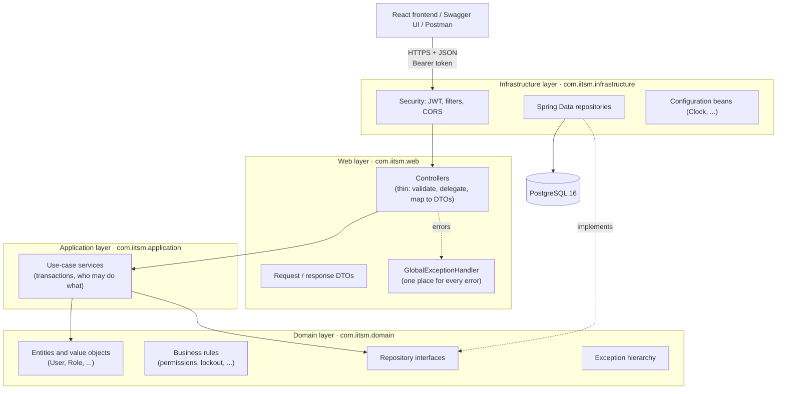

**Rules every class follows**

| Rule | Why |
|---|---|
| Controllers contain no business logic | Logic in one place (services and domain), easy to test and reuse |
| The domain imports no web or Spring MVC classes (only thin JPA mapping annotations) | Business rules stay plain Java: testable without Spring, presentable as pure OOP |
| Entities are never returned from controllers; services return snapshot "view" records built inside the transaction | No accidental data leaks (for example the password hash), no lazy-loading errors (`open-in-view` is off) |
| Repository interfaces live in the domain, implementations in infrastructure | The domain does not know about SQL or JPA (Repository pattern) |
| Every error is an `ItsmException` subclass rendered by one handler | Every failure has the same JSON shape for the frontend |
| Time always comes from an injected `Clock` | Time-based rules (lockout, SLA, escalation) can be tested by moving a fake clock |

---

## 3. Package map

```
com.iitsm
├── IitsmBackendApplication          entry point (forces the JVM time zone to UTC)
├── web
│   ├── controller                   AuthController, CatalogController, AdminCatalogController,
│   │                                AdminSlaController, AdminConfigController
│   ├── dto                          ErrorResponse and request/response records (dto/auth, dto/catalog)
│   ├── filter                       RequestIdFilter
│   └── handler                      GlobalExceptionHandler
├── application
│   ├── auth                         AuthService, AuthenticatedUser, UserView, AccessTokenIssuer (port)
│   ├── catalog                      CatalogService, SlaAdminService, CatalogViews
│   └── config                       ConfigService (live app_config cache)
├── domain
│   ├── category                     Category (tree, required skills)
│   ├── config                       ConfigKey, AppSettings, AppConfigEntry
│   ├── exception                    ItsmException + 18 business exceptions
│   ├── priority                     Priority (P1 to P4)
│   ├── repository                   one repository interface per aggregate
│   ├── service                      ItService (IT services and their dependency graph)
│   ├── sla                          SlaPolicy, EscalationPolicy, CalendarType, SlaPolicyResolver
│   └── user                         User, Role hierarchy, profiles, SkillSet, RefreshToken, UserFactory, enums
└── infrastructure
    ├── config                       ClockConfig, CorsConfig, OpenApiConfig, DomainConfig
    ├── persistence                  Spring Data implementations of the domain repositories
    └── security                     SecurityConfig, JwtService, JwtAuthenticationFilter, ApiErrorWriter, ApiErrorCorsProcessor
```

---

## 4. The life of a request

Every HTTP request passes through the same pipeline. The diagram follows a call to `GET /api/v1/auth/me`.

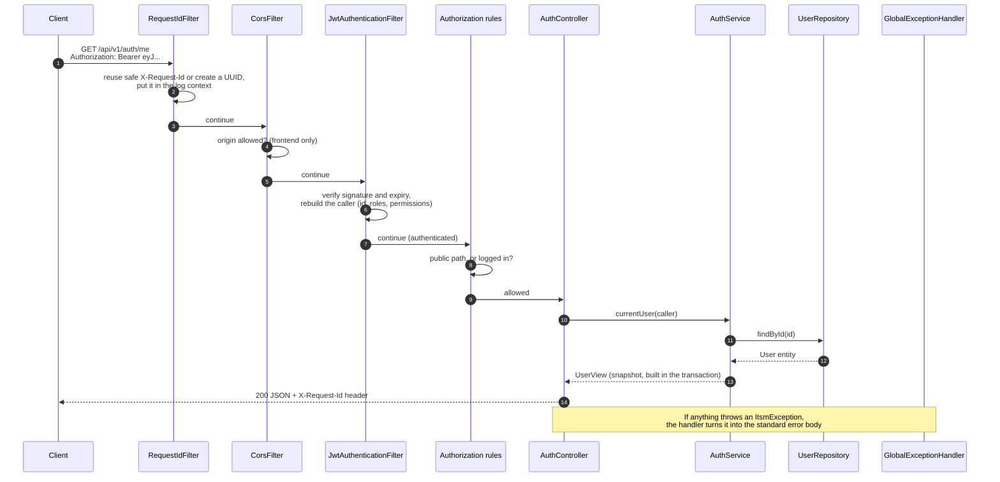

---

## 5. M1 Foundations

**What it does.** Gives the whole API one consistent way to fail, trace and protect itself: every error looks the same, every request carries an ID that also appears in the logs, only the frontend may call the API from a browser, and standard security headers are always sent.

### 5.1 The standard error body

Every failure, whether thrown by our code, by Spring (404, 405, bad JSON) or by the security filters (401, 403), returns this shape (API contract B.1):

```json
{
  "timestamp": "2026-11-06T09:21:00Z",
  "status": 400,
  "code": "VALIDATION_FAILED",
  "message": "Please correct the highlighted fields.",
  "path": "/api/v1/auth/register",
  "fieldErrors": [
    { "field": "email", "message": "must be a well-formed email address" },
    { "field": "password", "message": "must contain at least one letter and one digit" }
  ]
}
```

`fieldErrors` is always present (empty unless it is a validation failure). Stack traces are never returned; an unexpected error returns `INTERNAL_ERROR` with the request ID to quote.

### 5.2 Exception hierarchy

All 18 business errors extend one abstract base class that carries the machine-readable code and the HTTP status. This is inheritance used for a real *is-a* relationship: an `AccountLockedException` **is an** `ItsmException`.

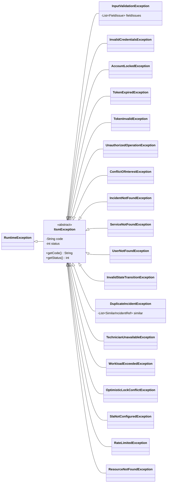

| Code | HTTP | Thrown when |
|---|---|---|
| `VALIDATION_FAILED` | 400 | Invalid input (with `fieldErrors`) |
| `INVALID_CREDENTIALS` | 401 | Wrong email or password (never says which) |
| `TOKEN_EXPIRED` / `TOKEN_INVALID` | 401 | Access token expired / missing, forged or revoked |
| `UNAUTHORIZED_OPERATION` | 403 | Role or permission does not allow the action |
| `CONFLICT_OF_INTEREST` | 403 | Trying to handle an incident you reported |
| `INCIDENT_NOT_FOUND` / `SERVICE_NOT_FOUND` / `USER_NOT_FOUND` | 404 | Missing resource |
| `ACCOUNT_LOCKED` | 423 | Too many failed logins |
| `INVALID_STATE_TRANSITION` | 409 | Action not allowed in the incident's current status |
| `DUPLICATE_INCIDENT` | 409 | Likely duplicate (response lists the similar incidents) |
| `TECHNICIAN_UNAVAILABLE` / `WORKLOAD_EXCEEDED` | 409 | Chosen technician cannot take the incident |
| `OPTIMISTIC_LOCK_CONFLICT` | 409 | Someone else changed the incident meanwhile |
| `SLA_NOT_CONFIGURED` | 422 | No SLA policy for that service and priority |
| `RATE_LIMITED` | 429 | Too many requests |
| `INTERNAL_ERROR` | 500 | Anything unexpected (no details exposed) |
| `NOT_FOUND`, `METHOD_NOT_ALLOWED`, `NOT_ACCEPTABLE`, `UNSUPPORTED_MEDIA_TYPE`, `REQUEST_REJECTED` | 404, 405, 406, 415, 4xx | Framework-level failures with no contract code (decision D-005) |

### 5.3 How an error becomes JSON

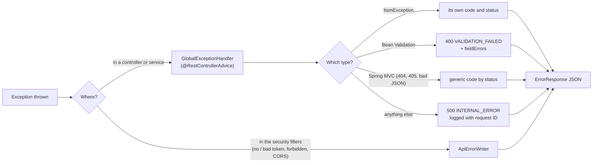

### 5.4 Request IDs, CORS and security headers

| Feature | Class | Behavior |
|---|---|---|
| Request ID | `RequestIdFilter` | Runs first. Reuses a safe incoming `X-Request-Id` (8 to 64 letters, digits, `.`, `_`, `-`) or generates a UUID. Echoed in the response header and printed on every log line. Unsafe values (for example `<script>`) are replaced, so nobody can inject text into the logs. |
| CORS | `CorsConfig`, `ApiErrorCorsProcessor` | Only the frontend origin (`CORS_ORIGIN`, default `http://localhost:5173`) may call the API from a browser. A rejected cross-origin request gets **403 `REQUEST_REJECTED` in the standard body** (Spring's default would be plain text). |
| Security headers | `SecurityConfig` | `X-Frame-Options: DENY` (no click-jacking), `Referrer-Policy: no-referrer`, plus Spring Security's defaults. |
| OpenAPI | `OpenApiConfig` | Swagger UI at `/swagger-ui.html` with an **Authorize** button for the Bearer token. |

---

## 6. M2 Users, roles and authentication

**What it does.** Lets people register and log in, keeps them logged in safely with short-lived access tokens and rotating refresh tokens, locks accounts under password guessing, and gives every request a clear answer to "who is this and what may they do?".

### 6.1 The user model: one person, several roles

A `User` **has** one or more `Role`s (composition). `Role` is abstract; each concrete role knows its own permissions (polymorphism). One person can therefore be an employee and a technician at once, and simply gets the union of both permission sets. A **Team Lead is not a separate class**: it is a technician whose escalation level is 1, and that single fact widens the permissions.

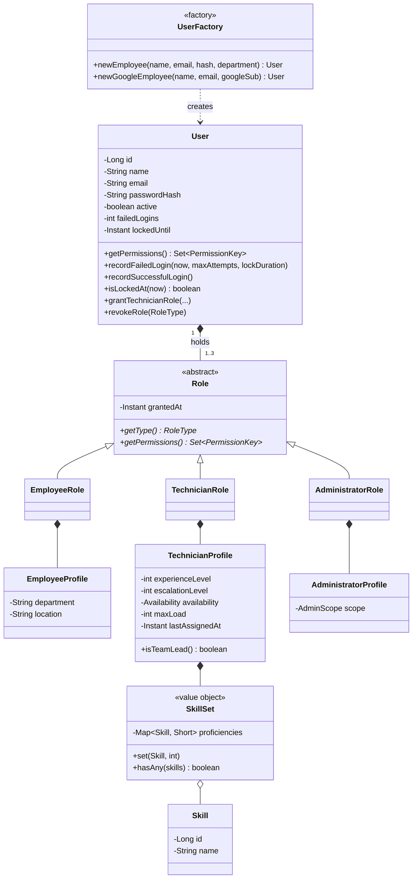

### 6.2 Who may do what (permissions)

Security checks use **permission keys, never role names**, so multi-role users work naturally and a role can change its permissions in one place.

| Permission | Employee | Technician | Team Lead (technician, level 1) | Administrator |
|---|:---:|:---:|:---:|:---:|
| `INCIDENT_CREATE`, `INCIDENT_VIEW_OWN` | ✅ | | | |
| `INCIDENT_VIEW_ASSIGNED`, `INCIDENT_HANDLE`, `WORKLOAD_VIEW` | | ✅ | ✅ | |
| `INCIDENT_VIEW_TEAM`, `TEAM_VIEW`, `INCIDENT_ASSIGN`, `INCIDENT_OVERRIDE_PRIORITY`, `SLA_VIOLATION_VIEW` | | | ✅ | |
| `INCIDENT_VIEW_ALL`, `USER_MANAGE`, `CATALOG_MANAGE`, `SLA_MANAGE`, `CONFIG_MANAGE`, `REPORT_VIEW`, `AUDIT_VIEW` | | | | ✅ |
| `INCIDENT_ASSIGN`, `INCIDENT_OVERRIDE_PRIORITY`, `TEAM_VIEW`, `SLA_VIOLATION_VIEW` | | | | ✅ |

Every user also holds EMPLOYEE (it cannot be removed), so everyone can report and follow their own incidents. Example: a user with EMPLOYEE + TECHNICIAN (team lead) gets the employee, technician and team-lead rows combined.

### 6.3 Endpoints

| Method and path | Who | What it returns |
|---|---|---|
| `POST /api/v1/auth/register` | Public | **201** `AuthResponse`. The new user gets EMPLOYEE only. Email stored lower-case. |
| `POST /api/v1/auth/login` | Public | `AuthResponse`, or 401 / 423 |
| `POST /api/v1/auth/refresh` | Public | New `AuthResponse`; the old refresh token stops working |
| `POST /api/v1/auth/logout` | Logged in | **204**; the refresh token is revoked |
| `GET /api/v1/auth/me` | Logged in | `CurrentUser` |

`AuthResponse` = `{ accessToken, refreshToken, expiresInSeconds: 900, user: { id, name, email, roles, permissions, technician | null, administrator | null } }`.

### 6.4 Logging in

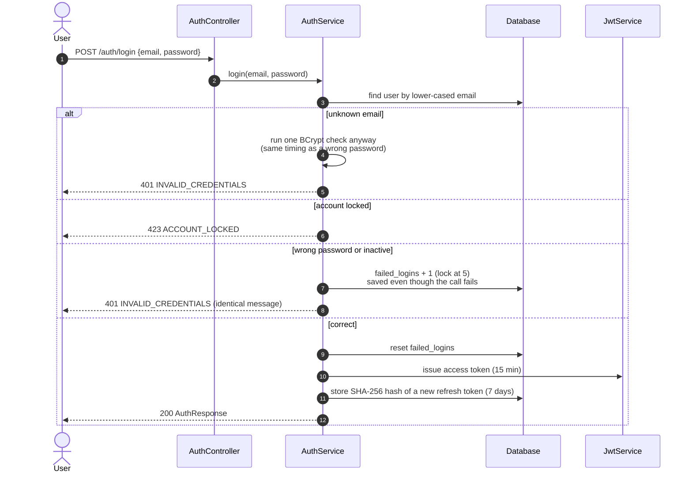

### 6.5 Account lockout

The lockout logic lives **inside the `User` entity** (`recordFailedLogin`, `isLockedAt`), not in a service, so it is a plain-Java business rule that is easy to test with a fake clock.

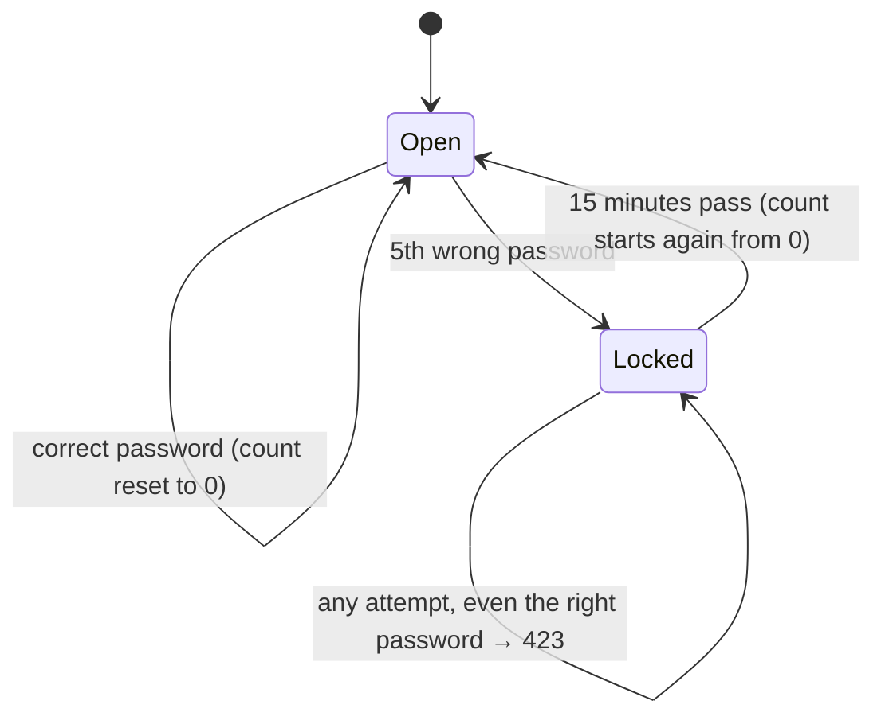

### 6.6 Tokens

| | Access token | Refresh token |
|---|---|---|
| Format | JWT, signed HS256 | 32 random bytes (URL-safe Base64) |
| Lifetime | 15 minutes | 7 days |
| Stored on the server | No (stateless) | Only its **SHA-256 hash** |
| Contains | user id, email, roles, permissions | nothing readable |
| Sent as | `Authorization: Bearer ...` | Request body of `/refresh` and `/logout` |

**Refresh rotation and theft detection.** Each refresh token works exactly once. Using an old one again means it was probably stolen, so every session of that user is revoked.

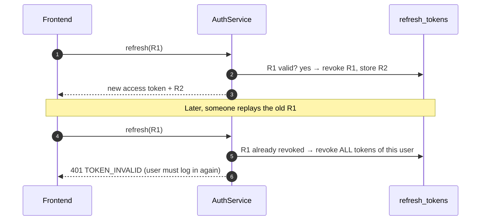

**How a token is checked on each request.** `JwtAuthenticationFilter` verifies the token and turns its permissions into Spring authorities. A bad or expired token does **not** end the request in the filter: public endpoints such as `/refresh` must keep working even if the browser still sends a stale header. The filter remembers the failure, and only endpoints that need a login answer `401 TOKEN_EXPIRED` or `401 TOKEN_INVALID`.

### 6.7 Security rules enforced

| Rule | Where |
|---|---|
| Passwords: 8 to 72 characters, at least one letter and one digit | `RegisterRequest` (Bean Validation) |
| Stored as BCrypt (cost 10) | `SecurityConfig.passwordEncoder` |
| Same message for unknown email and wrong password, same timing | `AuthService.login` |
| 5 failed logins lock the account for 15 minutes | `User.recordFailedLogin` |
| Access token 15 minutes, refresh token 7 days, rotated, revoked on logout | `JwtService`, `AuthService` |
| JWT secret must be at least 32 bytes, or the app refuses to start | `JwtService` constructor |
| Refresh tokens and passwords never stored in plain text | `RefreshToken`, `User` |
| Method security on permission keys (`@PreAuthorize("hasAuthority('...')")`) | `@EnableMethodSecurity` in `SecurityConfig` |

### 6.8 Verified behavior (2026-11-06)

Smoke run against the running app and a real PostgreSQL: **27 of 27 checks passed**, plus manual checks.

| Area | Checked |
|---|---|
| Register | 201, EMPLOYEE only, email lower-cased, `technician`/`administrator` present as `null`, duplicate email → 400 on `email`, invalid input → 400 with one fieldError per bad field |
| Tokens | `/me` with valid / missing / tampered / expired token → 200 / 401 `TOKEN_INVALID` / 401 `TOKEN_INVALID` / 401 `TOKEN_EXPIRED` |
| Refresh | Rotation issues a new refresh token; replaying the old one → 401 and the newest one is revoked too; refresh after logout → 401 |
| Lockout | 5 wrong passwords → 401 five times; unknown email gives the identical message; 6th attempt with the right password → 423; `locked_until` ≈ 15 minutes ahead |
| Multi-role | EMPLOYEE + team-lead TECHNICIAN → roles and permission union correct, `technician: { escalationLevel: 1, availability: AVAILABLE }` |
| Storage | Passwords are BCrypt (`$2a$10$...`), refresh tokens are 64-character hex hashes |
| CORS | Frontend origin allowed; other origins → 403 `REQUEST_REJECTED` JSON |
| Authorization | An employee calling admin endpoints (`/admin/services`, `/admin/config`, `/admin/sla-policies`) → 403 `UNAUTHORIZED_OPERATION` (checked with M3) |

---

## 7. M3 Catalog and configuration

**What it does.** Holds everything the incident engine looks things up in: the IT services the company runs (and which depend on which), the categories of problems and the skills needed for each, the SLA promises per priority, the escalation timeouts, and every tunable number (thresholds, weights, active strategies). Administrators manage all of it from the admin screens; changes apply **immediately, with no restart**.

### 7.1 The catalog model

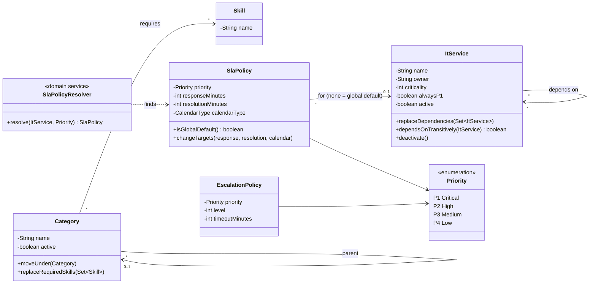

### 7.2 Services and the dependency graph

Each service has a **business criticality** (1 to 5) that feeds the priority score, and an **always P1** flag for services whose outage must always be critical (Payment). Services can depend on each other; the graph is used later for impact analysis ("if Database fails, what else breaks?") and correlation.

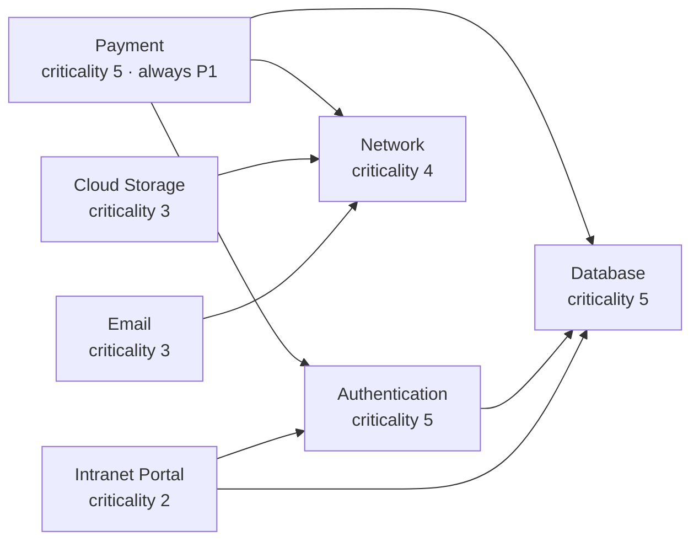

*Example graph from the planned seed data. An arrow means "depends on".*

**Graph rules** (enforced in `ItService.replaceDependencies`, the database adds a `CHECK (service_id <> depends_on_id)`):

- a service cannot depend on itself;
- no cycles: before adding "A depends on B", the code walks B's dependencies depth-first (`dependsOnTransitively`, using a stack and a visited set) and rejects the change if it reaches A. Example: with Payment → Authentication → Database, making Database depend on Payment is refused.

Services and categories are **never deleted**, only switched off (`DELETE` sets `active = false`), because incidents keep pointing at them. Switched-off items disappear from the lists users pick from.

### 7.3 Categories and skills

Categories form a tree (Network has VPN and Wi-Fi). Each lists the **skills needed to resolve it**; assignment (M6) only considers technicians who hold at least one of them. `GET /categories` returns the active tree for the report form; `moveUnder` refuses to place a category under itself or one of its own children. A skill can only be deleted when no category or technician uses it.

### 7.4 SLA policies and how the right one is found

A policy states the response and resolution minutes for one priority. A policy **without a service** is the global default; a **service-specific** policy overrides it (Payment promises 3 / 20 minutes for P1 instead of the default 5 / 30).

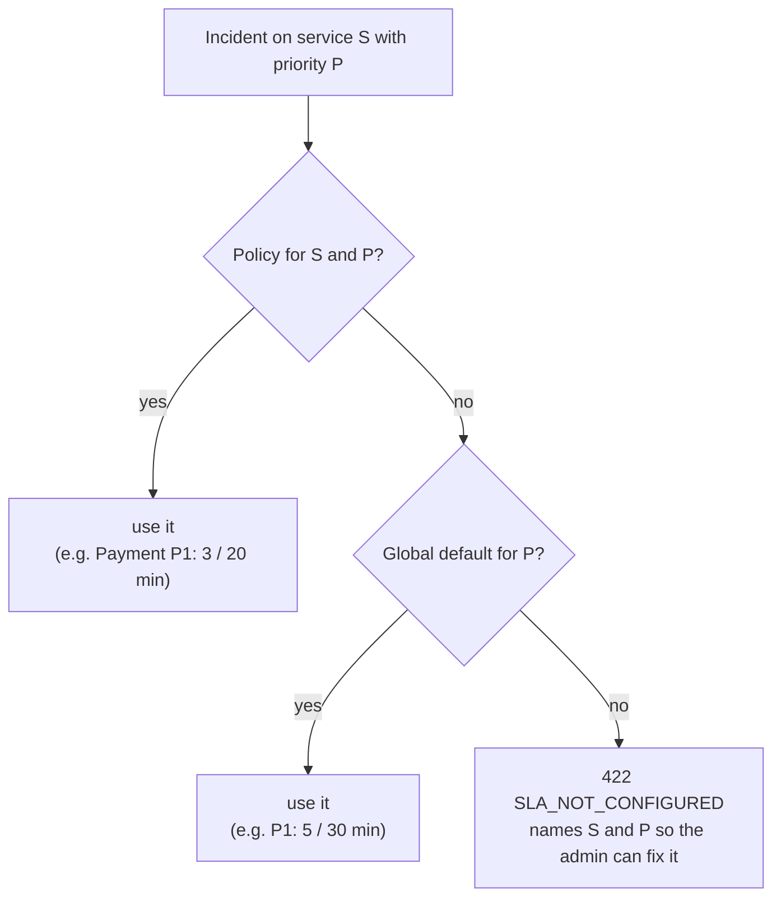

| Default policy | Response | Resolution |
|---|---|---|
| P1 Critical | 5 min | 30 min |
| P2 High | 15 min | 2 h |
| P3 Medium | 1 h | 8 h |
| P4 Low | 4 h | 24 h |

Rules: resolution must be longer than response (also a database `CHECK`), limits 1 to 10 080 and 1 to 43 200 minutes, one policy per service and priority. The "one global default per priority" rule is checked in code, because PostgreSQL treats two `NULL` service ids as different and its unique constraint alone would allow duplicates. `SlaPolicyResolver` is used by incident creation in M4.

### 7.5 Escalation policies

For P1 and P2 only: how long an incident may stay unacknowledged before it moves up a level (1 Team Lead, 2 System Admin, 3 IT Manager). Levels are added in order and removed from the top, so there is never a gap (level 3 without level 2). Used by the escalation chain in M11.

### 7.6 Live configuration (`app_config`)

Every tunable number lives in the `app_config` table, never in Java constants: priority bands and multipliers, assignment strategy and weights, SLA warning percentages, duplicate thresholds, AI engine, lockout rules (27 keys, handbook Appendix A.5).

| Class | Role |
|---|---|
| `ConfigKey` (enum) | Every key with its default, meaning and allowed range or values. A missing row means "use the default", so the system works before seed data exists. |
| `AppSettings` | An **immutable, fully validated snapshot** of all values with typed getters. Also checks rules across keys. |
| `ConfigService` | Keeps the current snapshot in memory; readers get it instantly. Updates are validated as a whole and swapped in only **after the database commit**. |

**Cross-key rules:** the four assignment weights add up to 1.0 · priority bands descend (P1 > P2 > P3) · the mid affected-users threshold is below the high one, and its multiplier is not larger · the first SLA warning comes before the second · the duplicate threshold is above the "related" threshold. A bad value comes back as a `fieldError` keyed by the config key, for example `{ "field": "assignment.weight.skill", "message": "the four assignment weights must add up to 1.0 (now 1.5)" }`.

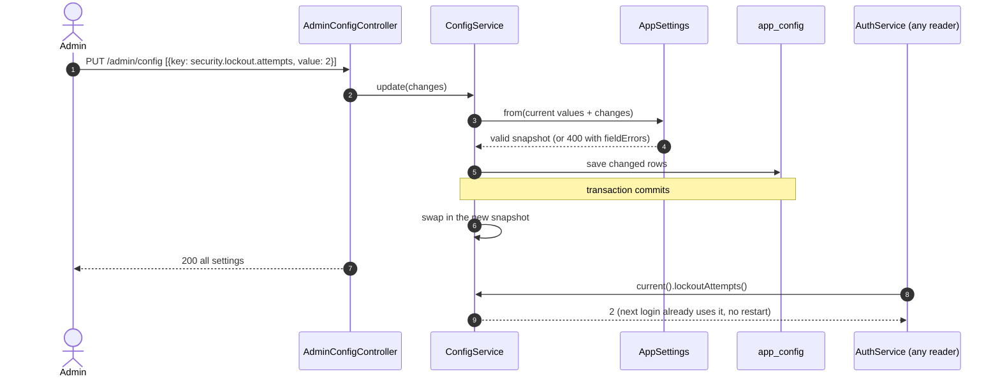

### 7.7 Endpoints

| Method and path | Permission | What it does |
|---|---|---|
| `GET /api/v1/services` | logged in | Active services: `id`, `name`, `criticality` |
| `GET /api/v1/categories` | logged in | Active categories as a tree |
| `GET, POST /api/v1/admin/services` · `GET, PUT, DELETE /admin/services/{id}` | `CATALOG_MANAGE` | Manage services (`DELETE` switches off) |
| `PUT /api/v1/admin/services/{id}/dependencies` | `CATALOG_MANAGE` | Replace the dependency list |
| `GET, POST /api/v1/admin/categories` · `PUT, DELETE /admin/categories/{id}` | `CATALOG_MANAGE` | Manage categories (`DELETE` switches off) |
| `GET, POST /api/v1/admin/skills` · `PUT, DELETE /admin/skills/{id}` | `CATALOG_MANAGE` | Manage skills (`DELETE` only when unused) |
| `GET, POST /api/v1/admin/sla-policies` · `PUT, DELETE /admin/sla-policies/{id}` | `SLA_MANAGE` | Manage SLA policies |
| `GET, POST /api/v1/admin/escalation-policies` · `PUT, DELETE /admin/escalation-policies/{id}` | `SLA_MANAGE` | Manage escalation levels |
| `GET, PUT /api/v1/admin/config` | `CONFIG_MANAGE` | Read and change settings |

Anyone without the permission gets **403 `UNAUTHORIZED_OPERATION`**; the check is a single `@PreAuthorize("hasAuthority('...')")` on each admin controller.

### 7.8 Verified behavior (2026-11-06)

Smoke run against the running app and PostgreSQL: **42 of 42 checks passed**. Highlights:

| Area | Checked |
|---|---|
| Authorization | Employee on admin services, config and SLA endpoints → 403; catalog without a token → 401 |
| Services | Create with dependencies; cycle (Database → Payment → Auth → Database) refused; self-dependency refused; criticality 6, duplicate name, unknown dependency id → 400 on the right field; unknown id → 404 `SERVICE_NOT_FOUND`; switched-off service hidden from `GET /services` but visible to admins |
| Categories and skills | Tree Network → VPN; moving a category under its own child refused; deleting a skill still required by a category refused; unused skill deleted |
| SLA policies | Second global default for P1 refused; Payment-specific P1 3 / 20 created; duplicate service + priority refused; resolution ≤ response refused; changing priority on update refused; targets updated |
| Escalation | Level 2 before level 1 refused; levels 1 to 3 created; deleting level 1 while level 2 exists refused; P3 refused |
| Configuration | 27 settings listed with defaults; weights not summing to 1.0, unknown key and first warning after second → 400 keyed by config key; **done-when: setting `security.lockout.attempts` to 2 made the next account lock after two failures, with no restart** |
| Schema | All M3 tables match Appendix A.2, including `CHAR(2)` priorities and every `CHECK` and unique constraint |

---

## 8. Data model built so far

Tables follow the locked schema in Appendix A of the handbook (snake_case, plural names, `TIMESTAMPTZ` in UTC). Until the Flyway migrations arrive they are generated from the entities (temporary profile `schema-auto`, decision D-006) and were checked column by column against Appendix A.

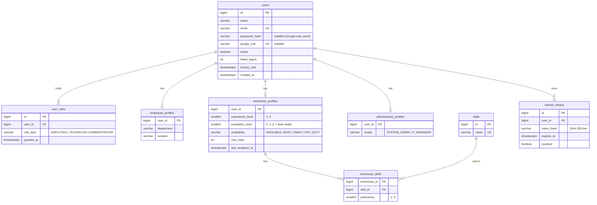

**Catalog and configuration (M3)**

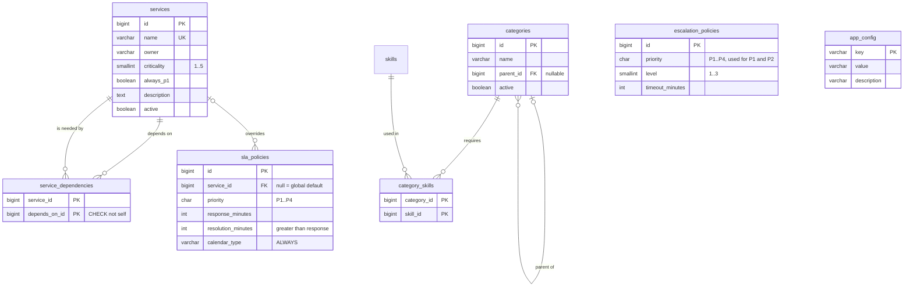

The database also enforces the rules with constraints: unique `(user_id, role_type)`, unique email and `google_sub`, unique service name, unique `(service_id, priority)` and `(priority, level)`, and `CHECK` constraints on every range and enum column.

---

## 9. OOP and design patterns: where to find them

### 8.1 OOP concepts (course brief requirements)

| Concept | Where it is visible in the code |
|---|---|
| **Encapsulation** | `User` has no public setters; state changes only through behavior methods (`recordFailedLogin`, `grantTechnicianRole`). The password hash never leaves the class except for the password check. `SkillSet` never hands out its internal map. `AppSettings` is immutable: a config change creates a new snapshot. |
| **Abstraction** | Abstract `Role` (each role defines `getPermissions()`); abstract `ItsmException`; repository interfaces hide SQL; `SlaPolicyResolver` hides how the right SLA is found. |
| **Inheritance (real is-a)** | `TechnicianRole` **is a** `Role`; `AccountLockedException` **is an** `ItsmException`. |
| **Polymorphism** | `user.getPermissions()` calls `getPermissions()` on each role without knowing its type. |
| **Interfaces** | One repository interface per aggregate (`UserRepository`, `ItServiceRepository`, `SlaPolicyRepository`, ...), `AccessTokenIssuer`. |
| **Composition** | `User` has `Role`s; `TechnicianRole` has a `TechnicianProfile`, which has a `SkillSet`; `ConfigService` has an `AppSettings` snapshot. |
| **Enums with behavior** | `ConfigKey` knows each setting's default and validates its own values; `Availability.acceptsNewWork()`; `AdminScope` knows its escalation level. |
| **Association / aggregation** | `SkillSet` refers to shared `Skill` objects; `RefreshToken` belongs to a `User`. |
| **Exception handling** | 17 custom exceptions, one global handler, one error shape. |
| **Collections** | `EnumSet` for permissions and roles (fast set union), `Map<Skill, Short>` for skill proficiency, `EnumMap` for settings, `ArrayDeque` (stack) plus `HashSet` (visited) for the depth-first cycle check in the service graph. |

### 8.2 The seven design patterns

| Pattern | Status | Where |
|---|---|---|
| **Factory** | ✅ in use | `UserFactory`: the only way to create a valid new user (always starts with EMPLOYEE). `IncidentFactory`, `NotificationFactory` follow in M4 / M9. |
| **Repository** | ✅ in use | Ten domain interfaces (`UserRepository`, `ItServiceRepository`, `SlaPolicyRepository`, ...) implemented by Spring Data in `infrastructure/persistence`. |
| **Adapter** | 🟡 started | `AccessTokenIssuer` port with the JWT adapter `JwtService`. Notification channels and the LLM client follow in M9 / M12. |
| **State** | ⬜ M4 | Incident lifecycle: one class per status. |
| **Strategy** | ⬜ M5 / M6 | Priority calculation and technician assignment. The active strategy is already a live setting (`assignment.strategy`, `priority.strategy` in `app_config`), so switching it will need no restart. |
| **Observer** | ⬜ M8 | Domain events with audit, notification, SLA and dashboard listeners. |
| **Chain of Responsibility** | ⬜ M11 | Escalation: Technician → Team Lead → System Admin → IT Manager. |

---

## 10. Configuration and running the backend

| Setting | Environment variable | Default |
|---|---|---|
| Database URL | `DB_URL` | `jdbc:postgresql://localhost:5432/iitsm` (this machine: port **5433**) |
| Database user / password | `DB_USER` / `DB_PASSWORD` | `iitsm` / `iitsm` |
| JWT secret (32+ bytes) | `JWT_SECRET` | none in production; a throwaway value in `dev` and `demo` |
| Frontend origin for CORS | `CORS_ORIGIN` | `http://localhost:5173` |
| Active profiles | `SPRING_PROFILES_ACTIVE` | `dev` |
| HTTP port | `SERVER_PORT` | `8080` |

| Profile | Purpose |
|---|---|
| `dev` | Development: seed data (once available), debug logging |
| `demo` | Recorded demo: short timers (SLA monitor 30 s, escalation 1 min, auto-verify 2 min) |
| `test` | Automated tests with Testcontainers PostgreSQL |
| `schema-auto` | **Temporary**: Hibernate creates the tables until the Flyway migrations arrive (use as `dev,schema-auto`) |

**Run locally:** start PostgreSQL (`docker start iitsm-db`, host port 5433), then run `IitsmBackendApplication` from IntelliJ with `SPRING_PROFILES_ACTIVE=dev,schema-auto`. Swagger UI: `http://localhost:8080/swagger-ui.html`. On this machine, MiniTool ShadowMaker's agent takes port 8080 at boot: `net stop MTAgentService` (Administrator) frees it, or use `SERVER_PORT=8081`.

---

## 11. Key decisions

Full details in `docs/ROADMAP.md`, section 6.

| ID | Decision | In one line |
|---|---|---|
| D-001 | Google sign-in as an extra (module M2b) | Same JWT tokens; `password_hash` nullable, new `google_sub` |
| D-003 | Package `com.iitsm`, four layers | Web / Application / Domain / Infrastructure |
| D-004 | Spring Boot 4.1.1 instead of 3.x | Boot 3.5 is out of free support with unpatched CVEs |
| D-005 | One error handler, request ID in a header, generic codes for framework errors | Every failure has the same shape |
| D-006 | Temporary `schema-auto` profile | Backend work does not wait for the late migrations |
| D-007 | Role mapping: single-table hierarchy + one profile table per role | Real OOP while keeping the agreed schema |
| D-008 | Auth design | Permission-based authorities, stateless access tokens, rotating hashed refresh tokens with theft detection |
| D-009 | Catalog and configuration design | Soft delete for services and categories, cycle-free service graph, global SLA uniqueness checked in code, settings as a validated immutable snapshot swapped after commit |

---

## 12. Changelog

| Date | Change |
|---|---|
| 2026-10-15 | Project created and aligned with the handbook; moved to Spring Boot 4.1.1 (D-004) |
| 2026-10-16 | M1 Foundations written: exception hierarchy, global handler, request ID filter, CORS, security baseline, OpenAPI |
| 2026-11-06 | M1 verified over HTTP. M2 domain model (users, roles, profiles, skills) and auth layer (register, login, refresh, logout, me, JWT, lockout) built and smoke-tested (27/27). CORS rejections now use the standard error body. This guide started. |
| 2026-11-06 | M3 Catalog and configuration built and smoke-tested (42/42): services with dependency graph, category tree, skills, SLA and escalation policies, SLA resolver, live `app_config` with validation. Lockout limits moved from properties to `app_config`. |
